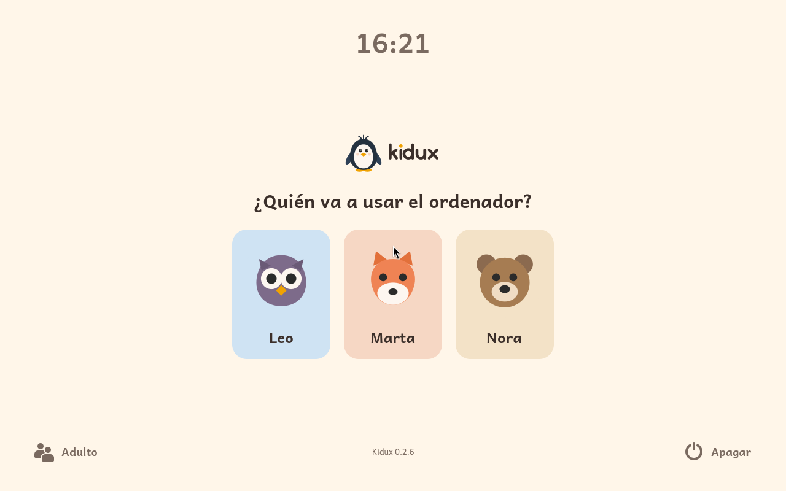
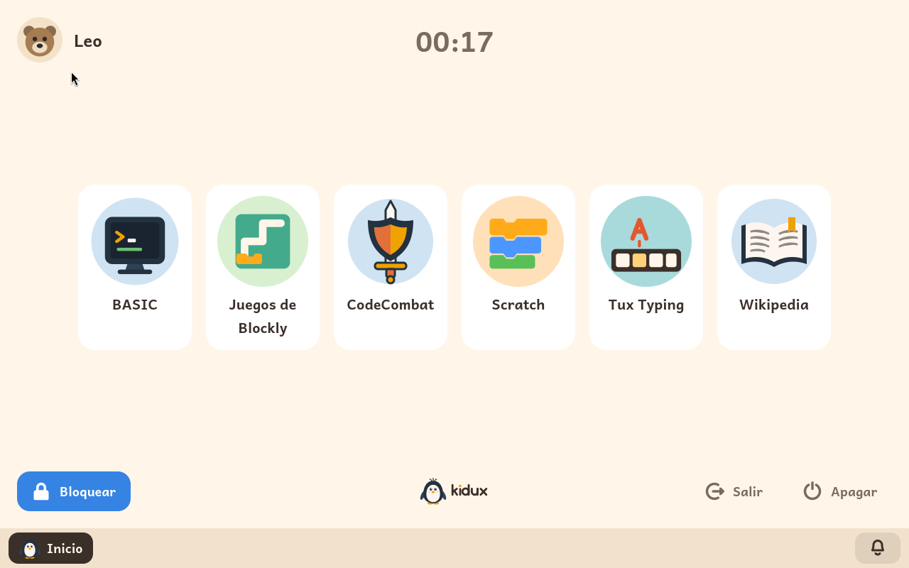
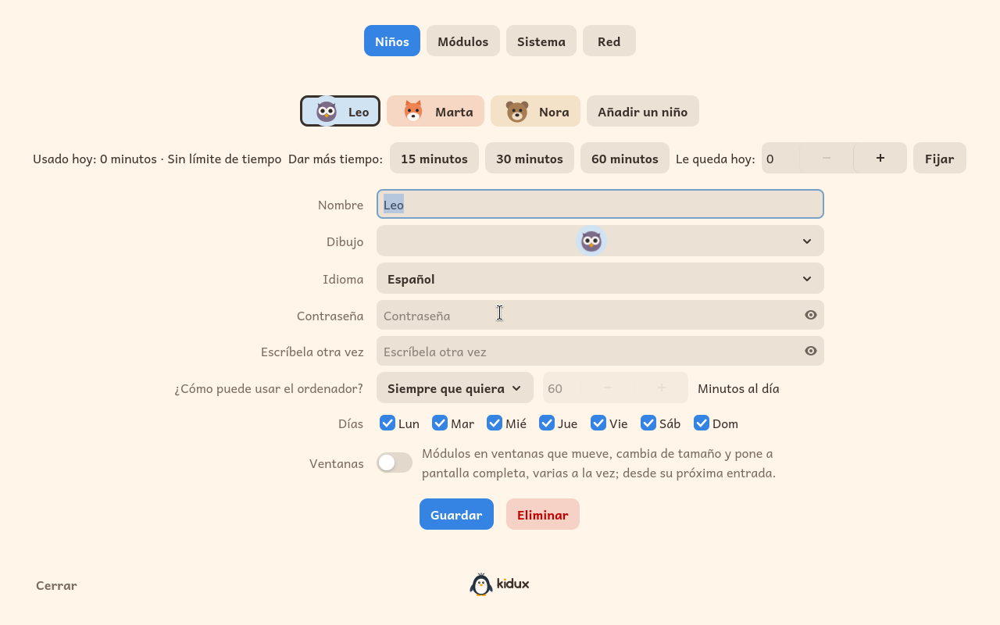

  <a href="https://kidux.org/es/"><b>kidux.org</b></a> ·
  <a href="README.md">English version</a>

**Kidux es una distribución de Linux diseñada específicamente para ser el primer ordenador de un niño o una niña.** Se instala de forma sencilla en cualquier ordenador de 64 bits (sea nuevo o antiguo) para transformarlo en un entorno seguro, educativo y libre de distracciones.

Con Kidux, cada menor dispone de un espacio digital que siente verdaderamente suyo: su nombre y su avatar en la pantalla de bienvenida, su propia contraseña personal y su idioma preferido. Al mismo tiempo, los adultos mantienen el control total: solo estarán disponibles los módulos de aprendizaje previamente autorizados, y únicamente durante el horario o tiempo diario que la familia decida.

Kidux es software libre y gratuito para todos, en casa o en el colegio, y su código fuente está en GitHub para que cualquiera pueda estudiarlo, modificarlo y compartirlo. Está construido sobre una base sólida y probada de Debian, disponible en español y en inglés desde el primer día.

## Lo que ve un niño

Al encender el ordenador, aparece una pantalla de inicio amigable que muestra el avatar de cada menor. El niño solo tiene que seleccionar su imagen e introducir su contraseña para acceder. No hay escritorios desordenados, ni accesos a la configuración del sistema, ni formas de eludir la protección. La pantalla es un entorno limpio y personal donde todo el contenido ha sido previamente aprobado por un adulto.

Una vez dentro, la pantalla del niño muestra los módulos de aprendizaje que un adulto le ha activado, representados mediante fichas visuales. Cada módulo puede funcionar de dos formas diferentes, según lo que el adulto elija para cada hijo:

- **A pantalla completa.** Es el modo inicial recomendado para todos los niños. Cada actividad ocupa todo el espacio de la pantalla por encima de una barra inferior permanente. Desde esta barra, el menor puede volver a su pantalla principal, alternar entre otros módulos que tenga abiertos o cerrar la actividad actual. Se pueden tener varios módulos abiertos a la vez, como en cualquier ordenador, y el niño pasa de uno a otro desde la barra o mediante atajos de teclado sencillos.
- **Modo ventanas.** Pensado para niños más mayores, un adulto puede activar el soporte de ventanas tradicionales. Los módulos se abren entonces con marcos, barras de título y los botones habituales de minimizar, maximizar y cerrar. Es posible organizar varias ventanas a la vez en la pantalla, redimensionarlas y desplazarlas libremente, mientras la barra inferior muestra la lista de programas abiertos.

Cuando se agota el tiempo asignado para el día, la pantalla se bloquea automáticamente de forma segura. El trabajo en curso nunca se pierde: las aplicaciones quedan congeladas en segundo plano a la espera de que un adulto decida conceder tiempo extra, desbloquear brevemente para guardar los cambios o cerrar la sesión.

Además, el propio menor puede bloquear el equipo cuando se levanta; la sesión se bloquea por sí sola tras unos minutos de inactividad, y en los portátiles basta con bajar la tapa. En cualquier circunstancia, el niño siempre tiene la libertad de apagar o reiniciar el ordenador de manera limpia.

Compartir el ordenador entre hermanos es muy cómodo: basta con que uno cierre su sesión para que el siguiente pueda entrar con su contraseña, encontrando de inmediato sus propios archivos, límites de tiempo, módulos autorizados e idioma preferido.

## Lo que decide un adulto

Toda la gestión del sistema se realiza desde un único lugar: el panel de adulto. Se accede introduciendo la contraseña maestra desde la pantalla de bienvenida o desde la pantalla de bloqueo, y desde ningún otro sitio del sistema.

Desde el panel, un adulto puede:

- Añadir perfiles de niños y personalizar el avatar, idioma, distribución de teclado y contraseña de cada uno.
- Definir la política de acceso al ordenador entre tres modalidades:
  - **Uso libre**: el niño puede usar el equipo en cualquier momento.
  - **Tiempo diario fijo**: se asigna un límite de minutos por día. El contador corre únicamente mientras la sesión está desbloqueada y se reinicia cada madrugada.
  - **Solo con permiso previo**: el niño necesita que un adulto le autorice tiempo cada vez que quiera utilizar el ordenador.
- Seleccionar qué días de la semana está permitido el uso del equipo (por ejemplo, restringirlo únicamente a los fines de semana).
- Conceder tiempo extra al instante en cualquier momento, o fijar el tiempo restante del día en un número exacto de minutos (incluyendo cero para pausar la sesión).
- Activar o desactivar el modo ventanas de forma individual para cada hijo.
- Configurar tras cuántos minutos de inactividad se bloquea la sesión y tras cuántos se apaga la pantalla para ahorrar energía.
- Instalar y desinstalar módulos de aprendizaje, y habilitar o deshabilitar cada uno según la edad y madurez de cada niño.

La contraseña de adulto nunca se introduce dentro de la sesión del menor, por lo que ningún programa o código que el niño ejecute puede capturarla ni falsear la pantalla de control.

## Módulos de aprendizaje

Todas las actividades de Kidux están organizadas en módulos de aprendizaje independientes. Los adultos instalan los módulos y eligen cuáles están disponibles para cada menor. El panel indica para qué franja de edad está orientada cada herramienta y qué actividades previas se recomienda haber completado antes.

Estos son los módulos incluidos y disponibles en Kidux:

- [GCompris](docs/es/modules/gcompris.md): una completa suite educativa con más de 100 actividades para niños de 2 a 10 años que abarcan lectura, numeración, ciencias, geografía, colores y destreza motriz con teclado y ratón. Funciona sin conexión; solo sus voces se descargan la primera vez.
- [Tux Typing](docs/es/modules/tuxtype.md): un clásico juego formativo de mecanografía para niños de 6 a 12 años. Ayuda al pingüino Tux a atrapar peces y salvar cometas tecleando letras y palabras con velocidad y precisión crecientes.
- [ScratchJr](docs/es/modules/scratchjr.md): la versión adaptada de Scratch para los más pequeños (de 5 a 7 años). Permite crear historias y animaciones interactivas ensamblando bloques visuales con dibujos, sin necesidad de saber leer todavía.
- [Juegos de Blockly](docs/es/modules/blockly-games.md): una serie de desafíos interactivos y rompecabezas progresivos creados por Google que introducen los conceptos clave de la programación informática paso a paso. Funciona de forma 100 % local sin requerir internet.
- [Scratch](docs/es/modules/scratch.md): el conocido entorno de programación visual por bloques del MIT utilizado en escuelas de todo el mundo para crear videojuegos, animaciones y proyectos interactivos. Funciona de manera local e independiente, sin conectar a la red social de Scratch; solo su biblioteca de personajes, fondos y sonidos viene de internet. Para niños a partir de 8 años.
- [TurboWarp](docs/es/modules/turbowarp.md): una versión de alto rendimiento de Scratch con un compilador integrado que permite ejecutar los mismos bloques y proyectos con total fluidez, ideal para ordenadores más lentos o proyectos muy pesados.
- [BASIC](docs/es/modules/basic.md): una recreación de la programación clásica en BASIC de los primeros ordenadores domésticos mediante [wwwBASIC](https://github.com/google/wwwbasic), acompañada de un curso interactivo propio de 30 capítulos que enseña a programar desde cero sin requerir conexión a internet.
- [CodeCombat](docs/es/modules/codecombat.md): una puerta de acceso controlado a la plataforma web [CodeCombat](https://codecombat.com/), donde los niños aprenden a escribir código real en Python o JavaScript mientras guían a su héroe en un juego de rol de mazmorras. Requiere conexión a internet y una cuenta de usuario, y casi toda la web es de pago. Kidux es independiente y no tiene afiliación comercial con CodeCombat.
- [Wikipedia](docs/es/modules/wikipedia.md): acceso directo a la enciclopedia libre [Wikipedia](https://www.wikipedia.org/) en el idioma del niño y a sus proyectos educativos asociados, manteniendo bloqueado el resto de internet para garantizar consultas seguras.
- [Correo](docs/es/modules/mail.md): un cliente de correo electrónico seguro y simplificado basado en [Thunderbird](https://www.thunderbird.net/), preconfigurado por un adulto con una cuenta familiar (Gmail, Outlook, iCloud o cualquier servidor IMAP/SMTP). El menor solo tiene que leer y escribir mensajes, sin opciones complejas de configuración.
- [Gmail](docs/es/modules/gmail.md): acceso web directo y exclusivo a [Gmail](https://mail.google.com/), especialmente diseñado para cuentas infantiles de Google supervisadas mediante Family Link. Requiere conexión a internet y mantiene el resto de la navegación web restringida. Kidux no tiene ninguna relación con Google.
- [Kig](docs/es/modules/kig.md): laboratorio de geometría dinámica e interactiva de KDE para niños de 10 a 14 años. Los puntos, rectas, circunferencias y polígonos conservan sus propiedades matemáticas al arrastrarlos por la pantalla. Incluye una guía didáctica integrada con misiones prácticas y funciona sin internet.
- [Kalzium](docs/es/modules/kalzium.md): exploración interactiva de la tabla periódica de los elementos de KDE para edades de 10 años en adelante. Incluye fichas informativas, modelos atómicos, simulador de estados de la materia y lecciones guiadas, todo disponible sin necesidad de internet.
- [Step](docs/es/modules/step.md): un completo simulador de física mecánica de KDE. Permite colocar cuerpos, muelles, masas y fuerzas gravitatorias o electromagnéticas sobre un plano para observar y medir las leyes de la física en tiempo real. Incluye experimentos guiados paso a paso y funciona sin internet.
- [Simulaciones](docs/es/modules/simulations.md): colección de 51 experimentos interactivos de física, química, matemáticas y ciencias de la Tierra creados por [PhET Interactive Simulations](https://phet.colorado.edu/) (Universidad de Colorado Boulder), adaptados para niños de 6 a 14 años e instalados localmente para utilizarlos sin conexión bajo licencia CC BY 4.0. Kidux no tiene ninguna relación con PhET.
- [Fotografía](docs/es/modules/photography.md): una guía práctica en 30 capítulos interactivos para aprender el arte de la fotografía con una cámara digital real. Enseña conceptos como iluminación, velocidad de obturación, apertura del diafragma, enfoque y composición, proponiendo retos prácticos para probar con la cámara sin necesidad de internet.

## Cómo conseguir Kidux

Kidux puede instalarse en cualquier ordenador con procesador de 64 bits (compatible con la inmensa mayoría de ordenadores de sobremesa y portátiles fabricados desde 2008). Requiere un mínimo de 2 GB de memoria RAM (siendo muy recomendables 4 GB para mayor soltura), 32 GB de espacio en disco (se dedica la unidad completa al sistema) y una pantalla con resolución de al menos 1280 × 800 píxeles al 100 % de escala. Se recomienda una pantalla más amplia (1920 × 1080 o pantallas de alta densidad como las pantallas Retina de MacBook con escalado al 175 %). En pantallas menores a 1280 × 800, algunas actividades pueden tener partes ocultas o no funcionar bien.

Hay dos formas de instalar Kidux, y una de probarlo antes:

- **Descargar el instalador**: se descarga [la imagen de Kidux](https://iso.kidux.org/kidux-amd64.iso), de unos 750 MB, se graba en una memoria USB o tarjeta SD y se arranca el ordenador desde ella. El instalador gráfico guía cada paso y deja Kidux instalado en pocos minutos, sin necesidad de desactivar el arranque seguro (Secure Boot). El manual de uso explica [cada paso con detalle](docs/es/user-guide.md#con-la-imagen-de-kidux).
- **Probarlo primero en un emulador**: una imagen preparada para VirtualBox, UTM o QEMU arranca Kidux dentro de una ventana, en Windows, macOS o Linux, con una familia ya creada y seis módulos activados. No se instala nada en el propio ordenador. La página [Probar Kidux en un emulador](docs/es/try.md) explica cómo hacerlo e indica las contraseñas.
- **Sobre una base de Debian**: se instala una versión limpia de Debian 13 "trixie" sin entorno de escritorio, se añade el repositorio de paquetes oficial de Kidux y se instala el sistema mediante paquetes deb. El manual de uso explica [todos los pasos de forma detallada](docs/es/user-guide.md#2-instalar-kidux).

## Documentación

- [Manual de uso](docs/es/user-guide.md), también disponible [en inglés](docs/en/user-guide.md): guía completa sobre la instalación, el asistente de primer arranque y la descripción detallada de cada pantalla y función tanto para adultos como para niños.
- [Documentación para desarrolladores](docs/dev/README.md) (en inglés): especificaciones técnicas sobre la arquitectura de Kidux, el sistema de seguridad, el empaquetado deb y cómo crear nuevos módulos de aprendizaje.

## Apoyar a Kidux

Kidux es un proyecto independiente desarrollado de forma vocacional durante fines de semana y ratos libres. Las donaciones voluntarias nos animan a seguir manteniendo y mejorando el sistema, y ayudan a cubrir los costes de servidores e infraestructura.

## Nombre y licencia

El nombre *Kidux* surge de la unión de *kid* (niño en inglés) y *Tux* (la conocida mascota pingüino de Linux). La guía de identidad visual está documentada en [branding/](branding/README.md).

Kidux es desarrollado y mantenido por [Antonio Morales García](https://antonio.mg). El código original, las imágenes y la documentación propia del proyecto son software libre, publicados bajo la licencia **GNU General Public License, versión 3 o posterior** (GPL-3.0-or-later). Los términos completos están en el archivo [LICENSE](LICENSE). Copyright (C) 2026 Antonio Morales García.

En resumen: cualquier persona puede usar, inspeccionar, modificar y compartir el código, en casa o en una organización como un colegio o una academia, sin ninguna licencia que solicitar. A los colegios que usen Kidux les invitamos a contarlo en [info@kidux.org](mailto:info@kidux.org), para que el proyecto sepa dónde ayuda a los niños. El nombre Kidux y la mascota del pingüino quedan fuera de esta licencia.

Kidux es una distribución derivada de Debian que integra programas desarrollados por terceras personas y comunidades bajo sus correspondientes licencias de software libre: Scratch (AGPL-3), TurboWarp (GPL-3), ScratchJr (BSD-3), Juegos de Blockly (Apache-2.0), wwwBASIC (Apache-2.0), GCompris (GPL-3), Tux Typing (GPL-2) y las simulaciones de PhET (CC BY 4.0). El código fuente de cada programa compilado por Kidux se publica con los parches y adaptaciones aplicadas.

La guía de Fotografía utiliza imágenes de diversos autores publicadas bajo licencias Creative Commons o en el dominio público, debidamente acreditadas en cada capítulo. Aquellas ilustraciones pedagógicas generadas por ordenador se indican explícitamente en el contenido.
