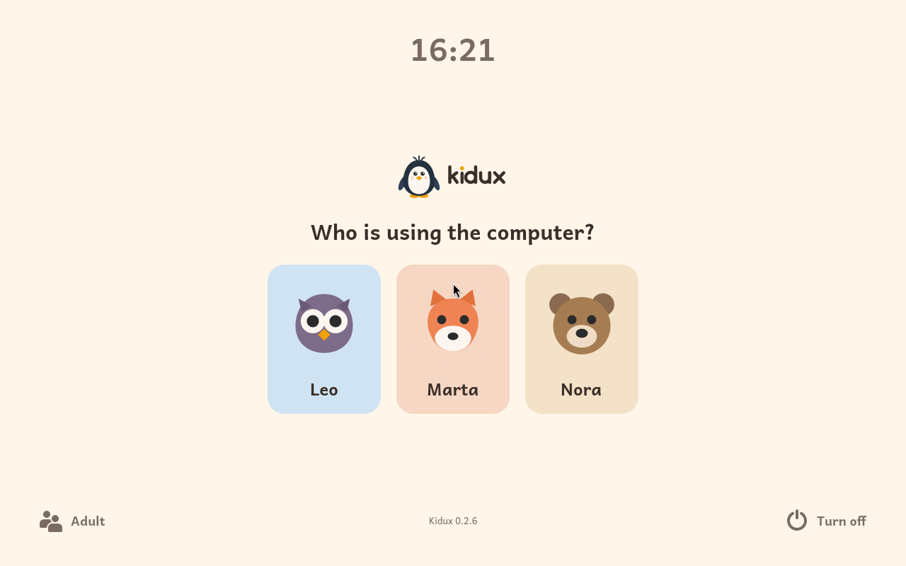
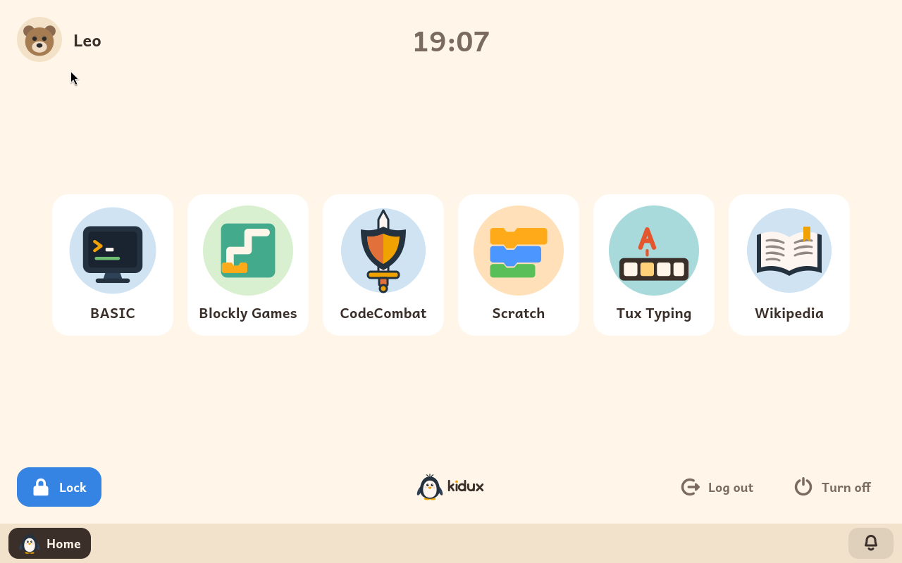
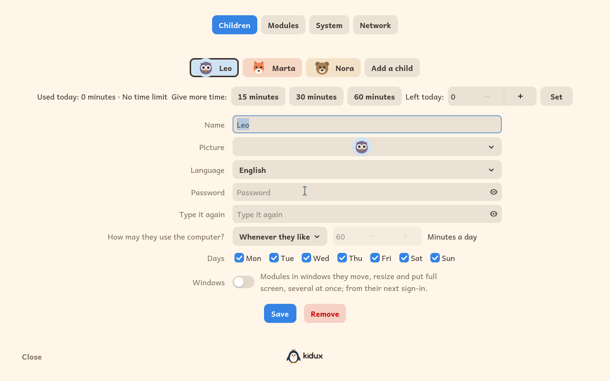
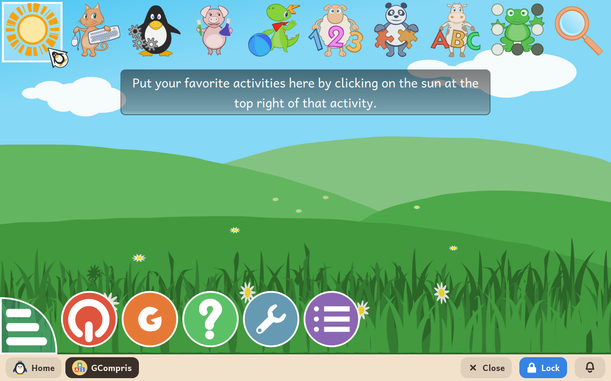

  <a href="https://kidux.org/"><b>kidux.org</b></a> ·
  <a href="README.md">English version</a> ·
  <a href="README.es.md">Versión en español</a>

**Kidux est une distribution Linux conçue pour être le premier ordinateur d'un enfant.** Vous pouvez l'installer sur n'importe quel ordinateur 64 bits, récent ou ancien, et en faire un environnement sûr, éducatif et sans distractions, pensé pour les jeunes esprits.

Avec Kidux, chaque enfant dispose d'un espace numérique bien à lui : l'image et le prénom qu'il a choisis sur l'écran de connexion, son propre mot de passe et la langue qu'il préfère. Les adultes, eux, gardent la main sur tout : les enfants n'accèdent qu'aux modules éducatifs autorisés, et seulement pendant le temps ou les jours fixés par leur famille.

Kidux est un logiciel libre, gratuit pour tous, à la maison comme à l'école, et tout son code source est sur GitHub : chacun peut l'étudier, le modifier et le partager. Construit sur la base éprouvée de Debian, il fonctionne en anglais, en espagnol et en français.

## Ce que voit un enfant

Quand l'ordinateur s'allume, il affiche un écran de connexion accueillant, avec une image pour chaque enfant. L'enfant choisit simplement la sienne et tape son mot de passe pour entrer. Pas de bureau encombré, pas d'accès aux réglages du système, aucun moyen de contourner les protections. L'écran est un espace personnel épuré, où chaque outil disponible a été choisi par un adulte.

Une fois connecté, l'enfant voit les modules d'apprentissage autorisés par sa famille, sous forme de grandes vignettes. Un adulte peut faire fonctionner chaque enfant dans l'un de deux modes, selon son âge et son expérience :

- **Mode plein écran.** Le mode recommandé pour commencer, pour tous les enfants. Chaque module occupe tout l'écran au-dessus d'une barre de navigation toujours présente en bas. Depuis cette barre, l'enfant revient à l'accueil, passe d'un module ouvert à un autre ou ferme l'activité en cours. Plusieurs modules peuvent rester ouverts en même temps, et l'enfant s'y retrouve facilement grâce à la barre ou à quelques raccourcis clavier.
- **Mode fenêtré.** Pour les enfants plus grands ou plus expérimentés, un adulte peut activer un affichage classique en fenêtres. Les activités s'ouvrent alors avec une barre de titre, une bordure et les boutons habituels pour réduire, agrandir et fermer. Plusieurs fenêtres peuvent être disposées, redimensionnées et déplacées côte à côte, tandis que la barre du bas affiche la liste des applications ouvertes.

Quand le temps accordé pour la journée est écoulé, l'écran se verrouille automatiquement. Le travail en cours n'est jamais perdu : les applications ouvertes sont mises en pause en arrière-plan, le temps qu'un adulte accorde du temps supplémentaire, déverrouille brièvement la session pour enregistrer les fichiers, ou ferme la session proprement.

Les enfants peuvent aussi verrouiller l'écran eux-mêmes quand ils s'absentent. La session se verrouille automatiquement après quelques minutes d'inactivité, et fermer le capot d'un ordinateur portable la verrouille aussitôt. Dans tous les cas, l'enfant peut toujours éteindre ou redémarrer l'ordinateur proprement.

Partager l'ordinateur entre frères et sœurs est très simple : un enfant quitte sa session et le suivant entre avec son propre mot de passe, et retrouve aussitôt ses fichiers, son temps du jour, ses activités autorisées et sa langue.

## Ce que décide un adulte

Toute la configuration se fait à un seul endroit : l'espace adulte. Il s'ouvre uniquement avec le mot de passe adulte, depuis l'écran de connexion ou l'écran de verrouillage, et n'est accessible de nulle part ailleurs dans le système.

Depuis l'espace adulte, un adulte peut :

- Créer le profil de chaque enfant, en choisissant son image, la langue de l'interface, la disposition du clavier et son mot de passe.
- Choisir l'une des trois façons d'utiliser l'ordinateur :
  - **Sans limite** : l'enfant peut utiliser l'ordinateur à tout moment.
  - **Temps quotidien** : un nombre de minutes par jour. Le décompte n'avance que lorsque la session est déverrouillée, et repart à zéro chaque matin.
  - **Avec autorisation** : un adulte doit accorder du temps pour chaque session.
- Indiquer quels jours de la semaine l'ordinateur peut être utilisé (par exemple, uniquement le week-end).
- Accorder des minutes supplémentaires à tout moment, ou fixer le temps restant de la journée à une valeur précise (y compris zéro pour suspendre l'accès).
- Activer ou désactiver le mode fenêtré pour chaque enfant.
- Régler les délais d'inactivité après lesquels l'écran se verrouille, puis s'éteint pour économiser l'énergie.
- Installer et supprimer des modules d'apprentissage, et activer ou désactiver chaque activité selon la maturité et les centres d'intérêt de chaque enfant.

Le mot de passe adulte n'est jamais tapé dans la session d'un enfant : aucun logiciel ni script lancé sous le compte de l'enfant ne peut l'intercepter ni imiter l'espace adulte.

## Modules d'apprentissage

Chaque activité de Kidux est un module d'apprentissage indépendant. Les adultes installent les modules et décident lesquels apparaissent sur l'écran de chaque enfant. Pour chaque activité, l'espace adulte indique les âges recommandés et les modules conseillés au préalable.

Voici les modules disponibles dans Kidux :

- [GCompris](docs/fr/modules/gcompris.md) : une suite éducative complète de plus de 100 activités ludiques pour les enfants de 2 à 10 ans : lecture, calcul, sciences, géographie, couleurs, maniement du clavier et de la souris. Fonctionne hors ligne ; seules ses voix sont téléchargées la première fois.
- [Tux Typing](docs/fr/modules/tuxtype.md) : un jeu d'arcade éducatif qui apprend à taper au clavier aux enfants de 6 à 12 ans. Aide Tux le pingouin à attraper les poissons qui tombent et à détruire les comètes en tapant des lettres et des mots, toujours plus vite et plus juste.
- [ScratchJr](docs/fr/modules/scratchjr.md) : une initiation à la programmation créée par le MIT Media Lab pour les jeunes enfants (de 5 à 7 ans). Les enfants assemblent des blocs illustrés pour créer des histoires animées et des jeux, avant même de savoir lire.
- [Blockly Games](docs/fr/modules/blockly-games.md) : une série d'énigmes éducatives conçues par Google, à faire à son rythme, qui présentent pas à pas les notions de base de l'informatique et de la pensée algorithmique. Fonctionne entièrement hors ligne.
- [Scratch](docs/fr/modules/scratch.md) : l'environnement de programmation par blocs le plus utilisé au monde, créé par le MIT et utilisé dans les écoles du monde entier pour créer des histoires interactives, des jeux et des animations. Il fonctionne en local et en toute sécurité, sans se connecter à la communauté Scratch en ligne ; seule sa bibliothèque de personnages, d'arrière-plans et de sons vient d'Internet. Pour les enfants à partir de 8 ans.
- [TurboWarp](docs/fr/modules/turbowarp.md) : une édition améliorée et plus performante de Scratch, avec un compilateur intégré qui fait tourner les animations et les scripts complexes à pleine vitesse, idéale pour les ordinateurs anciens ou les projets gourmands.
- [BASIC](docs/fr/modules/basic.md) : découvrir la programmation telle qu'elle a commencé sur les premiers ordinateurs familiaux, avec [wwwBASIC](https://github.com/google/wwwbasic), accompagné d'un guide interactif exclusif de 30 chapitres qui enseigne la programmation depuis le début, sans connexion à Internet.
- [CodeCombat](docs/fr/modules/codecombat.md) : une porte d'entrée vers la plateforme web [CodeCombat](https://codecombat.com/), où les enfants apprennent la vraie syntaxe de Python ou de JavaScript en dirigeant des héros dans un jeu de rôle et d'aventure. Nécessite une connexion Internet et un compte sur la plateforme, et la plus grande partie du site est payante. Kidux est indépendant et n'a aucun lien commercial avec CodeCombat.
- [Wikipédia](docs/fr/modules/wikipedia.md) : l'accès direct à l'encyclopédie [Wikipédia](https://www.wikipedia.org/) complète, dans la langue de l'enfant, et aux ressources de référence de Wikimedia associées, tout en gardant le reste du Web bloqué.
- [Messagerie](docs/fr/modules/mail.md) : un client de messagerie simplifié et sûr, basé sur [Thunderbird](https://www.thunderbird.net/), configuré à l'avance par un adulte avec un compte de la famille (Gmail, Outlook, iCloud ou n'importe quel fournisseur IMAP/SMTP standard). Les enfants lisent et envoient des messages sans avoir à affronter des réglages techniques.
- [Gmail](docs/fr/modules/gmail.md) : un accès web dédié à [Gmail](https://mail.google.com/), pensé pour les comptes Google d'enfants supervisés avec Family Link. Nécessite une connexion Internet, tout en gardant le reste de la navigation bloqué. Kidux n'a aucun lien avec Google.
- [Kig](docs/fr/modules/kig.md) : un laboratoire interactif de géométrie dynamique de KDE pour les enfants de 10 à 14 ans. Les points, droites, cercles et polygones gardent leurs propriétés géométriques quand on les déplace. Comprend des leçons guidées avec des missions pratiques, entièrement hors ligne.
- [Kalzium](docs/fr/modules/kalzium.md) : un tableau périodique interactif de KDE, à partir de 10 ans. Photos des éléments en haute résolution, modèles atomiques, curseur de température pour les états de la matière et activités éducatives guidées, sans connexion à Internet.
- [Step](docs/fr/modules/step.md) : un laboratoire interactif de simulation physique de KDE. On place sur un plan des corps, des ressorts, des poids et des forces gravitationnelles ou électromagnétiques pour simuler et mesurer des phénomènes physiques en temps réel. Comprend des expériences guidées et fonctionne hors ligne.
- [Simulations](docs/fr/modules/simulations.md) : une sélection de 51 simulations interactives de sciences et de mathématiques développées par [PhET Interactive Simulations](https://phet.colorado.edu/) (Université du Colorado à Boulder) pour les 6 à 14 ans, fournies en local sous licence CC BY 4.0 pour expérimenter hors ligne. Kidux n'a aucun lien avec PhET.
- [Photographie](docs/fr/modules/photography.md) : un guide pratique et interactif de 30 chapitres pour apprendre la photographie numérique avec un vrai appareil photo. Il explore la lumière, la vitesse d'obturation, l'ouverture, la mise au point et le cadrage, avec des exercices pratiques pour chaque sujet, sans connexion à Internet.

## Obtenir Kidux

Kidux fonctionne sur n'importe quel ordinateur 64 bits (compatible avec presque tous les PC de bureau ou portables fabriqués depuis 2008). Il lui faut au moins 2 Go de mémoire vive (4 Go recommandés pour plus de fluidité avec plusieurs activités), 32 Go d'espace disque (tout le disque est consacré à l'installation) et un écran d'au moins 1280 × 800 pixels à 100 %. Une résolution plus élevée est recommandée (par exemple 1920 × 1080, ou un écran haute densité comme un MacBook Retina à 175 %). Sur un écran plus petit que 1280 × 800, certaines activités peuvent avoir des parties cachées ou mal fonctionner.

Il y a deux façons d'installer Kidux, et une de l'essayer d'abord :

- **Télécharger l'installateur** : téléchargez [l'image de Kidux](https://iso.kidux.org/kidux-amd64.iso), environ 750 Mo, copiez-la sur une clé USB ou une carte SD et démarrez l'ordinateur dessus. L'installateur graphique vous guide pas à pas et installe Kidux en quelques minutes, sans avoir à désactiver le Secure Boot. Le guide d'utilisation détaille [chaque étape](docs/fr/user-guide.md#avec-limage-de-kidux).
- **L'essayer d'abord dans un émulateur** : une image préparée pour VirtualBox, UTM ou QEMU démarre Kidux dans une fenêtre, sous Windows, macOS ou Linux, avec une famille déjà créée et six modules activés. Rien n'est installé sur l'ordinateur lui-même. La page [Essayer Kidux dans un émulateur](docs/fr/try.md) explique comment faire et donne les mots de passe.
- **Sur Debian** : installez une base propre et minimale de Debian 13 « trixie » sans environnement de bureau, ajoutez le dépôt officiel de paquets de Kidux et installez les paquets du système. Le guide d'utilisation donne [les instructions détaillées pas à pas](docs/fr/user-guide.md#2-installer-kidux).

## Documentation

- [Guide d'utilisation](docs/fr/user-guide.md), aussi disponible en [anglais](docs/en/user-guide.md) et en [espagnol](docs/es/user-guide.md) : des instructions complètes sur l'installation, la première configuration, et chaque écran et réglage, pour les adultes comme pour les enfants.
- [Documentation pour les développeurs](docs/dev/README.md) (en anglais) : l'architecture technique, le modèle de sécurité, les règles d'empaquetage Debian et la création de nouveaux modules d'apprentissage.

## Soutenir Kidux

Kidux est un projet communautaire indépendant, développé le week-end et sur du temps libre. Les dons volontaires aident à couvrir les frais de serveur et la maintenance, et encouragent à continuer d'enrichir ses fonctions éducatives.

## Nom et licence

Le nom *Kidux* réunit *kid* (« enfant » en anglais) et *Tux*, le célèbre pingouin mascotte de Linux. La charte graphique est décrite dans [branding/](branding/README.md).

Kidux est développé et maintenu par [Antonio Morales García](https://antonio.mg). Son code original, ses images et sa documentation sont des logiciels libres, publiés sous la **Licence publique générale GNU, version 3 ou ultérieure** (GPL-3.0-or-later). Les conditions complètes sont dans le fichier [LICENSE](LICENSE). Copyright (C) 2026 Antonio Morales García.

En bref : chacun peut utiliser, examiner, modifier et redistribuer le code, à la maison ou dans une organisation comme une école ou un centre de soutien scolaire, sans licence à demander. Les écoles qui utilisent Kidux sont chaleureusement invitées à le faire savoir à [info@kidux.org](mailto:info@kidux.org), pour que le projet sache où il aide des enfants. Le nom Kidux et le pingouin mascotte ne sont pas couverts par cette licence.

Kidux est une distribution dérivée de Debian qui intègre des logiciels tiers, chacun sous sa propre licence libre : Scratch (AGPL-3), TurboWarp (GPL-3), ScratchJr (BSD-3), Blockly Games (Apache-2.0), wwwBASIC (Apache-2.0), GCompris (GPL-3), Tux Typing (GPL-2) et les simulations PhET (CC BY 4.0). Le code source amont modifié ou compilé pour Kidux est publié à côté des paquets binaires.

Le module Photographie contient des photographies de divers auteurs sous licences Creative Commons ou dans le domaine public, chacune créditée dans son chapitre. Les illustrations pédagogiques créées par des modèles informatiques sont signalées explicitement.
