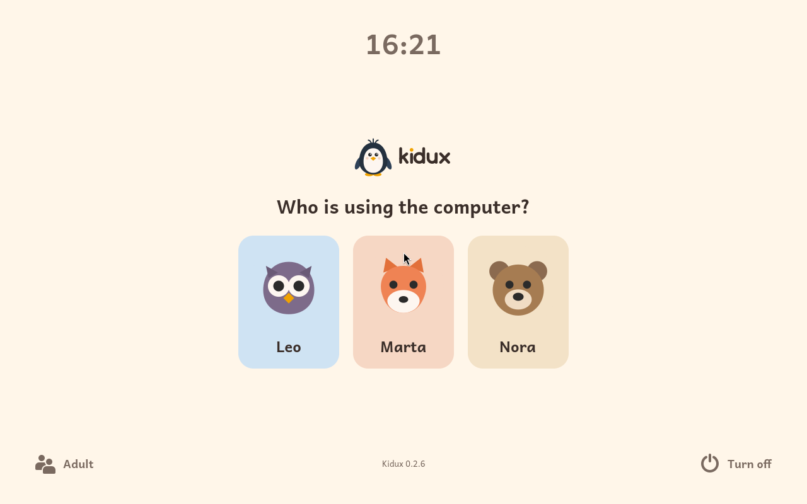
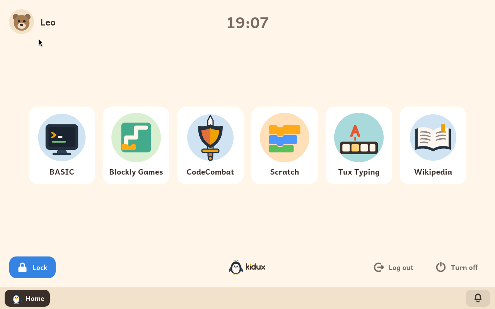
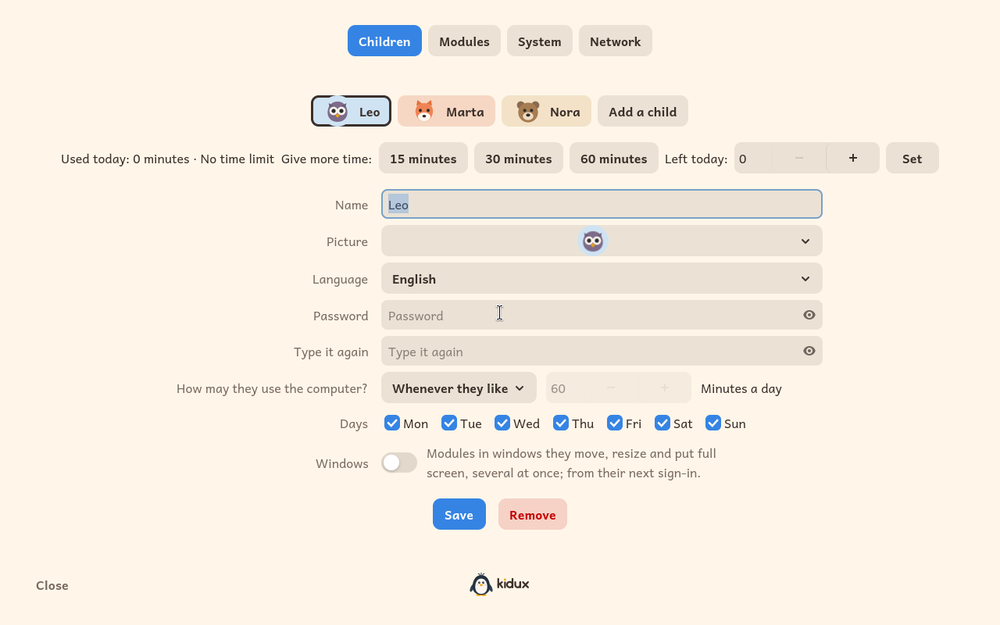
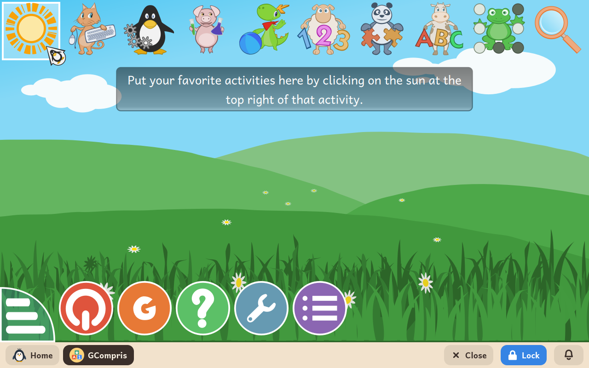

  <a href="https://kidux.org/"><b>kidux.org</b></a> ·
  <a href="README.es.md">Versión en español</a>

**Kidux is a Linux distribution specifically engineered to be a child's first computer.** You can install it on any 64-bit computer—new or old—transforming it into a secure, educational, and distraction-free environment tailored for young minds.

With Kidux, each child enjoys a personal digital space that genuinely feels like their own: their chosen avatar and name on the sign-in screen, their personal password, and their preferred language. At the same time, adults retain comprehensive control: children can only access authorized educational modules, and only during the daily hours or schedules set by their family.

Kidux is free software, free for everyone, at home or at school, and all its source code is on GitHub for anyone to study, change and share. Built on a proven Debian foundation, it provides bilingual English and Spanish support from day one.

## What a child sees

When the computer turns on, it displays a friendly sign-in screen with an avatar for each child. The child simply selects their picture and enters their password to enter. There is no confusing desktop clutter, no access to system settings, and no way to bypass protection. The screen is a clean personal space where every available tool has been thoughtfully chosen by an adult.

Once signed in, the child's screen presents the learning modules authorized by their family, displayed as intuitive visual tiles. An adult can configure each module to run in one of two modes depending on the child's age and experience:

- **Full-screen mode.** The recommended starting mode for all children. Each module occupies the entire display area above a permanent bottom navigation bar. From this bar, the child can return home, switch between currently open modules, or close the active activity. Multiple modules can remain open concurrently, and the child navigates easily using the bar or simple keyboard shortcuts.
- **Windowed mode.** For older or more experienced children, an adult can enable a traditional windowed layout. Activities then open with title bars, borders, and familiar minimize, maximize, and close buttons. Multiple windows can be arranged, resized, and moved side by side, while the bottom bar displays the list of open applications.

When the child's allotted time for the day expires, the screen locks automatically and securely. Work in progress is never lost: open applications are frozen safely in the background while waiting for an adult to grant additional time, briefly unlock the session to save files, or sign out cleanly.

Children can also lock the screen themselves whenever they step away. Sessions lock automatically after a few minutes of inactivity, and closing the lid of a laptop triggers an immediate lock. Under all circumstances, the child can always power off or restart the computer cleanly.

Sharing the computer among siblings is effortless: one child simply signs out and the next signs in with their own password, immediately loading their personal files, daily time balance, authorized activities, and language settings.

## What an adult decides

All system configuration is managed from a single central location: the adult administration panel. It is unlocked exclusively using the master adult password from either the sign-in screen or the lock screen, and cannot be accessed from anywhere else in the system.

From the panel, an adult can:

- Create child profiles, selecting an avatar, interface language, keyboard layout, and password for each.
- Choose an access policy from three distinct modes:
  - **Unlimited access**: the child may use the computer at any time.
  - **Daily time allowance**: assigns a specific number of minutes per day. The timer counts down only while the session is unlocked and resets each morning.
  - **Permission required**: the child requires an adult to grant time for each session.
- Specify which days of the week computer use is permitted (for instance, reserving screen time for weekends only).
- Grant bonus minutes immediately at any time, or adjust remaining time for the day to any specific amount (including zero to pause access).
- Enable or disable windowed mode independently for each child.
- Set idle timeout thresholds for automatically locking the screen and turning off the display to save energy.
- Install and remove learning modules, and enable or disable each activity according to each child's maturity and interests.

The master adult password is never typed inside a child's session, ensuring that no software or script running under the child's account can intercept credentials or spoof the administration interface.

## Learning modules

Every activity in Kidux is packaged as an independent learning module. Adults install modules and determine which ones appear on each child's screen. For each activity, the panel lists recommended age ranges and suggested preparatory modules.

The following modules are available in Kidux:

- [GCompris](docs/en/modules/gcompris.md): a comprehensive educational suite featuring over 100 playful activities for children ages 2 to 10, covering literacy, numeracy, basic science, geography, colors, and keyboard and mouse coordination. Works offline; only its voices are downloaded the first time.
- [Tux Typing](docs/en/modules/tuxtype.md): an engaging educational arcade game teaching touch typing to children ages 6 to 12. Help Tux the penguin catch falling fish and destroy comets by typing letters and words with increasing speed and precision.
- [ScratchJr](docs/en/modules/scratchjr.md): an introductory programming environment created by the MIT Media Lab for young children (ages 5 to 7). Children snap together graphical blocks to create animated stories and games, even before learning to read.
- [Blockly Games](docs/en/modules/blockly-games.md): a series of self-paced educational puzzles designed by Google that introduce core computer science and algorithmic thinking concepts step by step. Operates entirely offline.
- [Scratch](docs/en/modules/scratch.md): the world's most widely used visual block-based programming environment from MIT, used in schools globally to create interactive stories, games, and animations. Runs locally and securely, without connecting to the online Scratch community; only its library of characters, backdrops, and sounds comes from the internet. For children ages 8 and up.
- [TurboWarp](docs/en/modules/turbowarp.md): an enhanced, high-performance edition of Scratch with an integrated compiler that runs complex animations and scripts at full speed, ideal for older computers or resource-intensive projects.
- [BASIC](docs/en/modules/basic.md): experience classic computer programming as it began on early home computers using [wwwBASIC](https://github.com/google/wwwbasic), accompanied by an exclusive 30-chapter interactive tutorial guide teaching programming from scratch without needing internet access.
- [CodeCombat](docs/en/modules/codecombat.md): a gateway to the [CodeCombat](https://codecombat.com/) web platform, where children learn real-world Python or JavaScript syntax while controlling heroes in a dungeon role-playing adventure. Requires an active internet connection and a platform account, and most of the site is paid for. Kidux is independent and has no commercial affiliation with CodeCombat.
- [Wikipedia](docs/en/modules/wikipedia.md): direct access to the complete [Wikipedia](https://www.wikipedia.org/) encyclopedia in the child's language and related Wikimedia reference resources, while keeping the rest of the web safely blocked.
- [Mail](docs/en/modules/mail.md): a simplified, secure email client powered by [Thunderbird](https://www.thunderbird.net/), pre-configured by an adult with a family account (Gmail, Outlook, iCloud, or any standard IMAP/SMTP provider). Children can read and send messages without facing complex technical settings.
- [Gmail](docs/en/modules/gmail.md): dedicated web access to [Gmail](https://mail.google.com/), specially designed for child Google accounts supervised via Family Link. Requires an internet connection while keeping all other web browsing restricted. Kidux has no connection with Google.
- [Kig](docs/en/modules/kig.md): an interactive dynamic geometry laboratory from KDE for children ages 10 to 14. Points, lines, circles, and polygons dynamically maintain their geometric properties when dragged. Includes integrated guided lessons with hands-on missions, operating completely offline.
- [Kalzium](docs/en/modules/kalzium.md): an interactive periodic table from KDE for ages 10 and up. Features high-resolution element photos, atomic models, a state-of-matter temperature slider, and guided educational activities without needing internet access.
- [Step](docs/en/modules/step.md): an interactive physics simulation laboratory from KDE. Place bodies, springs, weights, and gravitational or electromagnetic forces on a canvas to simulate and measure physical phenomena in real time. Includes guided experiments and works offline.
- [Simulations](docs/en/modules/simulations.md): a curated collection of 51 interactive science and math simulations developed by [PhET Interactive Simulations](https://phet.colorado.edu/) (University of Colorado Boulder) for ages 6 to 14, bundled locally under the CC BY 4.0 licence for offline experimentation. Kidux has no connection with PhET.
- [Photography](docs/en/modules/photography.md): a practical, 30-chapter interactive guide teaching digital photography with a real camera. Explores lighting, shutter speed, aperture, focus, and framing, providing practical exercises for each topic without needing internet access.

## Getting Kidux

Kidux runs on any 64-bit computer (compatible with almost any desktop or laptop PC manufactured since 2008). It requires a minimum of 2 GB of RAM (4 GB recommended for smoother multitasking), 32 GB of disk space (the entire drive is dedicated to the installation), and a display resolution of at least 1280 × 800 pixels at 100% scaling. A higher resolution is recommended (such as 1920 × 1080 or high-density displays like MacBook Retina panels at 175% scaling). On displays smaller than 1280 × 800, some activities may have parts hidden or not work well.

There are two ways to install Kidux, and one to try it first:

- **Download the installer**: download [the Kidux image](https://iso.kidux.org/kidux-amd64.iso), about 900 MB, write it to a USB flash drive or SD card, boot your computer from it, with Secure Boot on or off, and follow the graphical installer, which leaves Kidux installed in a few minutes. The user guide explains [every step](docs/en/user-guide.md#from-the-kidux-image).
- **Try it first in an emulator**: on Windows, macOS or Linux, an image ready for VirtualBox, UTM or QEMU starts Kidux inside a window, with a family already set up and six modules switched on, without installing anything on the computer itself. [Trying Kidux in an emulator](docs/en/try.md) explains how, and gives the passwords.
- **On top of Debian**: install a clean, minimal base of Debian 13 "trixie" without a desktop environment, add the official Kidux package archive, and install the system packages. The user guide provides [detailed step-by-step instructions](docs/en/user-guide.md#2-installing-kidux).

## Documentation

- [User guide](docs/en/user-guide.md), also available in [Spanish](docs/es/user-guide.md): comprehensive instructions covering installation, initial setup, and detailed explanations of every screen and setting for adults and children.
- [Developer documentation](docs/dev/README.md) (in English): technical architecture specifications, security model details, Debian packaging guidelines, and instructions for creating new learning modules.

## Supporting Kidux

Kidux is an independent community project developed during weekends and personal free time. Voluntary donations help cover server costs and ongoing maintenance, and motivate continued expansion of educational features.

## Name and licence

The name *Kidux* combines *kid* and *Tux*, the beloved Linux penguin mascot. Visual branding guidelines are documented in [branding/](branding/README.md).

Kidux is developed and maintained by [Antonio Morales García](https://antonio.mg). Its original codebase, images, and documentation are free software, published under the **GNU General Public License, version 3 or later** (GPL-3.0-or-later). The complete terms are in the [LICENSE](LICENSE) file. Copyright (C) 2026 Antonio Morales García.

In brief: anyone may use, inspect, modify, and redistribute the code, at home or in an organisation such as a school or an educational academy, with no licence to request. Schools that use Kidux are warmly invited to say so at [info@kidux.org](mailto:info@kidux.org), so that the project learns where it helps children. The Kidux name and penguin mascot remain outside this licence.

Kidux is a Debian-derived distribution integrating third-party software under respective free software licences: Scratch (AGPL-3), TurboWarp (GPL-3), ScratchJr (BSD-3), Blockly Games (Apache-2.0), wwwBASIC (Apache-2.0), GCompris (GPL-3), Tux Typing (GPL-2), and PhET simulations (CC BY 4.0). Upstream source code modified or compiled for Kidux is published alongside the binary packages.

The Photography module includes photographs by various artists under Creative Commons or public domain licences, individually credited within each chapter. Pedagogical illustrations created by computer models are noted explicitly.
