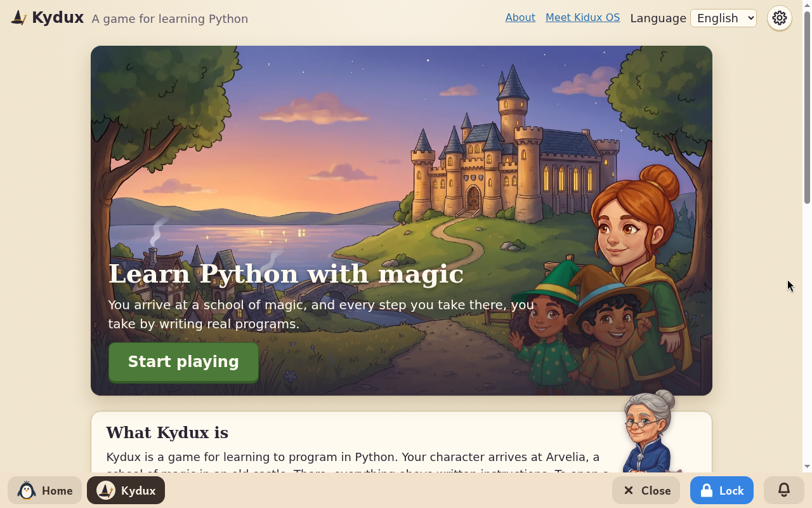
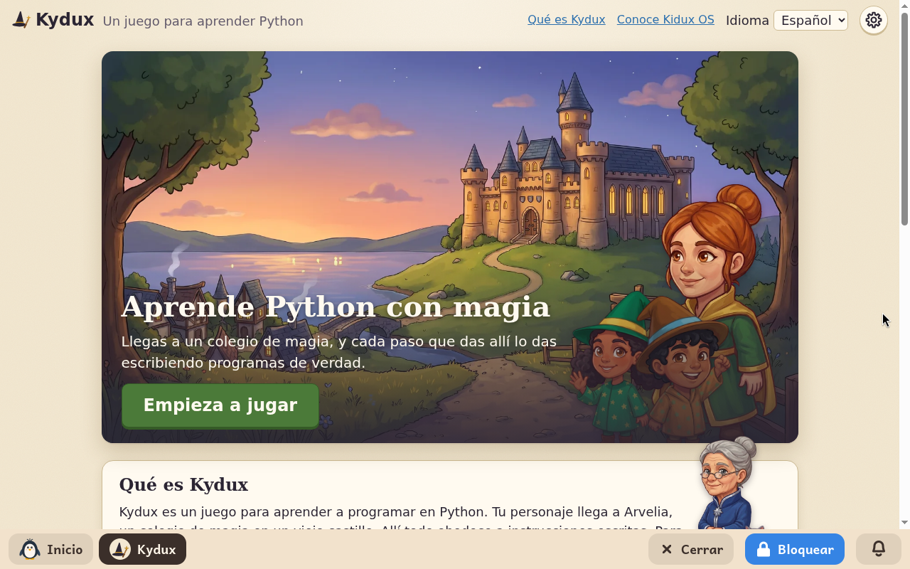
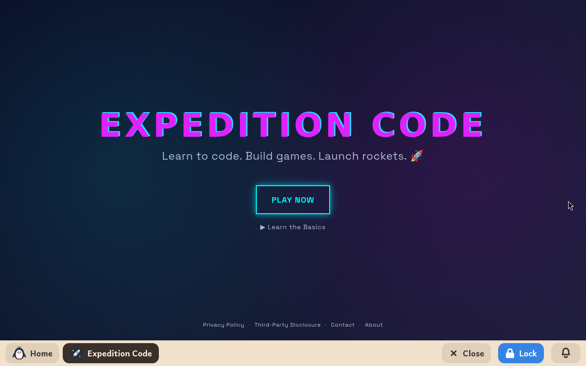
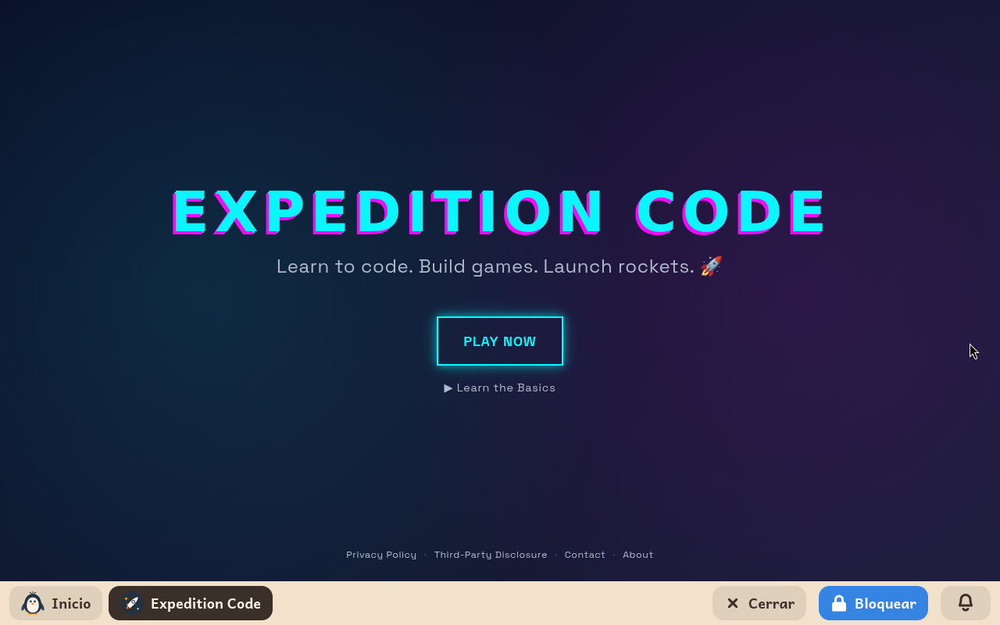

# Phase 4h plan — Kydux, the family's own game, and Expedition Code

Kydux is a game for learning Python, made by Kidux's owner, published at
`https://kydux.kidux.org` and played in any web browser. It is of the Kidux
family, and Kidux has no way to open it. This phase gives it one, a module
that is a door to that site (D85), and shows it first wherever Kidux shows
its modules: the README, the user guide and the website, each with a link
to the game and the words that it is played without Kidux too. A second
module is a door to Expedition Code, `https://www.expeditioncode.com/`,
another person's coding game, made as CodeCombat's is and with nothing to
sign in to. With Kydux there, the two doors to other people's coding
games, CodeCombat and Expedition Code, are shown last and in fewer words.

No part of the framework changes: both modules are a manifest, an icon and
their words, as Wikipedia's and Gmail's are. This plan follows
phase-4c-plan.md's rules (section 3 there) and D93: a commit per step,
partial tests while building and never the battery, every user-facing word
through i18n in both languages, a new package at `0.1.0` and `~dev` builds
of it until the owner tries the work and says yes.

Section 4 records what the owner decided and what the plan takes for
granted until the owner says otherwise. Section 5 is what was read from
the two sites before the plan, which step 4.40 confirms on the machine.
Section 6 is the content, ready to use. Section 7 lists what can go wrong
and what the plan does about each.

## 1. Steps

| Step | What | Size |
|---|---|---|
| 4.40 | Found on the machine first: each site opened as a child, its hosts read from the net log, and what does not work behind the wall | M |
| 4.41 | `kidux-module-kydux`: the package, its tests, and the last tests renamed to stay last | M |
| 4.42 | `kidux-module-expedition-code`: the package and its tests | M |
| 4.43 | The documents: Kydux first in the README and the user guide, the two modules' pages, the doors to other people's games last, the developer documents, and Kydux among the six modules of the opening picture | M |
| 4.44 | The website: a part of its own for Kydux, the two doors in a line, written and looked at now, committed once the release has written its pictures | M |
| 4.45 | Closing: the roadmap, the report, the prompt for the designer | S |

4.40 decides the two manifests and is done first; nothing is committed
before it. 4.41 and 4.42 are a package each. 4.43 depends on both. 4.44's
commit waits on a branch for the release's pictures (section 2, 4.44).

## 2. The steps

### 4.40 — Found on the machine first

On the machine left up (`tests/run vm up 04`), as Leo, with nothing
committed before these are known. Each module is tried first as a folder
copied by hand (D101): `/usr/share/kidux/modules/<id>/` with the manifest
of section 6 and any `icon.svg`, then `/usr/libexec/kidux-chromium-policy`
run as root, since no package's trigger writes the policy for a folder,
and `kidux-as enable leo <id> on`. `kidux-module-hello-web` installed
first brings `kidux-webapps` and Chromium. The folders and the policy are
taken away at the end of the step, and the policy written again.

The method is phase-4b-plan.md's *Finding a site's hosts*:
`kidux-as set-config chromium_flags '["--log-net-log=/tmp/net.json"]'`,
the module opened from its tile and used as a child would, closed, and
every `URL_REQUEST` that ends in `ERR_PROXY_CONNECTION_FAILED` (the wall)
or `ERR_BLOCKED_BY_ADMINISTRATOR` (the ceiling) listed by host with a
short script in the scratchpad. The flag is taken back at the end.

**Kydux.** With the manifest of section 6.1:

1. *Its hosts.* A scratch profile each time (`rm -rf
   ~leo/.config/kidux/kydux`). Once answering *Accept* to the game's
   question about cookies and once *Reject*; then the welcome page,
   *Start playing*, the story, the wizard made, the first lesson, the
   first level with a program run (Pyodide loads then), the map, the
   settings, music on. Expected, from section 5: nothing refused but what
   the page asks of no host of the list. A refused host of Google's
   counting (another `region<n>` name, `www.google-analytics.com`) is
   already under a name of the list; one that is not (a `doubleclick.net`
   or `google.com` name) stays out and is written in the manifest's
   comment.
2. *Its language.* With Leo in Spanish the game's first screen is in
   Spanish, and in English (`KIDUX_VM_LANGUAGE=en`, or Leo's language
   changed on the panel) in English: the game reads the browser's
   languages, which Chromium takes from `--lang`. If it opens in English
   for a Spanish child, the step stops there and the owner is told, with
   the remedy to decide: `--accept-lang=<lang>` among `kidux-webapp`'s
   flags, a change to `kidux-webapps` and a new version of it.
3. *The address's `?from=kidux`.* The game opens with it as without it,
   and it stays in the address through the game's screens (its screens
   are the part after `#`).
4. *A saved game kept as a file and opened again.* On the start screen,
   the game's own button keeps a game as a `.json` file: Chromium's file
   dialog opens on Leo's Downloads, and the file is there. The game's
   button to open one shows the same dialog. Both are allowed by the
   policy (D75, D76); if either is refused, what refused it is found and
   the owner told.
5. *A game left and found again.* The module closed with Alt+F4 and
   opened again: *Continue game* is there. The saved games live in the
   module's Chromium profile, `~/.config/kidux/kydux/chromium` (D89).
6. *The link out.* On the welcome page, *Meet Kidux* leads to
   `kidux.org`, which the wall refuses: what the child sees is noted, and
   that Alt+Left brings the game back with nothing lost.
7. *How it draws.* The test machine has no graphics Chromium takes, and a
   website's module gets no WebGL in software (D85), so the game draws
   with its 2D renderer there, as it does on an old computer. The first
   scene, the castle's gate, is looked at for anything missing against
   the same scene in a browser with WebGL, on another computer, and how
   evenly the wizard walks is noted. Later chapters cannot
   be reached without playing; they are the owner's hand test (4.45).
8. *What it weighs.* After the first level,
   `systemctl --user show kidux-module-kydux.scope -p MemoryPeak` as Leo.
   `memory_max` stays `3G` when the peak is over 1.5 GB and becomes `2G`,
   the default, left unwritten, otherwise.
9. *For the session test.* The window's title at each screen (expected
   `Kydux — cookies`, then `Kydux — ` and the welcome page's own words),
   and the keys that answer the notice with *Reject* and then confirm it,
   from the page as it loads, in both languages.

**Expedition Code.** With the manifest of section 6.2, its `hosts` first
only `expeditioncode.com`:

1. *Its hosts.* The front page, *Play now*, the beta notice, *Create new
   explorer* with a name that says what it is, `kidux-test`, the first
   mission played alone to its end with the narration heard, a room
   opened, the footer's pages. Every refused host is sorted into three:
   **needed**, without which the game does not work or loses its words'
   font or its voice, and which holds nothing to browse (expected: the
   game's backend, `spotted-shepherd-639.convex.cloud`, and Google's
   fonts, `fonts.googleapis.com` and `fonts.gstatic.com`); **left out, a
   third party's counting** (expected: `us.i.posthog.com`,
   `us-assets.i.posthog.com`); **left out, a site to browse** (expected:
   `www.youtube.com` and what its player brings, `i.ytimg.com`,
   `doubleclick.net`, `www.google.com`, `jnn-pa.googleapis.com`). The
   needed ones go into `hosts`, each by its own name and never by a
   parent's (`spotted-shepherd-639.convex.cloud`, not `convex.cloud`),
   and the manifest's comment names the rest and why (D122).
2. *That it works with those out.* The mission is played again behind the
   wall with the final `hosts`: the game runs, saves and finds the
   explorer again after the module is closed and opened (the site keeps
   a device's id in the browser, in the module's profile). If the game
   does not work without a host that is a site to browse, or without its
   counting, the step stops and the owner is told.
3. *The video.* The front page's *Learn the Basics* plays a YouTube
   video, which stays closed: what the child sees when pressing it is
   noted, and the video's address kept for the module's page (section
   6.5), since the site asks an adult to watch it with the child.
4. *The microphone.* The site lets a player say their code aloud. Whether
   the game's button asks Chromium for the microphone, what Chromium's
   question looks like in the application window for a child without
   windows, and what happens on *Block* and on *Allow* are noted. Nothing
   is changed for it (section 4, decision 9).
5. *Other players.* How a room is joined, by a code a player gives or
   from a public list, and whether players can write to each other, are
   noted for the module's page and its description.
6. *Links that open a window.* The footer's pages have links to other
   sites that ask for a new window (`target="_blank"`): what opens, and
   how the child closes it, is noted. CodeCombat's module is tried the
   same way for comparison.
7. *Its language, how it draws, what it weighs*, as Kydux's 2, 7 and 8.
   The site is in English whatever the child's language. `memory_max` is
   left at the default unless the peak is over 1.5 GB.
8. *For the session test.* The front page has no title, so Chromium names
   the window after the address: the title is noted, and the page's
   colours, for the test to know the page by (section 2, 4.42).

**Found** is written into this plan's section 5 where it corrects it, and
into the manifests' comments. Where a finding changes a decision of
section 4, the step stops and the owner decides.

### 4.41 — `kidux-module-kydux`

**The package**, started from `kidux-module-gmail`, the plainest door:

```
packages/kidux-module-kydux/
  module.toml              section 6.1, with 4.40's hosts and memory
  icon.svg                 section 6.3
  po/kidux-module-kydux.pot, po/es.po
  tests/test_module.py
  debian/                  control, rules, changelog, copyright,
                           kidux-module-kydux.lintian-overrides, source/format
```

- `debian/rules` as Gmail's: the catalogues compiled, `pyflakes3 tests`
  and the unit tests, the manifest, the icon and the `.mo` installed, and
  nothing under `/usr/share/kidux/webapps/`.
- `debian/control`: `Depends: ${misc:Depends}, kidux-webapps (>= 0.1.11~)`,
  the build dependencies as Gmail's, the description of section 6.1, and
  the `XB-Kidux-` fields written by `tests/project/module-fields.py
  --update`.
- `debian/changelog`: `0.1.0`, *Initial release: a door to Kydux, the
  Kidux family's game for learning Python.*, dated by `ci/hours.py
  changelog-date kidux-module-kydux`.
- `debian/copyright`: Kidux's, `GPL-3.0-or-later`; nothing of the game is
  in the package. The icon is drawn for Kidux after the game's own mark,
  which is the owner's and under the same licence.
- `ci/i18n-extract.sh` makes the template; `po/es.po` is section 6.1's
  Spanish.
- `ci/build-all.sh`: `kidux-module-kydux` after `kidux-module-wikipedia`.

**Unit tests**, `tests/test_module.py`, as Wikipedia's and Gmail's:

- the manifest reads as a door: `launch`, `app_ids ==
  ("chrome-kydux.kidux.org__*",)`, a window named
  `chrome-kydux.kidux.org__-Default` claimed, the ages `(8, 0)`, the
  memory, no settings, no `sign_in`, no `page_script`;
- its hosts are the game's own and its counting's and nothing else: the
  set is exactly the manifest's, `kidux.org` is not among them, and no
  host of the list is a parent of `kidux.org`'s other names (none ends
  the name `apt.kidux.org` or `iso.kidux.org`);
- its words say it is played without Kidux: `kydux.kidux.org` in the
  manifest's description and in `po/es.po`'s;
- the manifest's version is the package's; the catalogue is complete.

**Acceptance**, `tests/acceptance/26-module-kydux.sh`, as
`18-module-wikipedia.sh`: installed through the daemon with
`kidux-webapps`; the manifest, the icon and the Spanish words in place,
and no directory of its own under `/usr/share/kidux/webapps/`; the
policy's allowlist exactly `127.0.0.1:8123`, the manifest's hosts in
order, `blob:*`; `kidux-webapp --print kydux` as marta with
`--app=https://kydux.kidux.org/?from=kidux`, the bypass list with
`;kydux.kidux.org;*.kydux.kidux.org` and without `;kidux.org;`, and no
`--enable-unsafe-swiftshader`; listed for a child, switched off; removed
without a trace, and the policy gone with the server (D100).

**Session**, `tests/session/42-module-kydux.py`, as
`33-module-wikipedia.py`:

1. For the length of the test the machine's `/etc/hosts` sends
   `kidux.goatcounter.com` to `0.0.0.0`, taken back in a `finally`: a
   test machine's visits are not the game's players, and the game counts
   a visit with GoatCounter whatever the notice is answered.
2. The module installed through the daemon and switched on for Leo; Leo
   signs in to its tile and opens it by keyboard.
3. The window is the module's, maximised and not fullscreen, above the
   bar, and its title comes to hold `Kydux` within 90 seconds. A site
   that does not answer is said so, and still fails the test.
4. The game's question about cookies is answered *Reject*, and the
   question that follows confirmed, by the keys 4.40 found. The title
   stops holding `cookies`: the welcome page is on screen, in Leo's
   language.
5. `machine.screenshot("module-kydux")`, the pointer aside: the picture
   the guide, the README and the website show.
6. Alt+F4 closes it, again if the page asks first (D45), and the
   launcher comes back; Leo logs out from the lock screen and Chromium
   goes with the session; the module is switched off and removed.

`module-kydux        module-kydux.png` goes into
`tests/lib/doc-screenshots.txt`, which also makes the English run take
the test.

**The last tests stay last.** `tests/session/42-purge.py` becomes
`44-purge.py` and `tests/acceptance/26-no-key-no-archive.sh` becomes
`28-no-key-no-archive.sh`, both with `git mv`, leaving 43 and 27 for
4.42. Every mention of either name is brought up to date in the same
commit: `tests/acceptance/01-archive.sh`'s comment, phase-4f-plan.md and
phase-4g-plan.md, and whatever else `grep -rn "42-purge\|26-no-key"`
finds outside `build/`.

**Tried** with `tests/run unit kidux-module-kydux`, `tests/run project`,
`tests/run vm push kidux-module-kydux`, `tests/run vm test 42`, the same
in English, and the acceptance test alone.

### 4.42 — `kidux-module-expedition-code`

**The package**, the same shape: `packages/kidux-module-expedition-code/`
with the manifest of section 6.2 and 4.40's hosts, the icon of section
6.3, its catalogue, tests and `debian/`. Its id has a hyphen, as
`blockly-games` has, and its gettext domain is
`kidux-module-expedition-code`. `debian/changelog`: `0.1.0`, *Initial
release: a door to the Expedition Code website.* `ci/build-all.sh`:
after `kidux-module-kydux`.

**Unit tests**: the manifest reads as a door (`launch`, `app_ids ==
("chrome-www.expeditioncode.com__*",)`, the ages `(9, 0)`,
`recommended_before == ("scratch",)`), no settings, no `sign_in`; its
hosts are exactly the manifest's, with `expeditioncode.com` among them
and none of `youtube.com`, `google.com`, `posthog.com`, `convex.cloud`
as a bare name, nor a name under the first three; its words say *Kidux
is not connected with Expedition Code* and *In English only*, in both
languages; the version; the catalogue.

**Acceptance**, `tests/acceptance/27-module-expedition-code.sh`, as
Kydux's: the policy's exact allowlist; `--print` with
`--app=https://www.expeditioncode.com/` and the bypass list with
`;expeditioncode.com;*.expeditioncode.com`.

**Session**, `tests/session/43-module-expedition-code.py`: installed,
switched on, opened by keyboard; the window is the module's, maximised
and not fullscreen; the page is known by its colours, as 4.40 found
them, since it has no title (`machine.showing` with the page's night
blue over the room above the bar, 90 seconds);
`machine.screenshot("module-expedition-code")`; Alt+F4; log out; removed.
The test presses nothing on the page: it makes no explorer on another
person's server. `module-expedition-code    module-expedition-code.png`
goes into `tests/lib/doc-screenshots.txt`.

**Tried** as 4.41, with `vm test 43`.

### 4.43 — The documents

One commit, every user document in both languages.

**`tests/session/30-every-module.py`**: `MODULES` is `("basic",
"blockly-games", "kydux", "scratch", "tuxtype", "wikipedia")`, Kydux
where CodeCombat was, the third tile, so the picture the website and the
README open with shows the family's game. The windows half of the test
does not open it. Tried with `vm test 30`.

**README.md and README.es.md.**
- After the third paragraph of the introduction, a paragraph on Kydux,
  section 6.4.
- *Learning modules*: Kydux is the first of the list, with section 6.4's
  entry. CodeCombat leaves its place and goes to the end with Expedition
  Code, under a sentence of their own, section 6.4, each in one line.
- The picture under the list stays GCompris's; after it,
  ``.

**docs/en/user-guide.md and docs/es/user-guide.md**, section 9.
- The introduction gains a paragraph on Kydux after its first, section
  6.4, and its paragraph on doors to a website names what a door's site
  may count (section 6.4).
- `### Kydux` is the first module's section, before GCompris, section
  6.4's words, with its picture and *More about it*.
- `### CodeCombat` moves to the end, after Photography, unchanged but for
  one sentence less (section 6.4), and `### Expedition Code` follows it.
  The headings keep their names, so the website's and the pages' links to
  them hold (`tests/project/site.py`).

**docs/en/modules/kydux.md, docs/es/modules/kydux.md,
docs/en/modules/expedition-code.md, docs/es/modules/expedition-code.md**:
section 6.5, in the shape of `codecombat.md`.

**Developer documents.**
- `architecture.md`: section 8 gains two rows, Kydux above CodeCombat's
  (*`kidux-module-kydux`, a door to kydux.kidux.org (D85, D120) · ours,
  the game's own repository `github.com/othermore/kydux`, nothing of it
  in the package, step 4.41 · the family's own game: real Python taught
  from nothing, in English and Spanish, free, with no account*) and
  Expedition Code under it (D121, step 4.42); its first paragraph names
  the date these rows were checked, from `date -I`. The decision log
  gains D120, D121 and D122, section 4's words.
- `modules.md`: section 1's sentence on `web` names an address that
  carries a fixed word (`https://kydux.kidux.org/?from=kidux`); section
  2's *door to one website* says what a door's `hosts` hold (D122);
  section 3's last sentence says a third-party program is chosen only if
  it speaks both languages, and that a door to a website in one language
  says so in its name's description, as Expedition Code's does (D121).
- `website.md`: the six modules of the opening picture, with Kydux; and
  section 2 says what 4.44 builds.
- `requirements.md`: the modules' list names Kydux and Expedition Code
  beside CodeCombat, each in a line.
- `roadmap.md`: three boxes under phase 4, unticked until 4.45.
- `docs/dev/README.md`: phase-4g-plan.md is *built*, and this plan is the
  current one.
- `tests/README.md` if it names a renamed test.

**Tried** with `tests/run project` (`docs.sh`, `site.py`, `i18n.sh`,
`module-fields.py`, `build-list.sh`).

### 4.44 — The website

The page gains a part of its own for Kydux and shows the two doors to
other people's games in a line instead of a card.

**`site/site.toml`**: `kydux = "https://kydux.kidux.org/"`, with a
comment: the family's game, played in any browser.

**`site/page.html`.**
- A section `id="kydux"` between the pillars and the part on the child's
  own computer, or where it reads best once seen: the game's picture,
  `images/{{ lang }}/module-kydux.png`, on one side; on the other a
  title, two short paragraphs and two buttons, *Play Kydux now*, to
  `{{ site.kydux }}`, and *Kydux in the guide*, to the user guide's
  `#{{ kydux.anchor }}`. Under the buttons, in small letters, that it is
  played in any browser, without Kidux.
- The navigation gains *Kydux*, to `#kydux`, after *Modules*.
- In the modules' grid CodeCombat's card goes. Under the grid, before
  the line that leads to the guide, one sentence names the doors to
  other people's coding games, CodeCombat and Expedition Code, each name
  a link to its section of the guide.
- The footer's line of what belongs to others names Expedition Code.

**`site/en.toml` and `site/es.toml`**: section 6.6's words, the same keys
in each; `[modules.codecombat]` keeps `name` and `anchor` and loses `age`
and `text`, and `[modules.expedition]` has `name` and `anchor`.

**`site/style.css`**: the new section in the brand's colours, the picture
with the modules' rounded corners, one column under 620 pixels.

**`tests/project/site.py`**: every page links to `site.kydux`, its
Kydux and its two doors' anchors are headings of the guide in its
language, and the page shows no card for CodeCombat.

**The order of things.** `ci/build-site.py` stops when the page names a
picture `docs/images/<lang>/` does not hold, and `module-kydux.png` is
written there by the release run alone (D93). So:

1. The change is made on a local branch, `phase-4h-site`, from the
   commit of 4.43, and committed there. `main` does not move.
2. It is looked at in a scratch copy of the tree, under the scratchpad:
   the quick loop's own `module-kydux` pictures, Spanish and English,
   copied into the copy's `docs/images/`, `ci/build-site.py` run there,
   and `python3 -m http.server 8080 --directory <copy>/build/site`, for
   the owner to see from another computer (website.md, section 3).
   `tests/project/site.py` is run in the copy.
3. After the owner's yes, the battery and the release run, when the
   release's pictures are committed on `main`, the branch is rebased onto
   `main`, `tests/run project` passes there, and `main` takes it. Only
   then is anything pushed, at the owner's word, with `ci/push.sh`.

The site is published by its workflow when `main` is pushed.

### 4.45 — Closing

The roadmap's three boxes ticked; `docs/dev/README.md`; this plan's
section 5 as found. Then the last message, for the owner, in Spanish:
what was built, step by step with its commit; what 4.40 found, above all
what does not work behind the wall; how to try each module on the
MacBook, with this list:

- Kydux from its tile: the question about cookies, the welcome page in
  the child's language, a level played with sound, the game closed and
  found again, a game kept as a file and opened again.
- The owner's own saved game opened in the module, and a dark level, a
  night scene and a flight looked at: on a computer without WebGL the
  game draws with its 2D renderer, which nothing else tries.
- *Meet Kidux* on the welcome page, and the way back.
- Expedition Code from its tile: an explorer made, a mission played, the
  voice, the microphone's question, *Learn the Basics*.
- The panel's Modules page and *Add modules*: the two descriptions, in
  both languages.
- The website's preview, from another computer.

And the prompt for the designer, in English: the commits to review, what
differs from this plan and why, what waits for the owner, and whether the
designer's context and the programmer's are to be cleared.

Nothing is released, pushed or published in this step.

## 3. Rules for this plan

As phase-4c-plan.md section 3 and phase-4b-plan.md section 3. In
addition:

- **The game and the site are looked at, never changed.** Nothing in
  `~/Projects/kydux` is touched: the game has its own agents and its own
  plans. What this work finds that the game could do better goes into the
  report, for its designer.
- **No test makes an account or an explorer on a site.** 4.40's one
  explorer on Expedition Code is made by hand, named `kidux-test`, and
  said in the report.
- **A test machine's visits are not counted.** The session test of Kydux
  closes the counting host for its own length (4.41).
- **`kidux.org` never enters a module's `hosts`.** It would open the
  whole site, its package archive and its installer's download to the
  child.
- **Nothing a module names is anyone's mark** but the family's own:
  Kydux's icon is the game's hat, which is the owner's; Expedition
  Code's is drawn for Kidux and is not its logo.

## 4. What the owner decided, and what the plan takes for granted

Decided by the owner, 2026-11-24:

1. **Kydux is a module that is a browser held to its own site**, shown
   first in the documents and on the website, with a link to the game
   and the words that it is played without Kidux (D120).
2. **Expedition Code is a module made as CodeCombat's is**, with no
   account to give on the panel, since the site asks for none (D121).
3. **CodeCombat and Expedition Code are shown last and in fewer words**,
   now that Kydux is there (D120).
4. **The game's counting is not closed.** GoatCounter and Google
   Analytics are among Kydux's hosts; the game asks the child about
   cookies itself, as in any browser (D120).
5. **What matters is that the child cannot go out of the site.** A host
   a site only fetches from behind its pages, a font, a library, its own
   backend, is among the module's hosts (D122).

Taken by the plan, each for the owner to overturn before the build:

6. **A third party's counting and advertising stay out when the site
   works without them**, as CodeCombat's do: PostHog on Expedition Code.
   Kydux's own counting is the family's and is in (D122).
7. **A host that is a site to browse stays out even when a page embeds
   it**: YouTube on Expedition Code's front page. The wall cannot tell a
   host fetched from a host visited, so the video opened would open all
   of YouTube. The module's page gives the video's address for an adult
   to watch with the child (D122).
8. **Expedition Code is taken though it is in English only**, against
   modules.md's rule for third-party programs, since the owner asked for
   it by name; its description says so in both languages (D121).
9. **The microphone is left to Chromium's own question.** Kidux's policy
   says nothing of it, as for Scratch, which records sounds; the module's
   page says what the site does with a voice.
10. **Kydux's address carries `?from=kidux`.** The game does nothing with
    it today. It lets the game know later that it is inside Kidux, to
    leave out the link to `kidux.org`, which leads nowhere there, and to
    tell those players apart in its counting, with no new version of the
    module.
11. **Kydux is for ages 8 and up**, as its own welcome page says, with
    nothing recommended before it; Expedition Code for 9 and up, as its
    site says, with Scratch recommended before, since its site says it
    is not for a first contact with code.
12. **Nothing changes inside the product to show Kydux first.** The
    launcher orders tiles by id and the panel by age; neither has a
    place of honour, and none is made. The trial image keeps its six
    modules.
13. **The opening picture of the website and the README shows Kydux's
    tile** in CodeCombat's place (4.43).

The decisions for architecture.md's log:

- **D120 — Kydux, the family's own game, is a door to its site with its
  counting open, and is shown first.** The game is played on its site,
  `kydux.kidux.org`, and nothing of it is shipped: a new version of the
  game needs no new module. Its hosts are the game's and those its
  counting uses, since the game asks about cookies itself and the family
  reads its own numbers; never `kidux.org`. The documents and the
  website show it first, link to it and say it is played in any browser
  without Kidux; the doors to other people's coding games come last.
- **D121 — Expedition Code is a door to expeditioncode.com, nothing of it
  shipped, in English only, and Kidux says it is not connected with
  it.** No account is given on the panel: the site keeps a player by a
  name, an emoji and a phrase of their own. YouTube and the site's
  counting are left out. Its description says the language, that it is
  in beta, that children may play with others in a room, and that Kidux
  has no connection with it.
- **D122 — A door module's hosts are what its site needs to work, and
  never a site to browse.** What a site fetches behind its pages is
  named, each host by its own name. Left out: a host with pages of its
  own that a link or a player's button leads to, whatever embeds it,
  since the wall holds a module to hosts and not to pages; and a third
  party's counting and advertising, when the site works without them. A
  site of the family's keeps its own counting.

## 5. What the two sites are, read on 2026-11-24

Read with a headless Chromium from the development machine, in Spanish,
every host but the listed ones refused; 4.40 confirms it on a Kidux
machine.

**Kydux**, version 0.1.2.
- One host of its own, `kydux.kidux.org`, on GitHub Pages: its pages, its
  Python (Pyodide), its world and its pictures. A service worker of the
  game's adds the headers that isolate the page; it keeps nothing, so
  the game needs the internet at every start.
- Its counting: `kidux.goatcounter.com`, on every visit;
  `www.googletagmanager.com` and `region1.google-analytics.com`, after a
  yes to the notice. The game's own content policy lets it reach
  `*.googletagmanager.com`, `*.google-analytics.com` and
  `*.analytics.google.com`, which is the manifest's list.
- Its first screen is the notice about cookies, with *Accept* and
  *Reject*, and *Reject* asks once more. Then, for a new player, the
  welcome page, `#about`; the window's title is `Kydux — cookies`, then
  `Kydux — ` and the page's name.
- Its language is the one saved in the browser, else the first of the
  browser's languages it has, else English. It has Spanish and English.
- One link out of the game: *Meet Kidux* on the welcome page, to
  `https://kidux.org`. No link opens a new window.
- Saved games are in the browser's local storage. The start screen keeps
  one as a `.json` file, through an address the page makes itself
  (`blob:`), and opens one from a file.
- It draws with Phaser, on WebGL where the browser has it and on a 2D
  canvas otherwise. With WebGL switched off the first scene draws the
  same, grid and all. Nothing was looked at beyond the first scene.
- It is made for windows from 1024 × 700; a Kidux screen of 1280 × 800
  leaves it 1280 × 736 above the bar.

**Expedition Code**, in beta.
- By Sean Clark; for ages 9 and up; *not intended for absolute
  beginners*, its notice says. Players write JavaScript-style code, or
  words that an AI turns into JavaScript, to complete missions; up to
  three play in one room, each on their own computer.
- Hosts at the front page: `www.expeditioncode.com` (the bare name sends
  to `www`), a WebSocket to `spotted-shepherd-639.convex.cloud`, the
  backend; `fonts.googleapis.com`, `fonts.gstatic.com`;
  `us.i.posthog.com`, `us-assets.i.posthog.com`; and the video's:
  `www.youtube.com`, `i.ytimg.com`, `googleads.g.doubleclick.net`,
  `static.doubleclick.net`, `www.google.com`, `jnn-pa.googleapis.com`.
  Not looked at beyond the choice of an explorer: 4.40 plays a mission.
- Its pages have no title. Its language is English, whatever the
  browser's.
- *Play now* shows a notice that it is a beta, then *Create new
  explorer* or *I have a secret phrase*: a display name, an emoji and a
  phrase, kept as a hash; no email, no password. A device's id in the
  browser keeps a player signed in on the same computer.
- Its privacy page says: no advertising; the code a child writes is sent
  to an AI provider, Anthropic, without a name; a voice reads the game's
  words and a player may speak their code, through ElevenLabs; clicks
  are counted with PostHog and page views by Vercel, the site's own
  host.
- Links out: `youtube.com/watch?v=VuWysb-EyrU`, the basics video, in a
  new window; `seanclark.dev`; the providers' privacy pages.

## 6. Content

### 6.1 Kydux's manifest and words

```toml
# Kydux: a door to the Kidux family's own game for learning Python (D85,
# D120). Nothing of the game is shipped: it is played on its site, as in
# any browser, and a new version of the game needs no new module.
id = "kydux"
version = "0.1.0"
name = "Kydux"
description = "A game of the Kidux family for learning real Python: a young wizard arrives at a school of magic, and every step there is taken by writing a program. Free, in English and Spanish, with no account. Requires internet. It is also played in any browser, without Kidux, at kydux.kidux.org."
min_age = 8
# The word after the question mark tells the game it is opened from Kidux.
launch = { web = "https://kydux.kidux.org/?from=kidux" }
# The game's own host, and those its counting of visits uses, which the
# game asks the child about before any cookie (D120): GoatCounter, and
# Google Analytics' tag and its collectors. Read from Chromium's net log
# over the notice, the story, a lesson and a level. Never kidux.org: the
# welcome page's link to it leads nowhere here.
hosts = ["kydux.kidux.org", "kidux.goatcounter.com", "googletagmanager.com",
         "google-analytics.com", "analytics.google.com"]
categories = ["programming"]
i18n_domain = "kidux-module-kydux"
memory_max = "3G"
```

Spanish description: *Un juego de la familia Kidux para aprender Python de
verdad: quien juega llega a un colegio de magia, y allí cada paso se da
escribiendo un programa. Gratis, en español y en inglés, sin cuenta.
Requiere conexión a internet. También se juega en cualquier navegador,
sin Kidux, en kydux.kidux.org.*

`debian/control`'s description:

```
Description: Kidux learning module: Kydux, a door to the family's game for learning Python
 Kidux is a Debian derivative for a child's first computer. This learning
 module opens Kydux, a game of the Kidux family in which a child learns
 real Python at a school of magic, in a window of its own, and no other
 website: a link to anywhere else leads nowhere. Nothing of the game is
 in this package; it is played on its site, kydux.kidux.org, where anyone
 plays it in a web browser, without Kidux.
 .
 It needs the internet whenever it is used. It is free, in English and
 Spanish, and asks for no account. The game asks whether it may use
 cookies to count how it is played.
 .
 Once it is installed, an adult switches it on for each child on the
 Modules page of the adult panel.
```

### 6.2 Expedition Code's manifest and words

```toml
# Expedition Code: a door to the Expedition Code website (D85, D121).
# Nothing of it is shipped: its missions are its own and live on its site.
id = "expedition-code"
version = "0.1.0"
name = "Expedition Code"
description = "A coding game on its own website: children write JavaScript-style code to complete missions, alone or with up to two other players in a room. In English only, and in beta. Requires internet; it asks for no email and no password. Kidux is not connected with Expedition Code."
min_age = 9
recommended_before = ["scratch"]
launch = { web = "https://www.expeditioncode.com/" }
# Its pages, its backend and its fonts, read from Chromium's net log over
# the front page, a new explorer and a mission. Left out (D122): YouTube
# and what its player brings, which the front page's video needs, since
# YouTube is a site to browse; and PostHog, the site's counting of clicks.
hosts = ["expeditioncode.com", "spotted-shepherd-639.convex.cloud",
         "fonts.googleapis.com", "fonts.gstatic.com"]
categories = ["programming"]
i18n_domain = "kidux-module-expedition-code"
```

Spanish description: *Un juego de programación en su propia web: los niños
escriben código al estilo de JavaScript para completar misiones, solos o
con hasta otros dos jugadores en una sala. Solo en inglés, y en fase
beta. Requiere conexión a internet; no pide correo ni contraseña. Kidux
no tiene ninguna relación con Expedition Code.*

`debian/control`'s description:

```
Description: Kidux learning module: Expedition Code, a door to the Expedition Code website
 Kidux is a Debian derivative for a child's first computer. This learning
 module opens the Expedition Code website, where children write code to
 complete missions, in a window of its own, and no other website: a link
 to anywhere else leads nowhere. Nothing of Expedition Code is in this
 package; the site and its missions are its author's.
 .
 It needs the internet. The site is in English only and in beta. It asks
 for no email and no password: a child chooses a name and a secret
 phrase. Children may play in a room with others. The video the site
 opens with is on YouTube and does not play here.
 .
 Kidux and its author have no connection with Expedition Code.
 .
 Once it is installed, an adult switches it on for each child on the
 Modules page of the adult panel.
```

### 6.3 The icons

Drawn like the avatars (branding/README.md): flat shapes, no gradients, a
128 × 128 view box, a circle of radius 60 behind, the brand's ink
`#24313f` for outlines.

- **Kydux**: the game's own mark, the wizard's hat of
  `~/Projects/kydux/app/public/favicon.svg`, read there and drawn again
  on the circle in its own colours, so that the tile and the game's tab
  are the same hat. A comment at the top says what it is.
- **Expedition Code**: a small rocket rising to the right over a night
  blue circle, two stars beside it. Not the site's lettering nor any
  drawing of its own.

Both are looked at as tiles in the launcher at 4.41's and 4.42's session
tests, and shown to the owner in the report.

### 6.4 The README's and the user guide's words

**README, the paragraph on Kydux**, after the introduction's third:

> **Kydux, the family's own game.** [Kydux](https://kydux.kidux.org) is a
> game for learning real Python, made by the same hands as Kidux: a young
> wizard arrives at a school of magic, and every step there is taken by
> writing a program. In Kidux it is a learning module like the others. It
> is also played on its own, in any web browser and on any computer, at
> [kydux.kidux.org](https://kydux.kidux.org), with nothing to install.

> **Kydux, el juego de la familia.** [Kydux](https://kydux.kidux.org) es
> un juego para aprender Python de verdad, hecho por las mismas manos que
> Kidux: quien juega llega a un colegio de magia, y allí cada paso se da
> escribiendo un programa. En Kidux es un módulo de aprendizaje más.
> También se juega por su cuenta, en cualquier navegador y en cualquier
> ordenador, en [kydux.kidux.org](https://kydux.kidux.org), sin instalar
> nada.

**README, Kydux's entry**, the first of the list:

> - [Kydux](docs/en/modules/kydux.md): the Kidux family's own game for
>   learning real Python, from ages 8 and up. A story at a school of
>   magic, short lessons that explain one idea each, and levels solved by
>   writing a program. Free, in English and Spanish, with no account.
>   Requires internet. Also played without Kidux, in any browser, at
>   [kydux.kidux.org](https://kydux.kidux.org).

> - [Kydux](docs/es/modules/kydux.md): el juego de la familia Kidux para
>   aprender Python de verdad, a partir de 8 años. Una historia en un
>   colegio de magia, lecciones cortas que explican una idea cada una, y
>   niveles que se resuelven escribiendo un programa. Gratis, en español
>   y en inglés, sin cuenta. Requiere conexión a internet. También se
>   juega sin Kidux, en cualquier navegador, en
>   [kydux.kidux.org](https://kydux.kidux.org).

**README, the end of the list**, after Photography:

> Two more modules are doors to coding games on other people's websites,
> for a family that wants them. Kidux has no connection with either.
>
> - [CodeCombat](docs/en/modules/codecombat.md): [CodeCombat](https://codecombat.com/),
>   Python or JavaScript in a dungeon adventure. Requires internet and an
>   account, and most of the site is paid for.
> - [Expedition Code](docs/en/modules/expedition-code.md): [Expedition
>   Code](https://www.expeditioncode.com/), missions solved with
>   JavaScript-style code, alone or with others. Requires internet. In
>   English only, and in beta.

> Otros dos módulos son puertas a juegos de programación en webs de otras
> personas, para la familia que los quiera. Kidux no tiene relación con
> ninguno de los dos.
>
> - [CodeCombat](docs/es/modules/codecombat.md): [CodeCombat](https://codecombat.com/),
>   Python o JavaScript en una aventura de mazmorras. Requiere conexión a
>   internet y una cuenta, de pago para casi todo.
> - [Expedition Code](docs/es/modules/expedition-code.md): [Expedition
>   Code](https://www.expeditioncode.com/), misiones que se resuelven con
>   código al estilo de JavaScript, a solas o con otros. Requiere
>   conexión a internet. Solo en inglés, y en fase beta.

**User guide, section 9's introduction**, a paragraph after the first:

> One of them is Kidux's own: **Kydux**, a game for learning Python, made
> by the same hands. It is played on its website, so anyone plays it
> without Kidux too, in any web browser, at
> [kydux.kidux.org](https://kydux.kidux.org).

> Uno de ellos es de la casa: **Kydux**, un juego para aprender Python,
> hecho por las mismas manos. Se juega en su web, así que cualquiera lo
> juega también sin Kidux, en cualquier navegador, en
> [kydux.kidux.org](https://kydux.kidux.org).

and, at the end of the paragraph on doors to a website: *What such a site
counts of its visits, and what it asks about cookies, is the site's own.*
/ *Lo que una web así cuenta de sus visitas, y lo que pregunta sobre
cookies, es cosa de esa web.*

**User guide, `### Kydux`:**

> **Kydux** is a game for learning to program in Python, for children
> from eight. A young wizard arrives at a school of magic, and every step
> there needs a little real Python: a story tells what happens, a short
> lesson explains one idea, and the level after it asks the child to use
> it in a program of their own. It is in the child's language and needs
> no account.
>
> Kydux is of the Kidux family, and the module is a door to its website:
> it opens the game and no other site. It needs the internet whenever it
> is used. The same game is played without Kidux, in any web browser, at
> [kydux.kidux.org](https://kydux.kidux.org).
>
> The first time, the game asks whether it may use cookies to count how
> it is played. That is the game's own question, and it plays the same
> whatever the answer. A child's games are kept on the computer, each
> child their own, and are found again the next day; the game's start
> screen also keeps one as a file, which goes where the child says, and
> opens it again.
>
> 
>
> More about it: [Kydux's page](modules/kydux.md).

> **Kydux** es un juego para aprender a programar en Python, para niños a
> partir de ocho años. Quien juega llega a un colegio de magia, y allí
> cada paso pide un poco de Python de verdad: una historia cuenta lo que
> pasa, una lección corta explica una idea, y el nivel que viene después
> pide usarla en un programa propio. Está en el idioma del niño y no
> necesita cuenta.
>
> Kydux es de la familia Kidux, y el módulo es una puerta a su web: abre
> el juego y ninguna otra web. Necesita internet siempre que se usa. El
> mismo juego se juega sin Kidux, en cualquier navegador, en
> [kydux.kidux.org](https://kydux.kidux.org).
>
> La primera vez, el juego pregunta si puede usar cookies para contar
> cómo se juega. Esa pregunta es del propio juego, y se juega igual se
> responda lo que se responda. Las partidas de cada niño se guardan en el
> ordenador, las de cada uno por separado, y al día siguiente siguen ahí;
> la pantalla de inicio del juego también guarda una partida como
> archivo, donde el niño diga, y la vuelve a abrir.
>
> 
>
> Más sobre él: [la página de Kydux](modules/kydux.md).

**User guide, `### Expedition Code`**, after CodeCombat, at the end:

> **Expedition Code** is a door to the Expedition Code website, a coding
> game for children from nine who have programmed a little before:
> missions are completed by writing JavaScript-style code, alone or with
> up to two other players in a room. The site is its author's, in English
> only and in beta, and the module opens it and no other website. Kidux
> has no connection with Expedition Code.
>
> It needs the internet, and no account: a child chooses a name, an emoji
> and a secret phrase, and the phrase lets them back in. The video the
> site opens with is on YouTube, which stays closed here.
>
> 
>
> More about it: [Expedition Code's page](modules/expedition-code.md).

> **Expedition Code** es una puerta a la web de Expedition Code, un juego
> de programación para niños a partir de nueve años que ya hayan
> programado un poco: las misiones se completan escribiendo código al
> estilo de JavaScript, a solas o con hasta otros dos jugadores en una
> sala. La web es de su autor, está solo en inglés y en fase beta, y el
> módulo la abre a ella y a ninguna otra. Kidux no tiene ninguna relación
> con Expedition Code.
>
> Necesita internet, y ninguna cuenta: el niño elige un nombre, un emoji
> y una frase secreta, y con la frase vuelve a entrar. El vídeo con el
> que se presenta la web está en YouTube, que aquí sigue cerrado.
>
> 
>
> Más sobre él: [la página de Expedition Code](modules/expedition-code.md).

**User guide, `### CodeCombat`**: its words as they are, without the
sentence on the site's cookies, which section 9's introduction now says
for every door.

### 6.5 The two modules' pages

In the shape of `docs/en/modules/codecombat.md`: the links to the other
language and back to the guide, a sentence in bold, the table, *What it
is and how it works* with the picture, and *Important notes*.

**Kydux's table:** recommended age, from 8, for a child who reads
comfortably; internet, required whenever it is used; languages, English
and Spanish, the child's; account, none; price, free; web service,
[kydux.kidux.org](https://kydux.kidux.org), of the Kidux family, free
software under the GNU GPL, version 3 or later, its code at
`github.com/othermore/kydux`; **without Kidux**, the same game in any web
browser, at that address.

**Kydux's notes:** the cookies question and what the game counts, in the
game's own words on its notice, never more; where the saved games are
(the computer, each child their own; they stay when the module is removed
and are found when it is installed again; a game kept as a file goes to
the folder the child chooses, their Downloads first); that the welcome
page's link to Kidux's website leads nowhere inside Kidux, and Alt+Left
goes back; that the game needs a screen of 1280 × 720 or more.

**Expedition Code's table:** recommended age, from 9, for a child who has
programmed before; recommended before, Scratch; internet, required;
language, English only; account, none, a name, an emoji and a secret
phrase the child chooses; price, as the site says on the day of 4.40;
web service, [expeditioncode.com](https://www.expeditioncode.com/), by
Sean Clark, in beta; Kidux is not affiliated with or endorsed by it.

**Expedition Code's notes**, each as 4.40 found it: children may play in
a room with others, and how a room is joined; the code a child writes is
sent to the site's AI provider for hints and feedback; the game reads its
words aloud, and a child may speak their code if they allow the
microphone when Chromium asks; the basics video is on YouTube, closed
here, with its address for an adult to watch with the child on another
device; the secret phrase is worth writing down, since it is the way back
in from another computer; what the site counts, by its own privacy page,
with the link.

### 6.6 The website's words

```toml
# en.toml
[nav]
kydux = "Kydux"

[kydux]
title = "Kydux: learn Python with magic"
lead = "A game of our own, of the Kidux family. A young wizard arrives at a school of magic, and every step there is taken by writing real Python."
text = "A story, short lessons that explain one idea each, and levels to solve with a program of your own. For ages 8 and up, in English and Spanish, free and with no account."
play = "Play Kydux now"
guide = "Kydux in the guide"
note = "In Kidux it is one more learning module. It is also played without Kidux: in any web browser, on any computer, with nothing to install."
picture = "Kydux's welcome page, open in Kidux above the bar"
# The heading of the user guide's section on Kydux, as its address has it.
anchor = "kydux"

[modules]
doors = "For a family that wants them, two more modules are doors to coding games on other people's websites:"
doors_and = "and"

[modules.codecombat]
name = "CodeCombat"
anchor = "codecombat"

[modules.expedition]
name = "Expedition Code"
anchor = "expedition-code"
```

```toml
# es.toml
[nav]
kydux = "Kydux"

[kydux]
title = "Kydux: aprende Python con magia"
lead = "Un juego nuestro, de la familia Kidux. Quien juega llega a un colegio de magia, y allí cada paso se da escribiendo Python de verdad."
text = "Una historia, lecciones cortas que explican una idea cada una, y niveles que se resuelven con un programa propio. A partir de 8 años, en español y en inglés, gratis y sin cuenta."
play = "Jugar a Kydux ahora"
guide = "Kydux en la guía"
note = "En Kidux es un módulo de aprendizaje más. También se juega sin Kidux: en cualquier navegador, en cualquier ordenador, sin instalar nada."
picture = "La página de bienvenida de Kydux, abierta en Kidux sobre la barra"
anchor = "kydux"

[modules]
doors = "Para la familia que los quiera, otros dos módulos son puertas a juegos de programación en webs de otras personas:"
doors_and = "y"

[modules.codecombat]
name = "CodeCombat"
anchor = "codecombat"

[modules.expedition]
name = "Expedition Code"
anchor = "expedition-code"
```

The footer's `others` gains *Expedition Code* after *CodeCombat* in both
languages. `modules.lead` and `modules.title` stay.

## 7. What can go wrong

| What | What the plan does |
|---|---|
| A host the game needs is missing from `hosts`, and a part of it fails quietly | 4.40 reads the net log over a whole play, not the front page; the manifest's comment says what was read |
| `kidux.org` among the hosts would open the site, the archive and the installer's download | Never listed; a unit test and the acceptance test hold it out (4.41) |
| A host opened for a page's own use is also a site to browse: YouTube | Left out (decision 7); the module's page gives the video's address |
| The game opens in English for a Spanish child | 4.40, point 2; the remedy is `--accept-lang`, the owner's to decide |
| No WebGL on the test machine and on old computers: the game on its 2D renderer looks or runs worse | 4.40 looks at the first scene; the owner's hand test looks at a dark level, a night and a flight with their own saved game; what fails is the game's to mend, and is reported for its designer |
| Chromium with Pyodide and painted scenes goes over the module's memory cap and is killed | 4.40 measures the peak and sets `memory_max` |
| The welcome page's *Meet Kidux* leaves the child on a blocked page with no button back | Known and said in the module's page; `?from=kidux` lets the game leave the link out later (decision 10) |
| The session test presses keys on a page that the game's next version changes | The keys are few and found in 4.40; the test says which screen it expected when it fails; the game's designer is told that Kidux's test answers the notice by keyboard |
| Test machines counted among the game's players | The session test closes the counting host for its length; it answers *Reject* |
| A test on a site that does not answer fails the battery | As CodeCombat's and Wikipedia's: said in the output, and the test run again alone |
| Expedition Code has no title, so the test cannot wait for one | It waits for the module's window and the page's colours (4.42) |
| Expedition Code changes its backend's name, and the module shows a game that cannot save | The module's page says the site is in beta; the host is one line of the manifest and a new version; the session test does not see it, the owner's use does |
| Expedition Code needs YouTube, its counting or WebGL to work at all | 4.40 stops and the owner decides |
| A link that asks for a new window opens a second, blocked, window | 4.40 notes what opens for both modules and for CodeCombat; nothing is changed without the owner |
| The microphone's question, in a window without a frame, cannot be answered | 4.40 looks; if so, the owner decides between a policy for it and leaving the voice out |
| Children meet strangers in a room | 4.40 finds how a room is joined; the description and the page say it; the adult decides, as for every door |
| The website's build stops on a picture the release has not written yet | 4.44's branch and its scratch copy |
| The renamed last tests are still named somewhere by their old numbers | `grep` in 4.41, the same commit |
| A sentence added in one language only | `tests/project/docs.sh`, `site.py`, `i18n.sh` and `module-fields.py` in every step |
| The other development machine has work on a package of this plan | No package that exists is changed; the work starts with `git pull --rebase origin main` |
| Something is pushed, released or published before the owner's yes | Never: `ci/push.sh` only at the owner's word, inside the hours (D114) |
