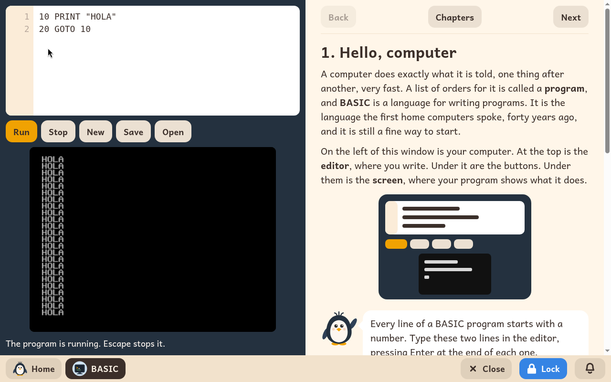

# BASIC

*[Versión en español](../../es/modules/basic.md)* · [Back to the user guide](../user-guide.md#9-learning-modules)

**BASIC** is the language the first home computers spoke, and it is still a good way to start writing programs. The module is a small computer of that time on the left, and a guide to it on the right.

| | |
|---|---|
| **For** | Children from 8 to 14 who read well |
| **Before it** | Scratch |
| **Needs** | Nothing from the internet |
| **Program** | [wwwBASIC](https://github.com/google/wwwbasic), by Google, under the Apache-2.0 licence, in an editor and a guide of Kidux's own |

## What it is

The left half has three parts: the editor at the top, where the child writes the program; a row of buttons; and the screen below, where the program shows what it does. **Run** runs the program, and so does Ctrl+Enter. A program that never ends is stopped with **Stop**, or with Escape. When a line has a mistake, the words under the screen say which line, and the editor marks it.

The right half is the guide, one chapter at a time, with **Back**, **Next** and the list of **Chapters**. The child reads a program there and types it into the editor. Each chapter ends with ideas to keep trying, and a box **For the adult** that says what the chapter teaches.

## The thirty chapters

1. Hello, computer
2. PRINT: the computer writes
3. LET: boxes with names
4. INPUT: talking with the computer
5. GOTO: jump!
6. IF: the computer decides
7. FOR and NEXT: the loop that counts
8. GOSUB and RETURN: a piece used many times
9. READ and DATA: a store of things
10. REM: notes to yourself
11. INT: whole numbers
12. RND: chance
13. Flowcharts: draw it first
14. Games to make
15. Saving your programs
16. Inside the computer
17. The fifth operation
18. What the computer does first
19. CLS: a clean screen
20. INPUT, more
21. FOR and NEXT, more
22. AND and OR
23. IF, more: menus
24. READ, DATA and RESTORE
25. DIM: a shelf of boxes
26. Putting things in order
27. Strings
28. CHR$ and ASC: the letters' numbers
29. Drawing, colour and sound
30. Programs to keep

## What an adult sets

| Setting | What it does |
|---|---|
| **Type it in for me** | A button under each program of the guide types it into the editor. Switched off, the child types every program. It is on to start with. |

The setting is in BASIC's **Settings** on the adult panel's Modules page, one column for each child.

## The child's files

The program in the editor stays there when BASIC is closed, until the child presses **New**. To keep a program, **Save** opens a window of the child's folders, in **Downloads**, to choose where to keep it and under what name, as a `.bas` file. **Open** opens the same window to bring one back.
