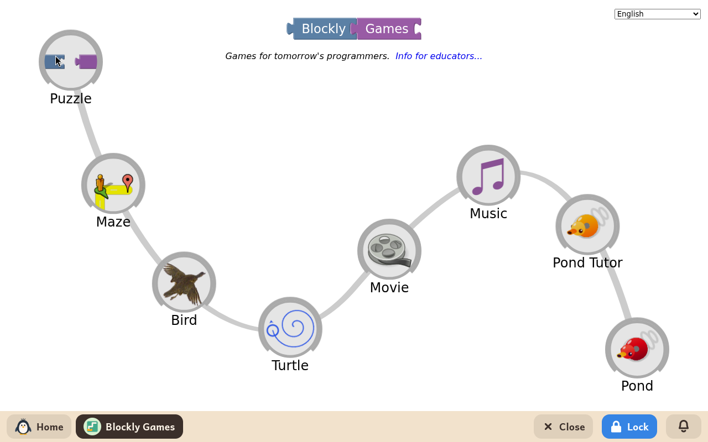
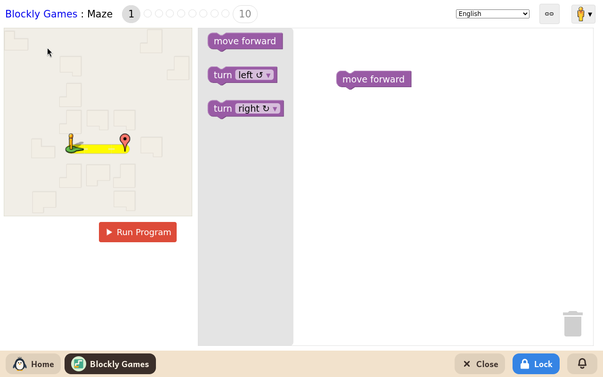

# Blockly Games

*[Versión en español](../../es/modules/blockly-games.md)* · [Back to the user guide](../user-guide.md#9-learning-modules)

**Blockly Games** is a series of interactive educational puzzles developed by Google to introduce computer science fundamentals and algorithmic thinking using visual coding blocks, following a gentle learning curve.

| | |
|---|---|
| **Recommended age** | Children from 6 to 12 years old with basic reading skills |
| **Recommended before** | ScratchJr |
| **Internet connection** | Not required (runs entirely offline on the local computer) |
| **Software used** | [Blockly Games](https://blockly.games/), developed by Google under the Apache-2.0 licence, packaged for offline execution in Kidux |

## What it is and how it works

Each game is organised into ten progressive levels. In the initial levels, children connect two or three simple movement blocks; in advanced levels, they learn how to create nested loops, mathematical comparisons, and conditional branches.

The child drags and snaps blocks together in the workspace, then clicks **Run** to check if their character follows the correct sequence to reach the objective. If the solution is incomplete or encounters an obstacle, visual hints help the child debug and try alternative ideas without penalties. All instructions, labels, and dialogues appear naturally in the child's configured language.

## Included activities

- **Maze**: teaches algorithmic sequencing, conditional turning, and repetition loops to navigate a character to the destination.
- **Bird**: introduces logical operators and conditional decision-making based on the bird's current position and state.
- **Turtle**: explores computational geometry by guiding a turtle that draws geometric shapes and intricate artistic patterns.
- **Movie**: demonstrates the relationship between mathematical functions and time to produce an animated short scene.
- **Music**: teaches algorithmic music composition, managing notes, rhythms, and multi-track polyphony.

## Additional notes

Progress in each puzzle level is saved automatically in the child's profile. If an adult removes the module and reinstalls it later, all completed levels remain intact. The activities do not create loose project files in the child's home directory.
