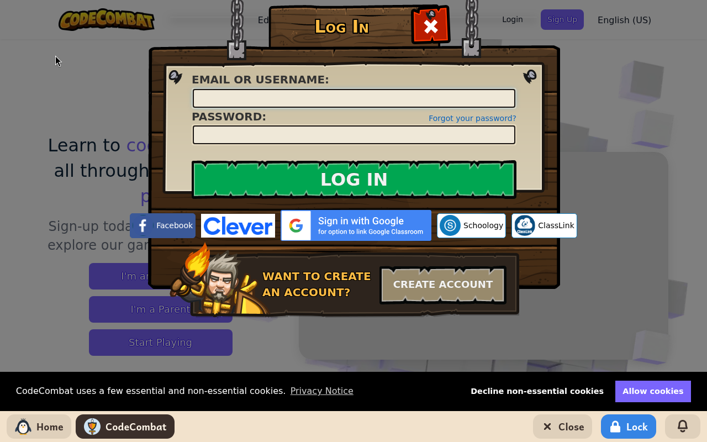
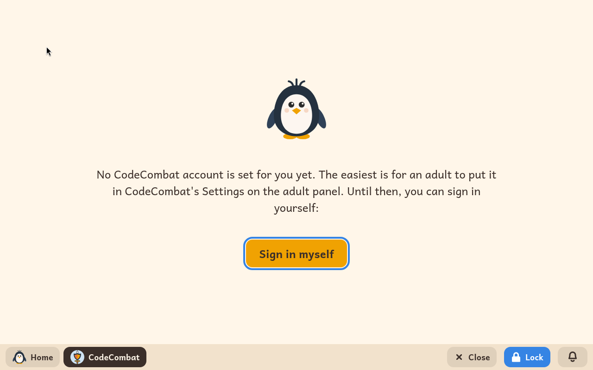

# CodeCombat

*[Versión en español](../../es/modules/codecombat.md)* · [Back to the user guide](../user-guide.md#9-learning-modules)

**CodeCombat** is a door to the CodeCombat website, where children learn to write real Python and JavaScript by playing: a hero walks through each level as the child's program tells it.

| | |
|---|---|
| **For** | Children from 9 to 16 |
| **Before it** | Scratch |
| **Needs** | The internet, and a CodeCombat account. The first levels are free; most of the site needs a subscription. |
| **Website** | [codecombat.com](https://codecombat.com/), by CodeCombat Inc. Kidux has no connection with CodeCombat. |

## What it is

The site is CodeCombat's, in the child's language. The module opens it and no other website: a link to anywhere else leads nowhere. The child writes a few lines of code, presses play, and the hero moves, fights or picks things up as the code says.

## What an adult sets

| Setting | What it does |
|---|---|
| **Email** | The email address of the child's CodeCombat account. |
| **Password** | Its password. Kidux signs the child in with it, and the child never sees it. |

With the account given, the module signs the child in by itself each time it is opened, saying *Connecting to CodeCombat…* meanwhile. It sets the site's language to the child's and opens where the playing starts. When the account is wrong or the site does not answer, the module says so and offers to try again.

Without an account given, the module says that the easiest is for an adult to put it in the panel, and offers a button to sign in by hand meanwhile.

## Good to know

- A subscription is bought on another computer, since the module opens no other site.
- Signing in through Google, Facebook or Clever leads nowhere here.
- The site may ask about its cookies the first time; that is the site's own question.
- What the child does on the site is kept by CodeCombat, in the account. Nothing is saved in the child's folders.
