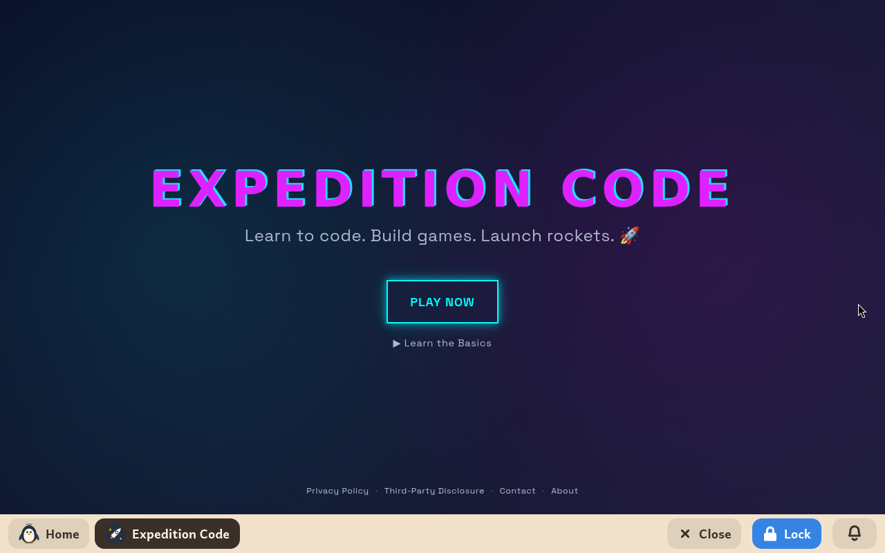

# Expedition Code

*[Versión en español](../../es/modules/expedition-code.md)* · [Back to the user guide](../user-guide.md#9-learning-modules) · Of the Kidux family: [Kydux, learn Python with magic](https://kydux.kidux.org)

**Expedition Code** is a coding game on its own website, where children complete missions by writing JavaScript-style code, alone or with up to two other players in a room.

| | |
|---|---|
| **Recommended age** | Children from 9 years old who have programmed before |
| **Recommended before** | Scratch |
| **Internet connection** | Required |
| **Language** | English only |
| **Account** | None: a name and an avatar the child chooses, and a secret phrase the site gives |
| **Price** | The site asks for no payment and names no price |
| **Web service** | [expeditioncode.com](https://www.expeditioncode.com/), by Sean Clark, in beta. Kidux is not affiliated with or endorsed by Expedition Code. |

## What it is and how it works

The module opens the Expedition Code website in a window of its own above the bar, and no other website. **Play now** shows the site's notice that it is a beta, then **Create new explorer**: the child types a name, chooses an avatar from a grid of pictures, and the site gives a secret phrase of three words to write down. On the same computer the site remembers the explorer by itself.

A mission is played in a room. The child opens one, **Create new room**, and the room shows a code of six letters; another player joins it by typing that code, on their own computer. A player alone plays the same. In a mission the child writes code with the toolbox's functions, runs it, and sees what it does on the mission's grid.

## Important notes

- **Playing with others**: a room is joined only with its code, which a player gives to another; there is no public list of rooms. The site shows scores and leaderboards.
- **The secret phrase**: it is the way back in from another computer, or after the browser's storage is lost, so it is worth writing down when the site shows it. Its **View Secret Phrase** shows it again on the computer where the explorer was made.
- **The code and the AI**: the code a child writes is sent to the site's AI provider, Anthropic, for hints and feedback, without a name.
- **The voice and the microphone**: the game reads its words aloud, and a child may say their code aloud instead of typing it. The editor's microphone button asks Chromium for the microphone, and Chromium asks the child whether to allow it; the voice goes through ElevenLabs.
- **The basics video**: the site's **Learn the Basics** is a video on YouTube, which stays closed here; **Esc** closes its empty frame. The site asks an adult to watch it with the child, on another device: [youtube.com/watch?v=VuWysb-EyrU](https://www.youtube.com/watch?v=VuWysb-EyrU).
- **The avatars' font**: the avatars are emoji, so the module brings a font of emoji, which other modules then use too.
- **What the site counts**: by its [privacy policy](https://www.expeditioncode.com/privacy), it shows no advertising, counts clicks with PostHog, which stays closed here, and page views with Vercel, its host, without cookies.
