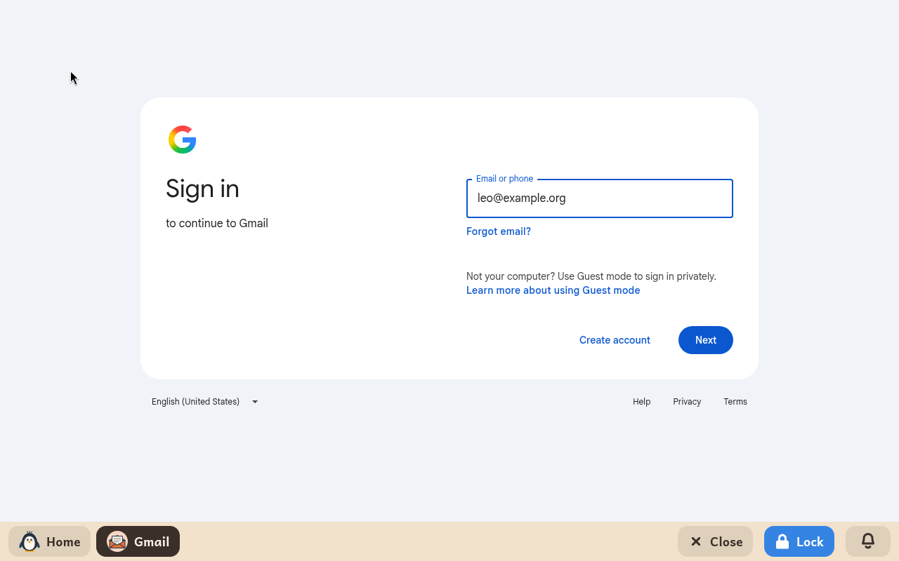

# Gmail

*[Versión en español](../../es/modules/gmail.md)* · [Back to the user guide](../user-guide.md#9-learning-modules)

**Gmail** is a door to Gmail's website, for a child with a Google account. It is Gmail as it is on any computer, in the child's language.

| | |
|---|---|
| **For** | Children from 8 up |
| **Needs** | The internet whenever it is used, and a Google account |
| **Website** | [mail.google.com](https://mail.google.com/), by Google. Kidux has no connection with Google. |

## What it is

The module opens Gmail's website and no other: a link out of it leads nowhere. It is the module for a child under thirteen, whose Google account is managed with Family Link and cannot sign in to [Mail](mail.md). It suits any Google account, for a family that prefers the website.

## What an adult sets

| Setting | What it does |
|---|---|
| **Email address** | The child's Google account. Google's sign-in page opens with it already written. |

The adult opens Gmail with the child the first time and signs in there, with the password and, if Google asks for it, the second step. Gmail stays signed in afterwards. Closing it, logging out or turning the computer off does not sign the child out, and Google asks again only when it chooses to. The password is typed only in Google's page; the panel never has it.

## Good to know

- The site may ask about its cookies the first time; that is Google's own question.
- Messages and attachments stay in Google's Gmail. Nothing is saved in the child's folders.
