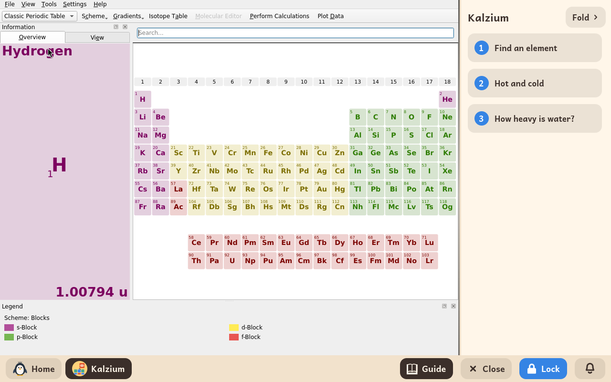

# Kalzium

*[Versión en español](../../es/modules/kalzium.md)* · [Back to the user guide](../user-guide.md#9-learning-modules)

**Kalzium** is an interactive periodic table of chemical elements developed by the KDE Education Project, designed for chemistry and science students.

| | |
|---|---|
| **Recommended age** | Students from 10 to 16 years old |
| **Internet connection** | Not required (all scientific data, tables, and media are installed locally) |
| **Software used** | [Kalzium](https://apps.kde.org/kalzium/), developed by the KDE community under the GPL-2 licence, packaged from Debian |

## What it is and how it works

Kalzium offers a clear, dynamic view of the periodic table of elements. Selecting any element opens a comprehensive data sheet with its chemical symbol, atomic number, standard atomic weight, discovery history, photographs of physical samples, Bohr electron orbital diagrams, and melting and boiling points.

The software includes rich interactive learning tools, such as a historical timeline showing when elements were discovered throughout history, an interactive temperature slider showing state changes (solid, liquid, gas), a molecular mass calculator, and an illustrated glossary of chemical terminology.

## Built-in interactive guide

Kidux complements Kalzium with a side-by-side interactive guide featuring three structured introductory lessons:

1. **Find an element**: navigating table periods, chemical groups, and blocks, and understanding element data sheets.
2. **Hot and cold**: using the temperature slider to observe phase transitions and identify elements with unusual melting points.
3. **How heavy is water?**: calculating molecular mass by summing constituent atomic weights (such as H₂O).

Clicking **Fold** at the top collapses the guide into a slim edge bar to give full width to the periodic table; clicking **Guide** on the bottom taskbar restores it at any time.

## Important notes

- **Safety and sandboxed actions**: External web help links and KDE Store add-on download dialogs have been deliberately disabled to ensure the child remains safely inside the offline desktop environment.
- **Preference storage**: Visual appearance settings and unit preferences are saved automatically within the child's profile without cluttering their personal documents folder.
