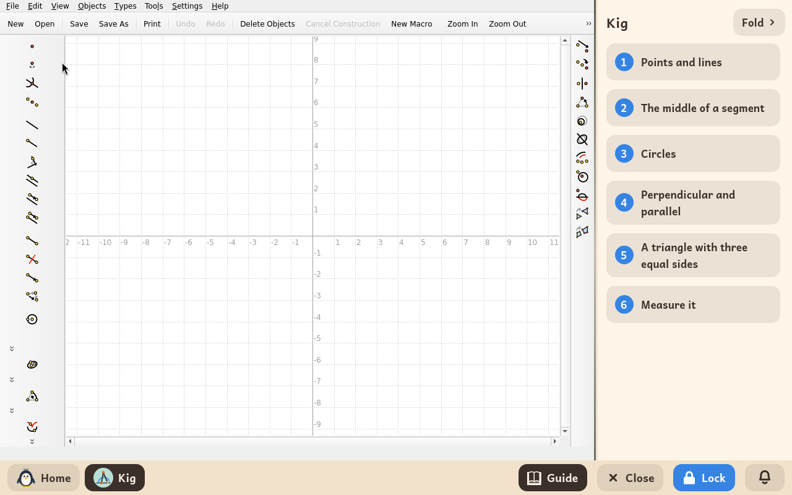
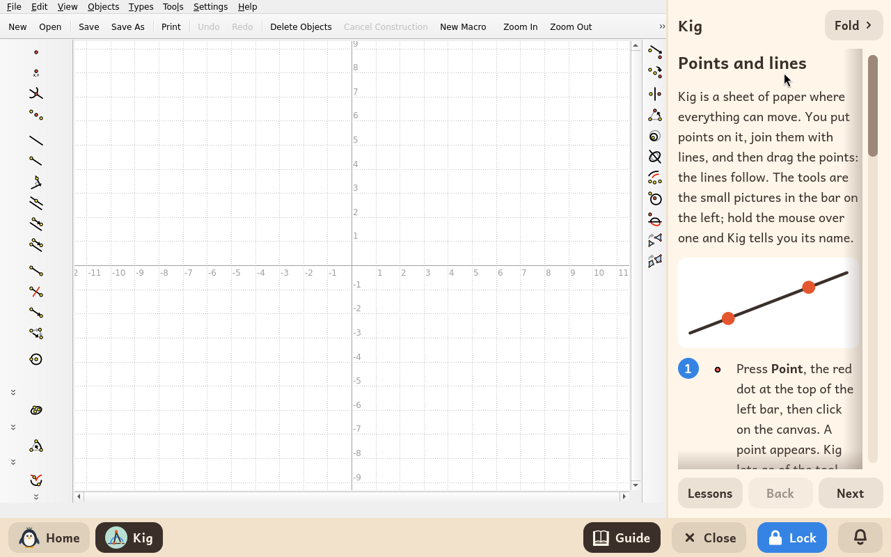
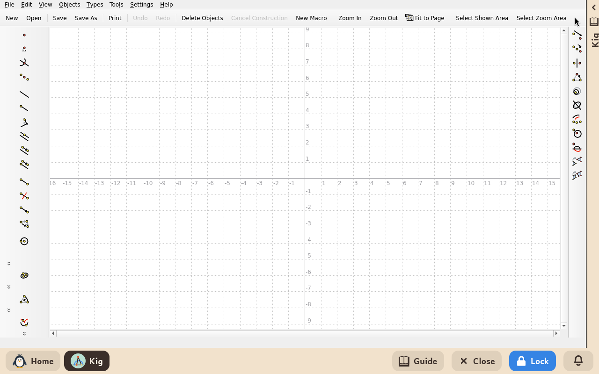

# Kig

*[Versión en español](../../es/modules/kig.md)* · [Back to the user guide](../user-guide.md#9-learning-modules)

**Kig** is an interactive dynamic geometry environment developed by the KDE Education Project. It allows students to construct mathematical figures—points, lines, polygons, circles, and conics—that strictly maintain their geometric properties when manipulated: a midpoint remains centered and parallel lines remain parallel when dragging any parent points.

| | |
|---|---|
| **Recommended age** | Children from 10 to 14 years old |
| **Recommended before** | GCompris |
| **Internet connection** | Not required (runs entirely offline on the local system) |
| **Software used** | [Kig](https://apps.kde.org/kig/), developed by the KDE community under the GPL-2 licence, packaged from Debian |

## What it is and how it works

Kig functions as an interactive geometric sketchbook. The side toolbar provides comprehensive construction tools: points, lines defined by two points, segments, circles, perpendiculars, parallels, midpoints, curve intersections, and real-time angle measurement.

Students can construct complex geometric figures and experimentally verify theorems: by dragging a vertex across the canvas with the mouse, the rest of the figure morphs dynamically while respecting all mathematical rules.

## Built-in interactive guide

Kidux pairs Kig with a side-by-side interactive guide featuring six structured lessons designed specifically for learners. Each step illustrates the required tool using its official name and icon. Four lessons include an interactive **mission**: a pre-configured geometry file with hands-on challenges, automatically copied into the child's personal folder (`Documents/Missions of Kig`) the first time the guide is opened.

1. **Points and lines**: placing free points, drawing lines through two points, assigning labels, and constructing triangles from line segments.
2. **The midpoint of a segment**: constructing invariant center points. Mission: `middle.kig`.
3. **Circles**: finding circle intersections and points constrained to circumferences. Mission: `two-circles.kig`.
4. **Perpendicular and parallel**: lines that preserve angular relations and constructing an indeformable square. Mission: `parallels.kig`.
5. **Equilateral triangle**: Euclid's classical compass-and-straightedge construction. Mission: `triangle.kig`.
6. **Dynamic measurement**: measuring angles and lengths in real time, demonstrating why a triangle's interior angles always sum to 180°.

Clicking **Fold** at the top of the side panel collapses the guide into a slim edge bar to give full screen width to the drawing canvas; clicking the folded strip or the **Guide** button on the bottom bar re-opens it instantly.

## Saving and managing files

Constructed drawings can be saved in `.kig` format using **File > Save**, safely stored inside the child's home folder. Missions can be accessed anytime via **File > Open > Documents > Missions of Kig**.

## Important notes

- **Offline safety**: Online documentation menus and KDE Store add-on download features are disabled to ensure the application stays fully within the local environment.
- **Blocked external links**: Any external hyperlink clicked inside the tool displays an informational tooltip stating that external internet access is disabled.
