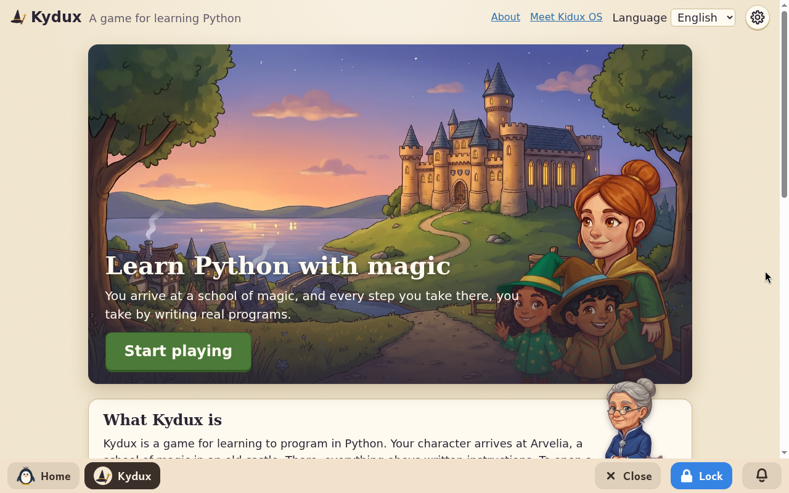

# Kydux

*[Versión en español](../../es/modules/kydux.md)* · [Back to the user guide](../user-guide.md#9-learning-modules) · Of the Kidux family: [Kydux, learn Python with magic](https://kydux.kidux.org)

**Kydux** is the Kidux family's own game for learning to program in Python, made as an [alternative to CodeCombat](https://kydux.kidux.org): a young wizard arrives at a school of magic, and every step there is taken by writing a little Python.

| | |
|---|---|
| **Recommended age** | Children from 8 years old who read comfortably |
| **Internet connection** | Required whenever it is used |
| **Languages** | English and Spanish: the child's |
| **Account** | None |
| **Price** | Free |
| **Web service** | [kydux.kidux.org](https://kydux.kidux.org), of the Kidux family. Free software under the GNU General Public License, version 3 or later; its code is at [github.com/othermore/kydux](https://github.com/othermore/kydux). |
| **Without Kidux** | The same game is played in any web browser, on any computer, at [kydux.kidux.org](https://kydux.kidux.org) |

## What it is and how it works

The game is a story told in chapters, a fun one that keeps the child interested. Short lessons explain the fundamental ideas of programming, and each level is solved with a small program the child writes with what they have learnt, which moves their wizard on the scene. It gets harder little by little, and there is help so that they do not get stuck.

The first time, the game asks whether it may use cookies, and then shows its welcome page and **Start playing**. The child makes their wizard, chooses its look and names their game.

## Important notes

- **The game is on its website**: the module opens Kydux in a window of its own above the bar, and no other website. What is new in the game arrives by itself the next time the module is opened, with nothing to install.
- **Cookies and what the game counts**: the game's notice says that it counts which stories, lessons and levels are opened, how long a level takes, how many times a program is run, the hints read and the stars earned; that it never sends the programs the child writes, the wizard's name or who the child is; and that it never asks for a name, an address or an account. The count is kept by Google Analytics, with cookies, only if the answer is yes. The game plays the same whatever the answer, and the answer can be changed on the game's settings page.
- **Saved games**: the game keeps each child's games on the computer, in their own Chromium storage for the module, and they are there the next day. They stay when the module is removed, and are found again when it is installed again. The game's start screen also keeps a game as a file (**Export**), in the folder the child chooses, their Downloads first, and opens one again (**Import a game**): the way to take a game to another computer, or to keep a copy.
- **The link to Kidux's website**: the game has a link to Kidux's website, which leads nowhere inside Kidux: Chromium shows a page saying it is blocked. **Alt+Left** goes back to the game, with nothing lost; when the page came up in a window of its own, **Ctrl+W** closes it.
- **The screen**: the game needs a screen of 1280 × 720 or more.
