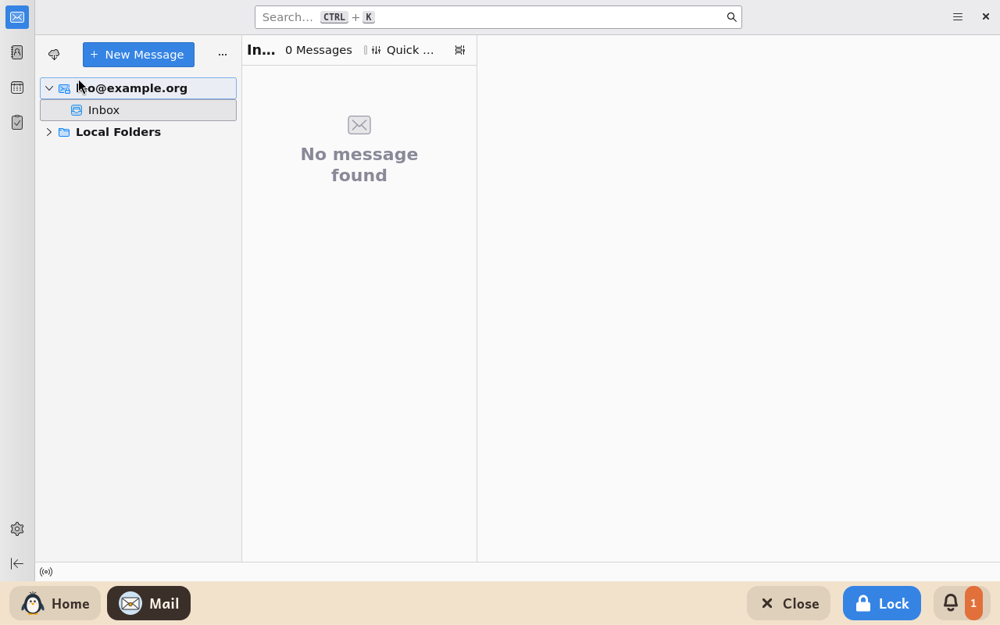
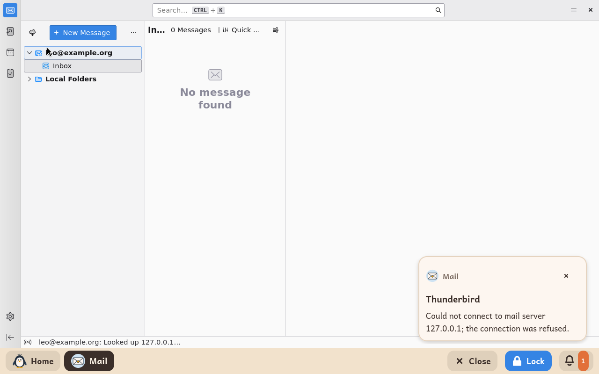

# Mail

*[Versión en español](../../es/modules/mail.md)* · [Back to the user guide](../user-guide.md#9-learning-modules)

**Mail** is a child-friendly desktop email client powered by Mozilla Thunderbird. It provides learners with a safe, streamlined mailbox to read and compose emails without needing to configure complex network settings, as account details are managed by adults in the settings panel.

| | |
|---|---|
| **Recommended age** | From 8 years old and up |
| **Internet connection** | Required to sync, send, and receive email messages; supports standard Gmail, Outlook, iCloud, or generic IMAP providers |
| **Software used** | [Thunderbird](https://www.thunderbird.net/), developed by MZLA Technologies and the Mozilla community under the MPL-2.0 licence, packaged from Debian |

## What it is and how it works

Kidux customises Thunderbird to isolate the core messaging workflow: children have clear access to their inbox, message list, and email composer, while extraneous features (such as public chat networks, extension stores, full web browsing, and advanced configuration menus) are completely disabled.

## Configuration options for adults

Adults configure mailbox parameters on the **Modules** tab of the adult settings panel:

| Setting | Description |
|---|---|
| **Email address** | The child's email address. Mail automatically detects server parameters for popular providers (Gmail, Outlook/Hotmail, iCloud, Yahoo, etc.). |
| **Name** | The sender display name shown to recipients on outgoing emails. |
| **Incoming server** | Required only if auto-discovery fails: the provider's IMAP host (e.g. `imap.example.org` or with port `imap.example.org:993`). |
| **Outgoing server** | The provider's outgoing SMTP server address (e.g. `smtp.example.org:465`). |

After saving settings in the panel, an adult should assist the child on first launch:
- **Google or Microsoft accounts**: an integrated sign-in window opens to enter credentials and verify two-factor authentication if configured.
- **Other email providers**: a single password prompt appears; tick "Remember password" to save credentials permanently.

Thunderbird keeps the mailbox password inside the child's own profile. The Kidux adult settings panel never sees or stores mailbox passwords.

## Important notes

- **Accounts managed by Google Family Link**: Children under thirteen whose Google accounts are supervised via Family Link cannot connect to external desktop clients like Thunderbird. Use the [Gmail](gmail.md) module for these accounts.
- **State enforcement**: Any manual changes to email accounts or manually added secondary addresses are discarded whenever Mail restarts; active configuration strictly mirrors the adult panel. If no email address is set in the panel, Mail opens showing only local disconnected folders.
- **Safe links and attachments**: Hyperlinks within message bodies are disabled to prevent untrusted web browsing. Received file attachments save safely into the child's **Downloads** folder without automatic execution.
- **Connection status notices**: If the mail server is unreachable or the internet connection drops, an unobtrusive notice appears above the taskbar and along the window status bar.

