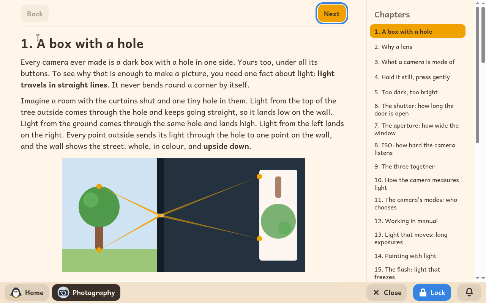

# Photography

*[Versión en español](../../es/modules/photography.md)* · [Back to the user guide](../user-guide.md#9-learning-modules)

**Photography** is an illustrated, hands-on learning course designed to teach children how to take photographs with a real camera: understanding camera mechanics, holding the camera steadily, and mastering exposure, focus, and visual composition.

| | |
|---|---|
| **Recommended age** | Children from 8 to 12 years old with comfortable reading fluency |
| **Technical requirements** | A digital camera (compact, bridge, mirrorless, or DSLR) and no internet connection |
| **Learning materials** | Produced by Kidux. Includes educational photographs published under open licences as well as clearly labelled explanatory computer graphics. |

## What it is and how it works

The guide is designed to work with any camera offering manual or creative mode dials, and can even be used with a smartphone camera to learn foundational concepts. As a consistent real-world reference, the lessons feature the advanced compact camera Olympus XZ-2: a dedicated callout box (**On the Olympus XZ-2**) in each chapter explains exactly which dial or button to use, noting common alternative terms used by other manufacturers.

Each chapter pairs concise theoretical principles with sample photographs, diagrams of the camera's display screen, and a practical assignment (**Try it**) to practice with the camera right away. In addition, an adult guidance box (**For the adult**) suggests collaborative exercises (such as setting up a dark room, using a torch, exploring the flash, or shooting outdoor dusk scenes).

## The thirty chapters

1. A box with a hole
2. Why a lens
3. What a camera is made of
4. Hold it still, press gently
5. Too dark, too bright
6. The shutter: how long the door is open
7. The aperture: how wide the window
8. ISO: how hard the camera listens
9. The three together
10. How the camera measures light
11. The camera's modes: who chooses
12. Working in manual
13. Light that moves: long exposures
14. Painting with light
15. The flash: light that freezes
16. Focus: where the camera looks
17. Focus modes: once, following, by hand
18. Depth of field: how much is sharp
19. Very close: macro
20. Zoom: near and far, and what it does to faces
21. Where to put things: the rule of thirds
22. Lines, frames and patterns
23. Backgrounds, and tidying up
24. Point of view
25. Light has a time and a side
26. Colour, and no colour
27. People and moments
28. Looking at your photographs
29. Choosing, and telling a story
30. The words of photography

## Important notes

The lessons and interactive guides are viewed on the computer, while the hands-on photography assignments take place with a real camera away from the screen. The module does not store loose project files in the child's home folder.
