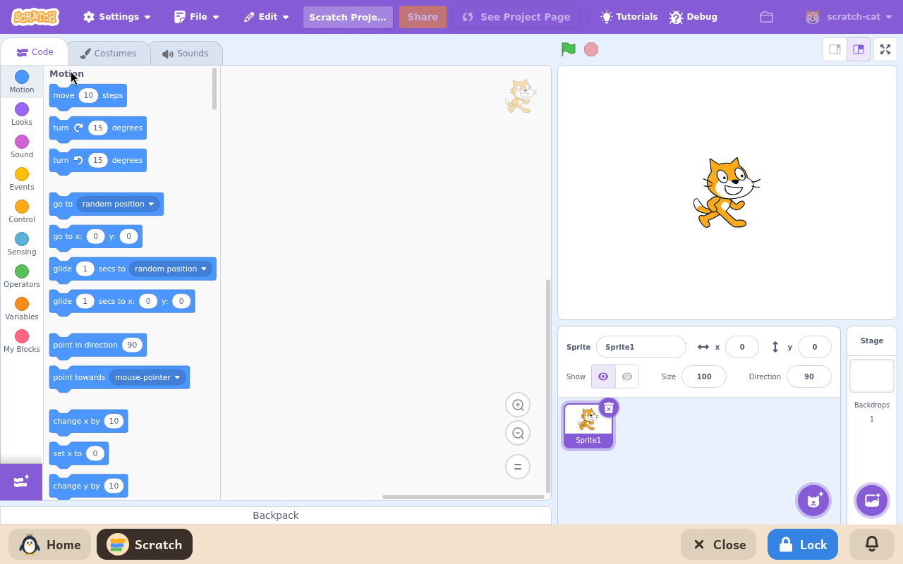

# Scratch

*[Versión en español](../../es/modules/scratch.md)* · [Back to the user guide](../user-guide.md#9-learning-modules)

**Scratch** is the widely acclaimed visual block-based programming environment developed by the MIT Media Lab and the Scratch Foundation. It enables learners to create interactive video games, animated stories, and simulations by connecting colourful code blocks.

| | |
|---|---|
| **Recommended age** | Children and teenagers from 8 to 16 years old |
| **Recommended before** | ScratchJr |
| **Internet connection** | Optional (only used to download media assets from the official sprites, backdrops, and sound library; all coding, editing, and running work 100% offline) |
| **Software used** | [Scratch Desktop](https://scratch.mit.edu/), developed by the Scratch Foundation under the AGPL-3 licence, built by Kidux for local execution |

## What it is and how it works

Kidux runs the full official Scratch desktop editor locally on the machine in the child's configured language. To protect child privacy and eliminate online distractions, the public social networking features of the Scratch website are removed: projects are not published to the internet, and outside users cannot contact the child.

The workspace contains all the standard Scratch tools: the real-time stage viewport, sprite and backdrop lists, full block palettes (motion, looks, sound, events, control, sensing, operators, variables, and custom blocks), and integrated bitmap/vector costume and sound editors.

## Included features

- **Complete visual editor**: full set of standard Scratch blocks, layer management, and audio effects.
- **Media asset library**: official sprites, backdrops, and instrument recordings, safely cached from Scratch servers when browsing the asset gallery.
- **Creative editors**: built-in vector drawing canvas to design custom sprites and backdrops, plus a microphone sound recorder.
- **Guided tutorial cards**: step-by-step illustrated project cards that guide beginners through animation and game mechanics. Their videos do not play, because they are on a website, and a module shows only its own pages.

## Saving and loading projects

To save a project, click **File > Save to your computer**. A standard file chooser opens to select a destination folder and file name inside the child's personal folder. To resume work on an existing file, click **File > Load from your computer**.

Saved projects use the standard `.sb3` format and are fully interchangeable with [TurboWarp](turbowarp.md) and any standard Scratch installation on other computers.
