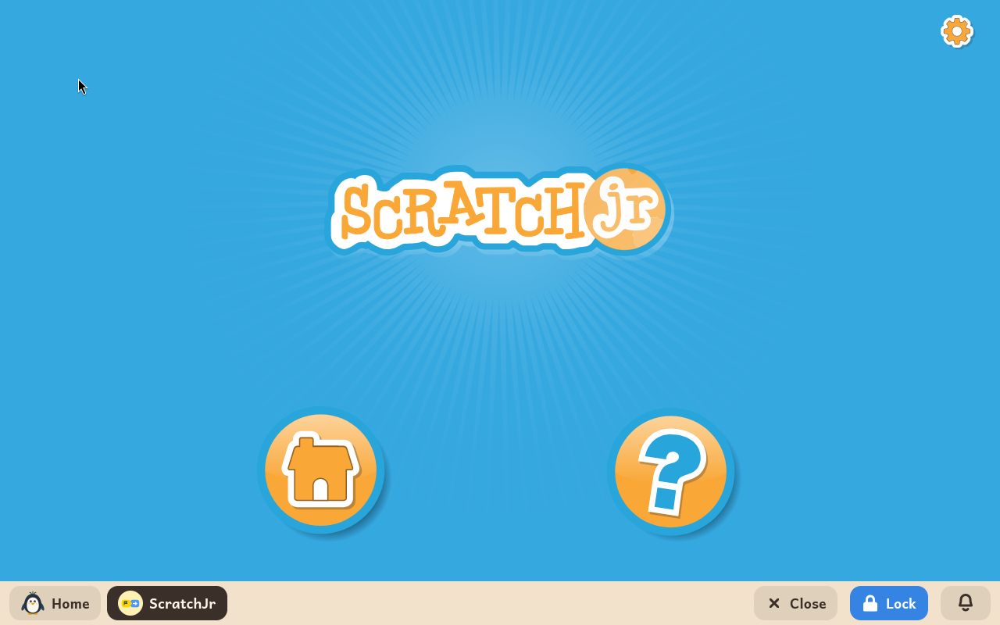

# ScratchJr

*[Versión en español](../../es/modules/scratchjr.md)* · [Back to the user guide](../user-guide.md#9-learning-modules)

**ScratchJr** is an introductory coding platform specifically designed for early learners aged 5 to 7. Children can animate interactive characters and create simple games and stories by snapping together intuitive graphical blocks, without needing to be fluent readers.

| | |
|---|---|
| **Recommended age** | Children from 5 to 7 years old (early childhood and early elementary) |
| **Internet connection** | Not required (runs entirely offline without network access) |
| **Software used** | [ScratchJr](https://www.scratchjr.org/), developed collaboratively by the MIT Media Lab, Tufts University, and the Playful Invention Company under the BSD-3 licence |

## What it is and how it works

In ScratchJr, code blocks snap together horizontally using clear graphic symbols rather than written words. The child selects an animal or character, drags movement blocks into a script, and taps the green flag to run the animation.

Characters can walk, jump, turn, change size, play recorded sounds, or respond to collisions. The wordless visual interface empowers young children to explore storytelling, sequential thinking, and problem solving independently.

## Included features

- **Characters and backdrops**: an extensive library of colourful characters and environments, accompanied by an easy-to-use paint tool for custom drawings.
- **Action and control blocks**: motion, rotation, speech bubbles, timed pauses, and repetition loops.
- **Multi-scene stories**: capability to link multiple scenes together into complete narrative storybooks.
- **Voice recording**: children can record their own voices using the computer's microphone to give custom voices to characters.

## Saving projects and storage

Projects save automatically in real time while the child creates, stored inside `Documents/ScratchJR` within the child's home folder. If the module is ever uninstalled to save space, saved creations remain untouched and are immediately available upon reinstallation.

*Technical note*: ScratchJr runs within a dedicated standalone desktop runtime (approximately 380 MB), so package installation may take a few minutes depending on your internet connection.
