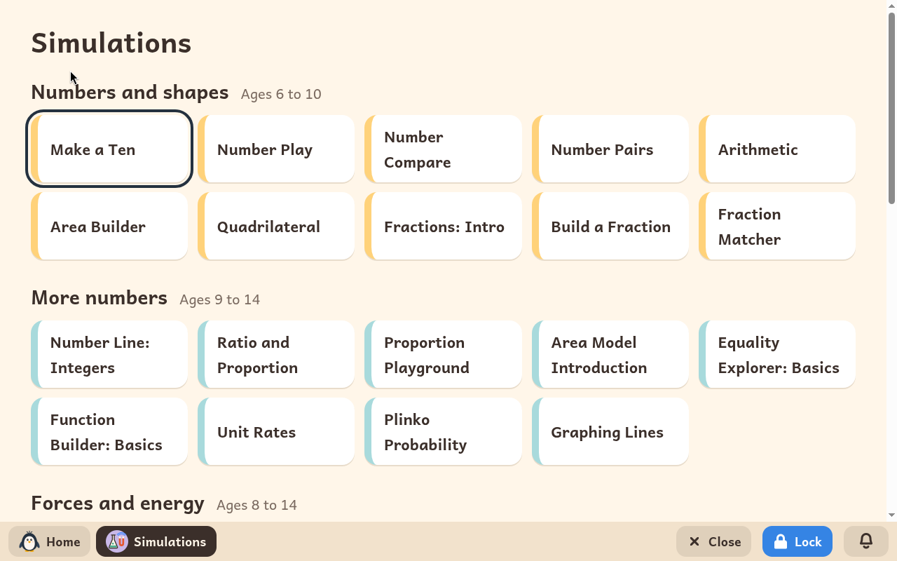
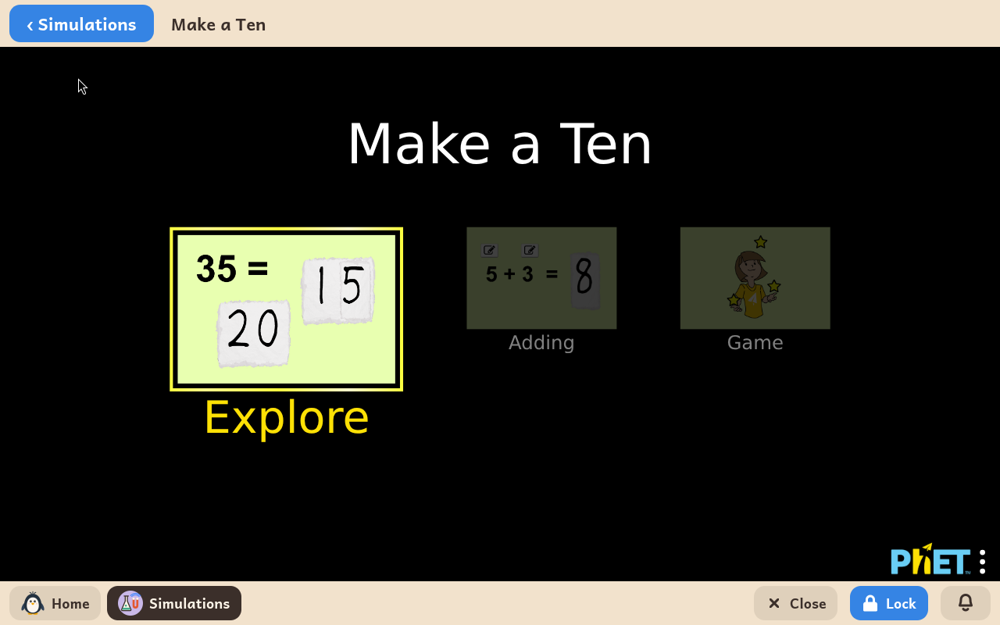

# Simulations

*[Versión en español](../../es/modules/simulations.md)* · [Back to the user guide](../user-guide.md#9-learning-modules)

**Simulations** are experiments to play with on the screen: build a number, balance a seesaw, bend a ray of light, rub a balloon on a sweater, build an atom, put planets in orbit.

| | |
|---|---|
| **For** | Children from 6 to 14 |
| **Needs** | Nothing from the internet: the simulations are on the computer |
| **Program** | [PhET Interactive Simulations](https://phet.colorado.edu/), by the University of Colorado Boulder, the versions published under the CC BY 4.0 licence. Kidux is not connected with PhET. |

## What it is

PhET's simulations are used in schools everywhere. Kidux has chosen fifty-one of them for children from six to fourteen and sorted them by group and age, in a page of its own, in the child's language. Each one opens in its own frame, with **Simulations** at the top to come back to the list.

## What is inside

**Numbers and shapes**, ages 6 to 10: Make a Ten, Number Play, Number Compare, Number Pairs, Arithmetic, Area Builder, Quadrilateral, Fractions: Intro, Build a Fraction, Fraction Matcher.

**More numbers**, ages 9 to 14: Number Line: Integers, Ratio and Proportion, Proportion Playground, Area Model Introduction, Equality Explorer: Basics, Function Builder: Basics, Unit Rates, Plinko Probability, Graphing Lines.

**Forces and energy**, ages 8 to 14: Forces and Motion: Basics, Balancing Act, Friction, Energy Skate Park: Basics, Energy Forms and Changes, Masses and Springs: Basics, Pendulum Lab, Projectile Motion, Gravity Force Lab: Basics.

**Light, sound and waves**, ages 8 to 14: Color Vision, Bending Light, Geometric Optics: Basics, Waves Intro, Wave on a String.

**Electricity and magnets**, ages 8 to 14: Balloons and Static Electricity, John Travoltage, Magnet and Compass, Magnets and Electromagnets, Circuit Construction Kit: DC.

**Matter and atoms**, ages 9 to 14: States of Matter: Basics, Gases Intro, Density, Buoyancy: Basics, Build an Atom, Build a Molecule, Concentration, pH Scale: Basics.

**Earth, space and life**, ages 8 to 14: Gravity and Orbits, My Solar System, Greenhouse Effect, Under Pressure, Natural Selection.

## Good to know

- Each simulation says, under it, that it is by PhET Interactive Simulations, University of Colorado Boulder, under CC BY 4.0, as PhET asks.
- Nothing is saved in the child's folders.
