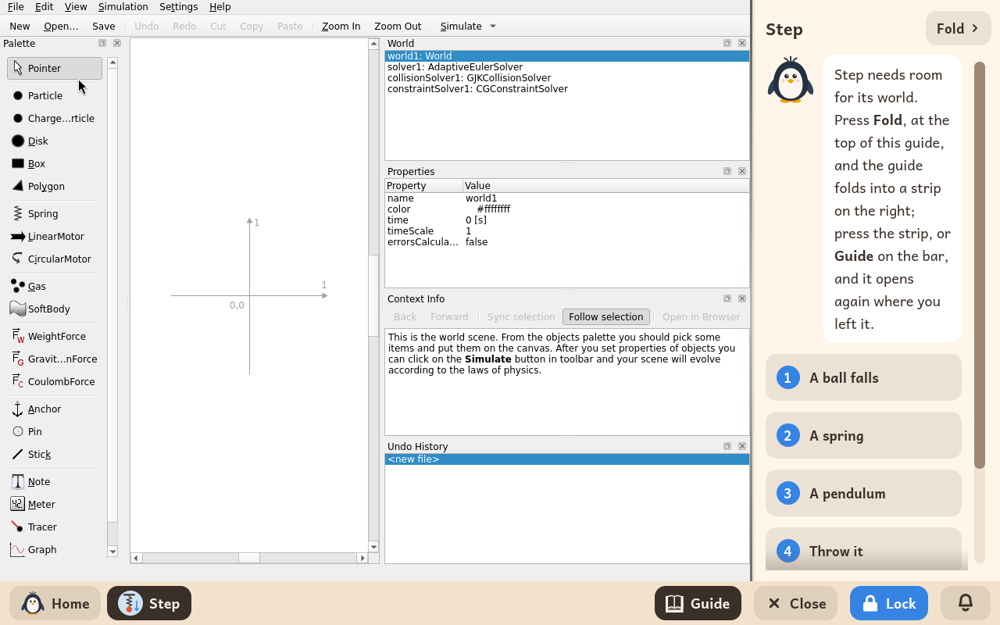

# Step

*[Versión en español](../../es/modules/step.md)* · [Back to the user guide](../user-guide.md#9-learning-modules)

**Step** is an interactive two-dimensional physical simulator developed by the KDE Education Project. It enables learners to build virtual mechanical experiments on a canvas by placing bodies, springs, ropes, and forces to simulate motion laws, collision dynamics, and energy conservation in real time.

| | |
|---|---|
| **Recommended age** | Students from 10 to 16 years old |
| **Recommended before** | Simulations |
| **Internet connection** | Not required (runs entirely offline without network access) |
| **Software used** | [Step](https://apps.kde.org/step/), developed by the KDE community under the GPL-2 licence, packaged from Debian |

## What it is and how it works

Step provides an extensive palette of mechanical entities: point particles, circular discs, rigid rectangular bodies, linear springs, mechanical motors, force fields, gravitational pulls, fixed anchors, and virtual sensors.

The student places bodies into the world, specifies physical properties (such as mass, initial velocity, friction, or spring stiffness) in the properties inspector, and clicks **Simulate**. The simulation engine numerically solves the equations of motion in real time, rendering vector paths and dynamic plots. The **File > Examples** menu offers a wide assortment of classic physics experiments ready to run.

## Built-in interactive guide

Kidux complements Step with a side-by-side interactive guide featuring six structured lessons. Five of them include a dedicated **lab mission**: a pre-configured project file with interactive challenges, automatically copied into the student's `Documents/Missions of Step` folder on first access:

1. **A ball falls**: gravitational acceleration and graphical plotting of free fall. Mission: `fall.step`.
2. **A spring**: harmonic oscillators with two masses and spring constant variations. Mission: `spring.step`.
3. **A pendulum**: rigid rods with weights and isochronism in small oscillations. Mission: `pendulum.step`.
4. **Throw it**: two-dimensional projectile trajectories and horizontal launch curves. Mission: `throw.step`.
5. **Measure it**: configuring meters, velocity vectors, and real-time graphs.
6. **Bounce and crash**: elastic and inelastic collisions and momentum conservation. Mission: `bounce.step`.

To provide maximum screen space for the physical canvas, the **Fold** button at the top collapses the guide; clicking **Guide** on the bottom taskbar reopens it right where the student left off.

## Saving files and missions

Custom experiments can be saved in `.step` format using **File > Save** inside the student's personal documents folder. Lab missions are accessed via **File > Open > Documents > Missions of Step**.

## Important notes

- **Sandbox isolation**: Online community experiment downloads and external web help links are disabled to maintain an isolated, distraction-free environment.
- **External links**: Clicking any web reference within the context information pane displays an informational notice that external internet access is disabled.
