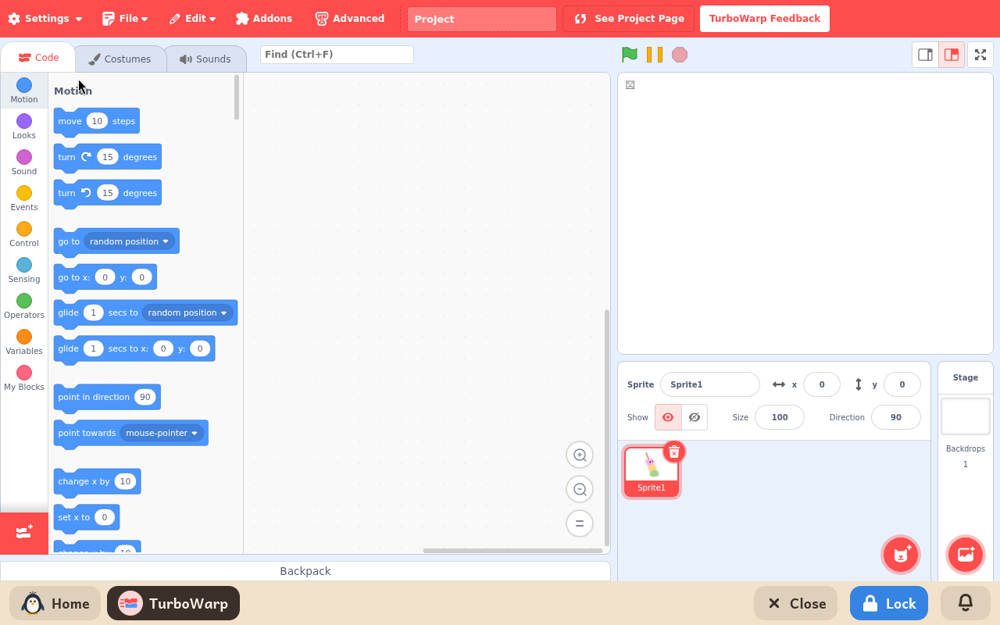

# TurboWarp

*[Versión en español](../../es/modules/turbowarp.md)* · [Back to the user guide](../user-guide.md#9-learning-modules)

**TurboWarp** is Scratch made faster: the same editor, the same blocks and the same project files, with a compiler that runs projects many times faster.

| | |
|---|---|
| **For** | Children from 8 to 16 |
| **Before it** | ScratchJr |
| **Needs** | The internet to open its library of characters, backdrops and sounds. Everything else works without it. |
| **Program** | [TurboWarp](https://turbowarp.org/), by the TurboWarp project, under the GPL-3 licence, built by Kidux to run on the computer |

## What it is

Choose TurboWarp instead of Scratch on a slower computer, or when Scratch does not run well on this one. A child who knows Scratch finds everything in the same place.

## What is inside

The same as Scratch: the editor, the library (from the internet), the paint and sound editors. On top of that, TurboWarp's own settings for speed and for a larger stage.

## The child's files

As in Scratch: **File**, then **Save to your computer**, chooses where to keep the project in the child's folders, and **Load from your computer** brings it back. A project is opened from a file only. TurboWarp cannot fetch one from the Scratch website by its number.
