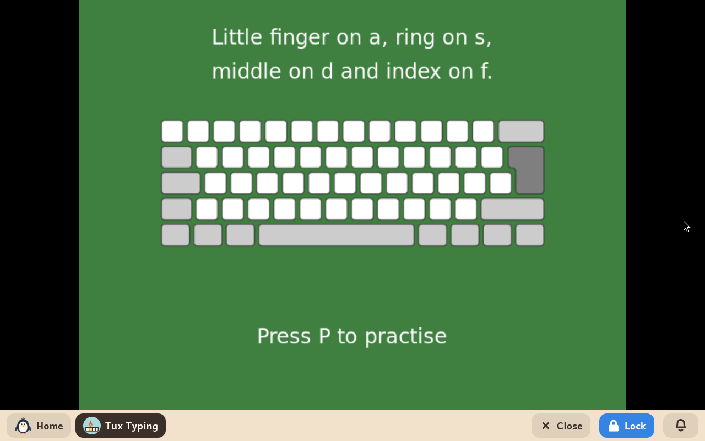
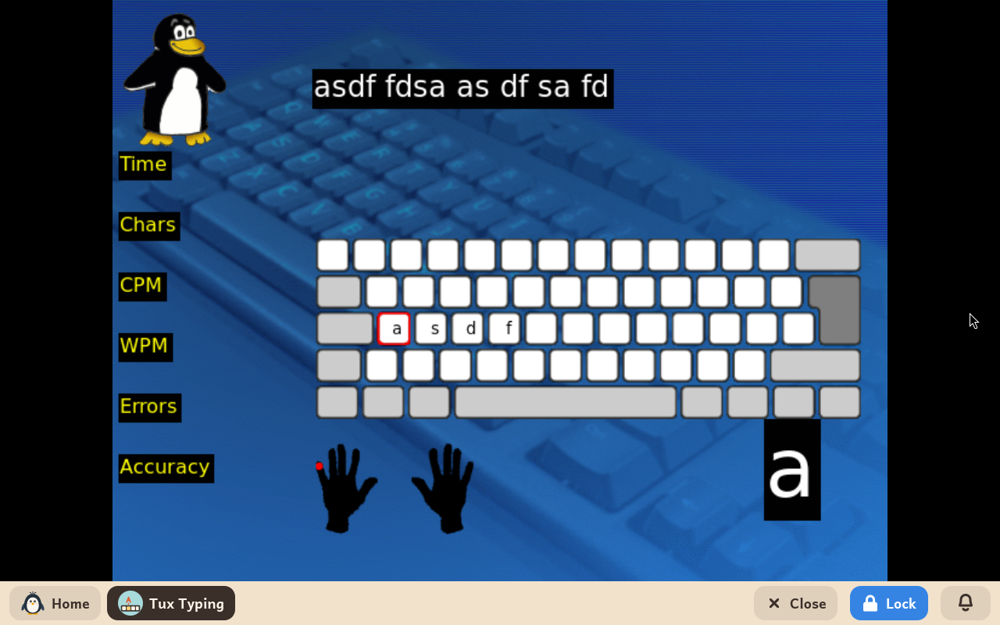

# Tux Typing

*[Versión en español](../../es/modules/tuxtype.md)* · [Back to the user guide](../user-guide.md#9-learning-modules)

**Tux Typing** is a classic arcade-style educational typing game starring Tux the Linux Penguin. It helps children master keyboard layout, improve typing speed, and build muscle memory through playful arcade challenges.

| | |
|---|---|
| **Recommended age** | Children from 6 to 12 years old |
| **Recommended before** | GCompris (for initial familiarity with letters and keyboard keys) |
| **Internet connection** | Not required (runs completely offline without internet connectivity) |
| **Software used** | [Tux Typing](https://github.com/tux4kids/tuxtype), developed by the Tux4Kids community under the GPL-2 licence, packaged from Debian |

## What it is and how it works

In Tux Typing's arcade games, letters or complete words fall from the sky. The child must type each letter before it hits the ground so Tux can eat the falling fish or blast incoming asteroids. As players advance through stages, falling speeds increase and vocabulary words become longer.

The interface and gameplay dictionaries are translated into the child's configured language, so children practice typing words in their native language.

## Game modes

- **Fish Cascade**: falling individual letters; ideal for learning key positions across the keyboard.
- **Comet Zap**: falling words that must be typed accurately before impact.
- **Lessons**: Kidux's typing course, described below.

## Typing lessons

Kidux brings a course of its own of twelve lessons, in English or in Spanish as the child's language is, which teaches touch typing with all ten fingers in the classic order: the home row first (a s d f and j k l ;), then the top row and last the bottom one, with the comma and the full stop.

- **Choosing a lesson**: on the main menu, **Lessons** shows the list, from "Lesson 01 - a s d f" to "Lesson 12 - x z and stop". A lesson is chosen with the mouse, or with the arrows and Enter.
- **Each lesson's steps**: a first page brings the new keys (**Enter** to go on); the second shows which finger types each of them over a drawn keyboard; **P** starts the practice of those keys and, once it is done, a second practice with words made only of letters already learnt.
- **During the practice**: the line to type is at the top; below, the next key large and, over the drawn hands, a red dot on the finger that types it. At the end, Tux celebrates with the time, the errors and the accuracy.
- **Leaving**: **Esc** leaves the practice or the lesson at any moment.

## Important notes

- **High scores and achievements**: Game progress, high scores, and unlocked stages are saved internally by the application without cluttering the child's personal documents folder.
- **What the course does not cover yet**: Capital letters and accented letters.
- **Display resolution**: As a legacy graphical application, choosing a scaled display mode (indicated by an asterisk `*` in the adult panel's System tab) may cause slight graphical softening. Selecting an unscaled native resolution restores crisp rendering.
