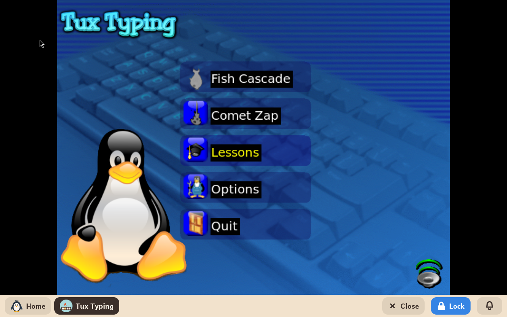

# Tux Typing

*[Versión en español](../../es/modules/tuxtype.md)* · [Back to the user guide](../user-guide.md#9-learning-modules)

**Tux Typing** teaches a child to type. Letters and words fall from the sky, and the child catches each one by typing it, one level harder each time.

| | |
|---|---|
| **For** | Children from 6 to 12 |
| **Before it** | GCompris, which teaches the keyboard's letters first |
| **Needs** | Nothing from the internet |
| **Program** | [Tux Typing](https://github.com/tux4kids/tuxtype), by Tux4Kids, under the GPL-2 licence, from Debian |

## What it is

Tux the penguin stands at the bottom of the screen, and letters fall towards him. The child types each letter before it lands, and Tux eats it. Later, whole words fall. The levels get faster, and the words get longer.

Its menus are in the child's language, and so are the words that fall: a Spanish-speaking child catches Spanish words.

## What is inside

- **Fish Cascade**, where single letters fall;
- **Comet Zap**, where words fall and the child types them whole;
- lessons that go through the keyboard a few keys at a time, with the fingers to use;
- a practice mode where the child types a text at their own pace.

## Good to know

- Tux Typing keeps its scores and its settings for itself, not in the child's folders. Removing the module keeps them for when it comes back.
- It is an older program, made for the X11 display system. On a screen size marked with \* on the adult panel's System page it can look a little blurred; a size without \* fixes that.
