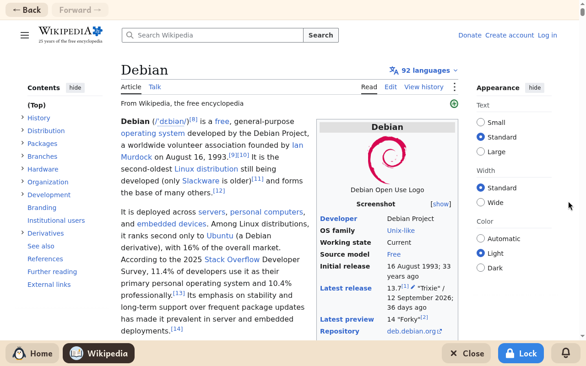

# Wikipedia

*[Versión en español](../../es/modules/wikipedia.md)* · [Back to the user guide](../user-guide.md#9-learning-modules)

**Wikipedia** provides filtered, secure access to the comprehensive free encyclopedia and its sister educational projects (such as Wiktionary and Wikibooks) in the child's configured language.

| | |
|---|---|
| **Recommended age** | From 8 years old and up (at the adult's discretion, as Wikipedia is an open general encyclopedia) |
| **Internet connection** | Required at all times to fetch encyclopedia articles and multimedia |
| **Web service** | [wikipedia.org](https://www.wikipedia.org/), operated by the Wikimedia Foundation and volunteer contributors |

## What it is and how it works

This module opens a sandboxed browser window restricted strictly to Wikipedia and sister educational domains (such as Wiktionary, Wikidata, Wikimedia Commons, and Wikibooks). To protect young learners, all external web links, external reference citations, and social media sites are strictly blocked.

Content is the full, authentic Wikipedia encyclopedia. Children can search for topics, read rich articles with illustrations and diagrams, and explore cross-links between related concepts seamlessly.

## Navigation controls

A slim top navigation bar provides essential browsing controls:
- **Back** and **Forward**: navigate between visited articles in history (buttons are dimmed when no further history is available).
- **Keyboard and mouse shortcuts**: standard keyboard shortcut **Alt + Left Arrow** and mouse thumb back buttons work seamlessly.

## Important notes

- **Storage**: Reading articles does not store files in the child's documents folder.
- **Adult supervision**: Because Wikipedia is an open general encyclopedia covering a wide range of human knowledge, adults can choose which children have the module enabled based on maturity and study requirements.
