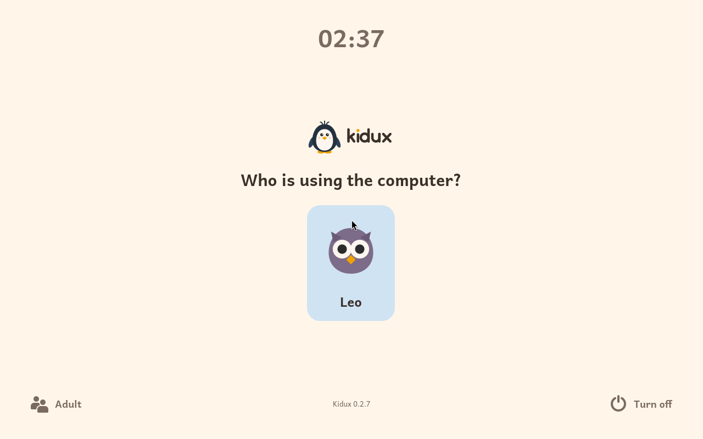
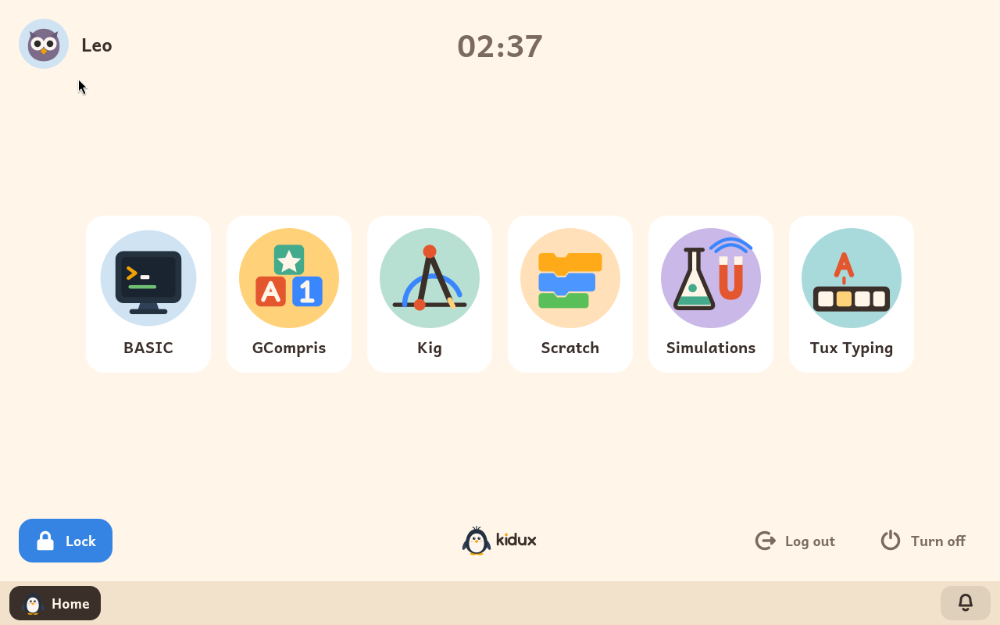

# Trying Kidux in an emulator

*[Versión en español](../es/try.md)*

**Kidux can be tried on the computer you use every day, before giving it a
computer of its own.** An emulator, a program that runs a whole computer
inside a window, starts Kidux from an image ready for it, with a family
already in it: one child and the learning modules switched on for them.
Nothing is installed on your computer besides the emulator, and closing the
window leaves everything as it was.

It is Kidux whole, not a demonstration: the same system the installer
puts on a computer, with its sign-in screen, the child's screen, the
time limits, the lock screen and the adult panel. It updates itself from
Kidux's archive like any Kidux computer.

| | |
|---|---|
| **The child** | **Leo**, password `leo`. |
| **The adult password**, which opens the adult panel | `kidux` |
| **The administrator**, for the text console, which a trial does not need | `anna`, password `kidux` |
| **Learning modules installed and switched on for Leo** | BASIC, Tux Typing, Scratch, GCompris, Simulations and Kig. The adult panel installs more. |
| **Time** | Leo has no time limit, so that you can try at leisure. The adult panel sets one. |
| **Languages** | One image in Spanish and one in English. |
| **What it needs** | 4 GB of memory free for the emulator, and about 10 GB of disk. |

Once it has started, Kidux shows its sign-in screen with Leo, and after
Leo's password, Leo's own screen with the modules:





## Which image, for which emulator

| Your computer | The emulator | The image |
|---|---|---|
| **Windows** | [VirtualBox](https://www.virtualbox.org/), free | [kidux-trial-en.ova](https://iso.kidux.org/kidux-trial-en.ova) |
| **Mac with an Intel processor** | VirtualBox, or [UTM](https://mac.getutm.app/) | the `.ova` for VirtualBox, the `.qcow2` for UTM |
| **Mac with an Apple processor** (M1 and later) | [UTM](https://mac.getutm.app/), free | [kidux-trial-en.qcow2](https://iso.kidux.org/kidux-trial-en.qcow2) |
| **Linux** | QEMU, or VirtualBox | the `.qcow2` for QEMU, the `.ova` for VirtualBox |

The Spanish images are `kidux-trial-es.ova` and `kidux-trial-es.qcow2`, at
the same address. Each file is about 1.5 GB. Their SHA-256 sums are
in [SHA256SUMS](https://iso.kidux.org/SHA256SUMS).

## Windows, or a Mac or Linux, with VirtualBox

1. Install VirtualBox, and download the `.ova` image.
2. In VirtualBox, choose **File > Import Appliance**, choose the image,
   and press **Finish**. VirtualBox makes a machine with two processors
   and 4 GB of memory.
3. Choose the machine, press **Settings**, and under **System >
   Motherboard** tick **Enable EFI (special OSes only)**: Kidux starts
   with UEFI, as a computer bought in the last ten years does. Press
   **OK**.
4. Press **Start**. Kidux's logo appears, and then its sign-in screen
   with Leo.

To see Kidux's screens whole, make the window at least 1280 by 800, or
use **View > Full-screen Mode**.

## A Mac with UTM

1. Install UTM, and download the `.qcow2` image.
2. In UTM, choose **Create a New Virtual Machine**, then **Emulate**, then
   **Other**. Leave **Boot Device** as **None**, and press **Continue**.
3. On **Hardware**, choose the architecture **x86_64** and the system
   **Standard PC (Q35 + ICH9)**, give it **4096 MB** of memory and **2**
   cores, and continue. On **Storage**, continue as it is; it is replaced
   in a moment. Skip **Shared Directory**, and on **Summary** call it
   *Kidux* and press **Save**.
4. Open the machine's settings. Under **Drives**, delete the drive UTM
   made, then press **New**, choose **Import**, the interface **VirtIO**,
   and the `.qcow2` image. Under **QEMU**, leave **UEFI Boot** ticked.
   Press **Save**.
5. Start the machine. Kidux's logo appears, and then its sign-in screen
   with Leo.

On a Mac with an Apple processor, UTM emulates a whole PC processor,
since Kidux is made for PCs: everything works, but slowly, much more
slowly than on a real computer. On a Mac with an Intel processor UTM, or
VirtualBox, runs it at full speed.

## Linux with QEMU

Install QEMU and its UEFI firmware (on Debian or Ubuntu, the packages
`qemu-system-x86` and `ovmf`), download the `.qcow2` image, and in the
folder it is in, start it with:

```
qemu-system-x86_64 -enable-kvm -cpu host -m 4096 -smp 2 -machine q35 \
    -bios /usr/share/ovmf/OVMF.fd \
    -drive file=kidux-trial-en.qcow2,if=virtio \
    -vga none -device VGA,xres=1280,yres=800 \
    -device qemu-xhci -device usb-tablet -nic user,model=virtio-net-pci
```

Kidux's logo appears, and then its sign-in screen with Leo. Every change
made while trying is kept in the image file itself; a fresh download
starts again from the beginning.

## What a trial cannot show

- **The real computer's own parts**: its Wi-Fi, its lid, its battery, its
  brightness and volume keys. Inside an emulator Kidux sees the emulator's
  network as a cable, and no battery or lid.
- **The speed of a real computer.** An emulator is slower than the same
  computer running Kidux itself, and much slower when it emulates a
  different processor.
- **Keys the computer keeps for itself.** Some combinations, such as
  Ctrl+Alt+Del, reach the computer around the emulator rather than Kidux.

When you have seen enough, [the user guide](user-guide.md#2-installing-kidux)
explains how to install Kidux on a computer of its own.
