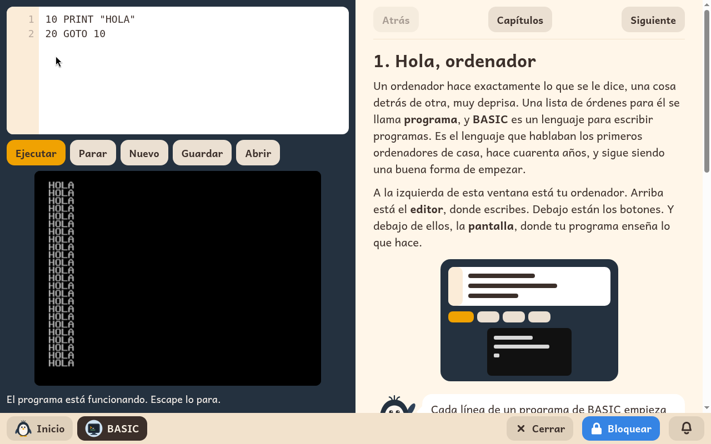

# BASIC

*[English version](../../en/modules/basic.md)* · [Volver al manual](../user-guide.md#9-módulos-de-aprendizaje)

**BASIC** es el lenguaje que hablaban los primeros ordenadores de casa, y sigue siendo una buena forma de empezar a escribir programas. El módulo es un pequeño ordenador de aquella época a la izquierda, y una guía para usarlo a la derecha.

| | |
|---|---|
| **Para** | Niños de 8 a 14 años que ya leen bien |
| **Antes** | Scratch |
| **Necesita** | Nada de internet |
| **Programa** | [wwwBASIC](https://github.com/google/wwwbasic), de Google, bajo la licencia Apache-2.0, en un editor y una guía propios de Kidux |

## Qué es

La mitad izquierda tiene tres partes: arriba el editor, donde el niño escribe el programa; una fila de botones; y debajo la pantalla, donde el programa enseña lo que hace. **Ejecutar** pone el programa en marcha, y Ctrl+Intro también. Un programa que no termina nunca se para con **Parar**, o con Escape. Cuando una línea tiene un error, las palabras de debajo de la pantalla dicen qué línea es, y el editor la marca.

La mitad derecha es la guía, un capítulo cada vez, con **Atrás**, **Siguiente** y la lista de **Capítulos**. El niño lee allí un programa y lo escribe en el editor. Cada capítulo termina con ideas para seguir probando, y un recuadro **Para el adulto** que dice lo que enseña el capítulo.

## Los treinta capítulos

1. Hola, ordenador
2. PRINT: el ordenador escribe
3. LET: cajas con nombre
4. INPUT: hablar con el ordenador
5. GOTO: ¡salta!
6. IF: el ordenador decide
7. FOR y NEXT: el bucle que cuenta
8. GOSUB y RETURN: un trozo que se usa muchas veces
9. READ y DATA: un almacén de cosas
10. REM: notas para ti
11. INT: números enteros
12. RND: el azar
13. Diagramas de flujo: dibújalo antes
14. Juegos para hacer
15. Guardar tus programas
16. Dentro del ordenador
17. La quinta operación
18. Qué hace primero el ordenador
19. CLS: una pantalla limpia
20. INPUT, más
21. FOR y NEXT, más
22. AND y OR
23. IF, más: menús
24. READ, DATA y RESTORE
25. DIM: una estantería de cajas
26. Poner las cosas en orden
27. Cadenas
28. CHR$ y ASC: los números de las letras
29. Dibujo, color y sonido
30. Programas para guardar

## Qué ajusta un adulto

| Ajuste | Qué hace |
|---|---|
| **Escríbemelo** | Un botón debajo de cada programa de la guía lo escribe en el editor. Apagado, el niño escribe todos los programas. Empieza encendido. |

El ajuste está en los **Ajustes** de BASIC de la página Módulos del panel de adulto, una columna por niño.

## Los archivos del niño

El programa del editor se queda allí cuando se cierra BASIC, hasta que el niño pulsa **Nuevo**. Para conservar un programa, **Guardar** abre una ventana con las carpetas del niño, en **Descargas**, para elegir dónde guardarlo y con qué nombre, como un archivo `.bas`. **Abrir** abre la misma ventana para traerlo de vuelta.
