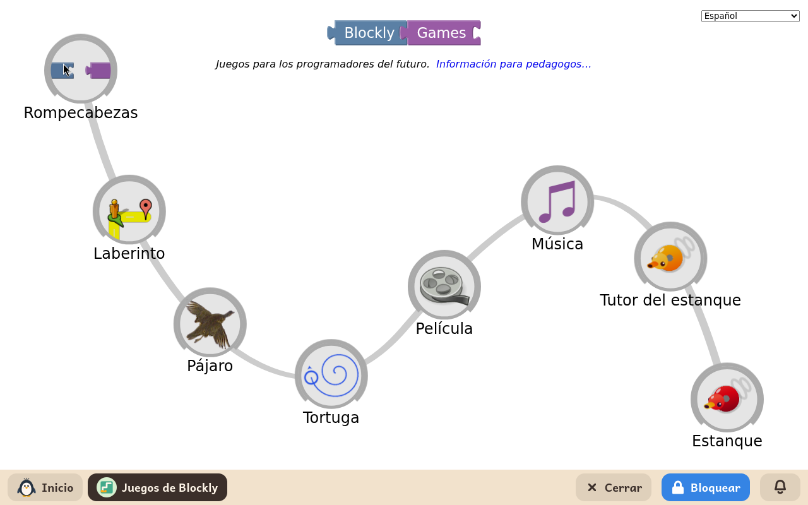
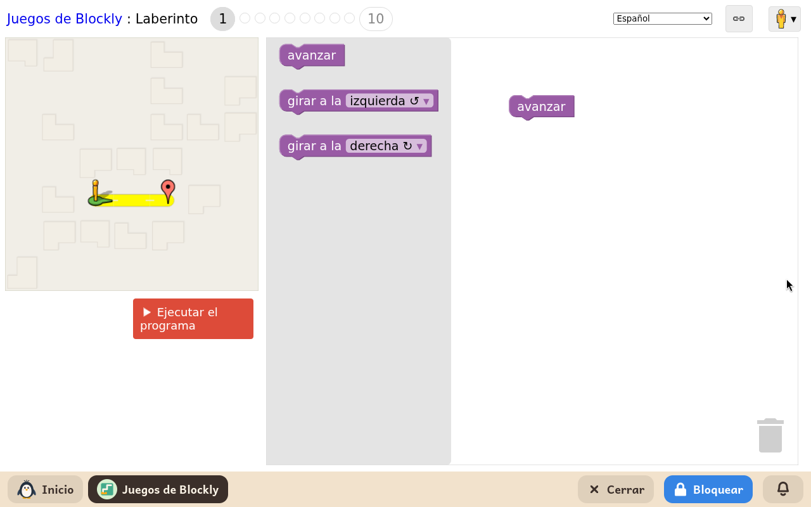

# Juegos de Blockly

*[English version](../../en/modules/blockly-games.md)* · [Volver al manual](../user-guide.md#9-módulos-de-aprendizaje)

**Juegos de Blockly** es una serie de rompecabezas interactivos desarrollados por Google para introducir los conceptos esenciales de la informática y el pensamiento computacional mediante bloques visuales, con una curva de dificultad suave y progresiva.

| | |
|---|---|
| **Edad recomendada** | Niños de 6 a 12 años con nociones básicas de lectura |
| **Módulos recomendados antes** | ScratchJr |
| **Conexión a internet** | No requerida (las actividades están instaladas localmente en el equipo) |
| **Software utilizado** | [Blockly Games](https://blockly.games/), desarrollado por Google bajo licencia Apache-2.0, empaquetado para su ejecución local en Kidux |

## Qué es y cómo funciona

Cada juego se divide en diez niveles progresivos. En los primeros niveles basta con unir dos o tres bloques sencillos de movimiento; en los niveles avanzados, el menor aprende a formular condiciones complejas, bucles anidados y operaciones matemáticas.

El niño arrastra y encaja los bloques en la zona de trabajo y pulsa **Ejecutar** para comprobar si su personaje realiza la secuencia correcta y alcanza la meta. Si la solución falla, el sistema muestra sugerencias visuales para probar alternativas sin penalización. Todas las instrucciones y mensajes se muestran de forma clara en el idioma preferido del menor.

## Actividades incluidas

- **Laberinto**: enseña secuencias lógicas, giros condicionales y bucles para guiar a un personaje hasta la salida del mapa.
- **Pájaro**: introduce el concepto de ramificación y toma de decisiones utilizando operadores lógicos y condiciones según la posición del pájaro.
- **Tortuga**: enseña geometría computacional guiando a una tortuga que dibuja figuras regulares y patrones complejos con bucles repetitivos.
- **Película**: introduce la relación entre variables matemáticas y el tiempo para construir una breve escena animada.
- **Música**: enseña a programar partituras musicales, gestionando notas, duraciones y polifonía a varias voces simultáneas.

## Información adicional

El progreso en cada nivel se guarda automáticamente en el perfil del niño. Si un adulto desinstala el módulo y lo vuelve a instalar más adelante, los niveles completados y el avance se conservan intactos. Las actividades no generan archivos dispersos en las carpetas personales del menor.
