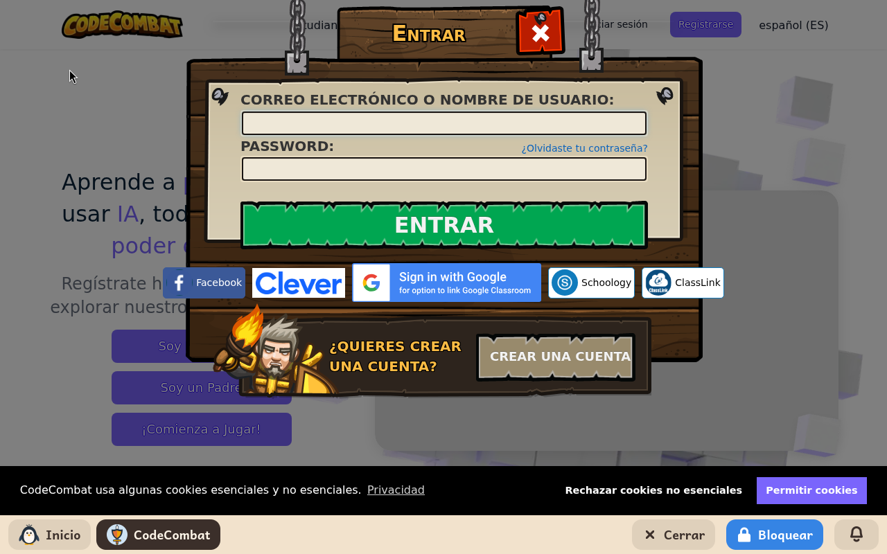
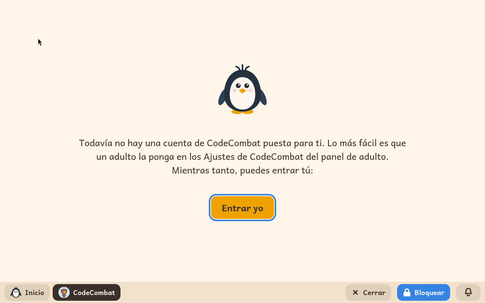

# CodeCombat

*[English version](../../en/modules/codecombat.md)* · [Volver al manual](../user-guide.md#9-módulos-de-aprendizaje)

**CodeCombat** es una puerta a la web de CodeCombat, donde los niños aprenden a escribir Python y JavaScript de verdad jugando: un héroe recorre cada nivel como le dice el programa del niño.

| | |
|---|---|
| **Para** | Niños de 9 a 16 años |
| **Antes** | Scratch |
| **Necesita** | Internet y una cuenta de CodeCombat. Los primeros niveles son gratis; casi toda la web necesita una suscripción. |
| **Web** | [codecombat.com](https://codecombat.com/), de CodeCombat Inc. Kidux no tiene ninguna relación con CodeCombat. |

## Qué es

La web es de CodeCombat, en el idioma del niño. El módulo la abre a ella y a ninguna otra: un enlace a cualquier otro sitio no lleva a ninguna parte. El niño escribe unas líneas de código, pulsa reproducir, y el héroe se mueve, lucha o recoge cosas según dice el código.

## Qué ajusta un adulto

| Ajuste | Qué hace |
|---|---|
| **Correo** | La dirección de correo de la cuenta de CodeCombat del niño. |
| **Contraseña** | Su contraseña. Kidux entra con ella, y el niño nunca la ve. |

Con la cuenta puesta, el módulo entra solo cada vez que se abre, diciendo *Conectándose a CodeCombat…* mientras tanto. Pone la web en el idioma del niño y abre donde se empieza a jugar. Si la cuenta no es correcta o la web no contesta, el módulo lo dice y ofrece intentarlo otra vez.

Sin cuenta puesta, el módulo dice que lo más fácil es que un adulto la ponga en el panel, y ofrece un botón para entrar a mano mientras tanto.

## Conviene saber

- La suscripción se compra desde otro ordenador, porque el módulo no abre ninguna otra web.
- Entrar con Google, Facebook o Clever no lleva a ninguna parte aquí.
- La web puede preguntar por sus cookies la primera vez; esa pregunta es de la propia web.
- Lo que el niño hace en la web lo guarda CodeCombat, en la cuenta. No se guarda nada en las carpetas del niño.
