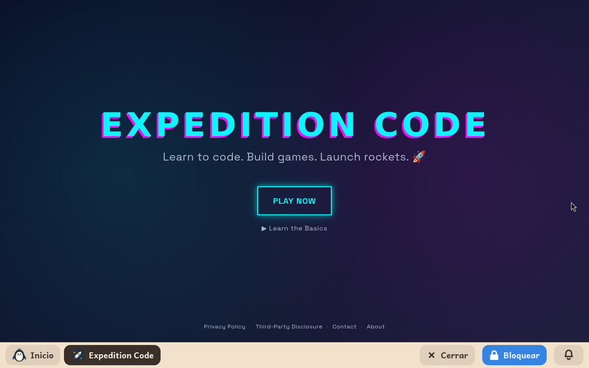

# Expedition Code

*[English version](../../en/modules/expedition-code.md)* · [Volver al manual](../user-guide.md#9-módulos-de-aprendizaje) · De la familia Kidux: [Kydux, aprende Python con magia](https://kydux.kidux.org)

**Expedition Code** es un juego de programación en su propia web, donde los niños completan misiones escribiendo código al estilo de JavaScript, a solas o con hasta otros dos jugadores en una sala.

| | |
|---|---|
| **Edad recomendada** | Niños a partir de 9 años que ya hayan programado antes |
| **Módulos recomendados antes** | Scratch |
| **Conexión a internet** | Requerida |
| **Idioma** | Solo inglés |
| **Cuenta** | Ninguna: un nombre y un avatar que elige el niño, y una frase secreta que da la web |
| **Precio** | La web no pide ningún pago ni dice ningún precio |
| **Servicio web** | [expeditioncode.com](https://www.expeditioncode.com/), de Sean Clark, en fase beta. Kidux no está afiliado ni vinculado con Expedition Code. |

## Qué es y cómo funciona

El módulo abre la web de Expedition Code en una ventana propia por encima de la barra, y ninguna otra web. **Play now** muestra el aviso de la web de que está en fase beta, y después **Create new explorer**: el niño escribe un nombre, elige un avatar en una cuadrícula de dibujos, y la web le da una frase secreta de tres palabras para apuntarla. En el mismo ordenador la web recuerda al explorador ella sola.

Una misión se juega en una sala. El niño abre una, **Create new room**, y la sala muestra un código de seis letras; otro jugador entra escribiendo ese código, desde su propio ordenador. Un jugador solo juega igual. En una misión el niño escribe código con las funciones de la caja de herramientas, lo ejecuta y ve lo que hace en la cuadrícula de la misión.

## Notas importantes

- **Jugar con otros**: a una sala solo se entra con su código, que un jugador le da a otro; no hay ninguna lista pública de salas. La web muestra puntuaciones y clasificaciones.
- **La frase secreta**: es la forma de volver a entrar desde otro ordenador, o si se pierde el almacenamiento del navegador, así que conviene apuntarla cuando la web la enseña. Su botón **View Secret Phrase** la vuelve a mostrar en el ordenador donde se creó el explorador.
- **El código y la IA**: el código que escribe el niño se envía al proveedor de IA de la web, Anthropic, para dar pistas y comentarios, sin ningún nombre.
- **La voz y el micrófono**: el juego lee sus textos en voz alta, y el niño puede decir su código en voz alta en lugar de escribirlo. El botón del micrófono del editor le pide el micrófono a Chromium, y Chromium le pregunta al niño si lo permite; la voz pasa por ElevenLabs.
- **El vídeo de introducción**: **Learn the Basics** es un vídeo de YouTube, que aquí sigue cerrado; **Esc** cierra su marco vacío. La web pide a un adulto que lo vea con el niño, en otro dispositivo: [youtube.com/watch?v=VuWysb-EyrU](https://www.youtube.com/watch?v=VuWysb-EyrU).
- **La letra de los avatares**: los avatares son emoji, así que el módulo trae una letra de emoji, que después usan también los demás módulos.
- **Lo que cuenta la web**: según su [política de privacidad](https://www.expeditioncode.com/privacy), no muestra publicidad, cuenta los clics con PostHog, que aquí sigue cerrado, y las páginas vistas con Vercel, su alojamiento, sin cookies.
