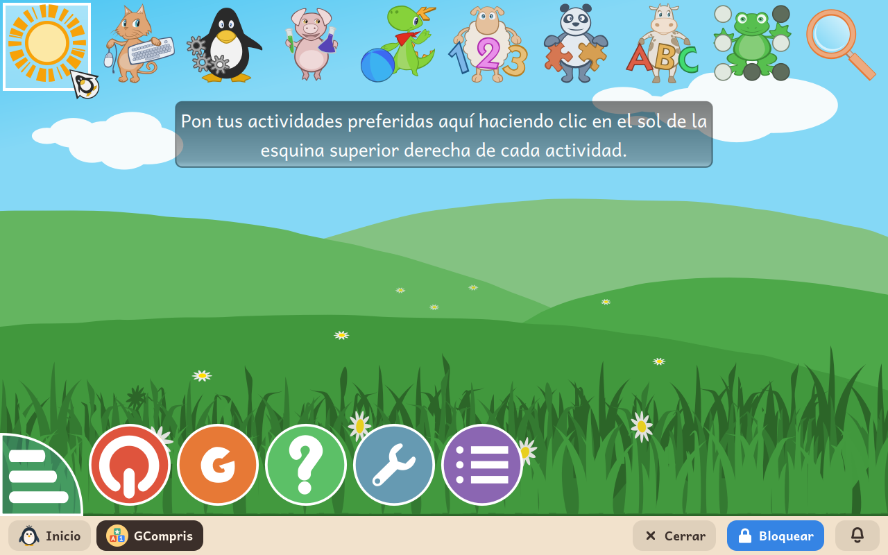

# GCompris

*[English version](../../en/modules/gcompris.md)* · [Volver al manual](../user-guide.md#9-módulos-de-aprendizaje)

**GCompris** es una completa suite educativa de software libre que ofrece más de un centenar de actividades interactivas para niños de entre 2 y 10 años, abarcando desde el aprendizaje de las letras y los números hasta conceptos de ciencia, geografía y manejo del ratón y el teclado.

| | |
|---|---|
| **Edad recomendada** | Niños de 2 a 10 años |
| **Conexión a internet** | Requerida únicamente durante las primeras ejecuciones para descargar las locuciones de voz y recursos multimedia adicionales. Una vez descargados, funciona completamente sin conexión. |
| **Software utilizado** | [GCompris](https://gcompris.net/), desarrollado por la comunidad internacional de GCompris bajo licencia GPL-3, empaquetado oficialmente desde Debian |

## Qué es y cómo funciona

GCompris reúne una amplia colección de minijuegos y retos pedagógicos adaptados al desarrollo infantil. Los más pequeños pueden escuchar la pronunciación de las letras del abecedario, aprender a asociar cantidades con dibujos, reconocer figuras geométricas y adquirir destreza psicomotriz utilizando el ratón y el teclado de forma gradual y amena.

El programa está íntegramente traducido y doblado con voces naturales en el idioma del niño, lo que permite su uso autónomo incluso antes de dominar la lectoescritura.

## Categorías de actividades incluidas

Las actividades se organizan por áreas de conocimiento claramente diferenciadas por iconos:

- **Lectura y escritura**: reconocimiento de letras, fonética, formación de palabras y juegos de vocabulario.
- **Matemáticas y lógica**: conteo numérico, sumas, restas, lectura del reloj analógico y digital, y manejo de monedas.
- **Ciencia y geografía**: mapas interactivos del mundo, experimentos sobre el ciclo del agua y nociones básicas de física.
- **Destreza digital**: ejercicios guiados para familiarizarse con el cursor del ratón, el doble clic, el teclado y el dibujo libre.

Cada actividad incluye indicadores visuales que señalan el nivel de dificultad y la edad recomendada. GCompris se muestra a pantalla completa sobre la barra inferior de Kidux; pulsar el botón **Inicio** de la barra permite salir y regresar cómodamente al lanzador principal.

## Aspectos a tener en cuenta

- **Descarga de voces**: Para optimizar el tamaño de instalación inicial, los paquetes de audio y voces narradas se descargan automáticamente de internet cuando se seleccionan por primera vez las actividades que los requieren. El panel de adultos informa de este proceso antes de la instalación.
- **Privacidad y archivos**: El avance, los dibujos y las puntuaciones se gestionan de forma interna dentro de la aplicación, sin generar archivos temporales ni carpetas sueltas en el directorio del menor.
