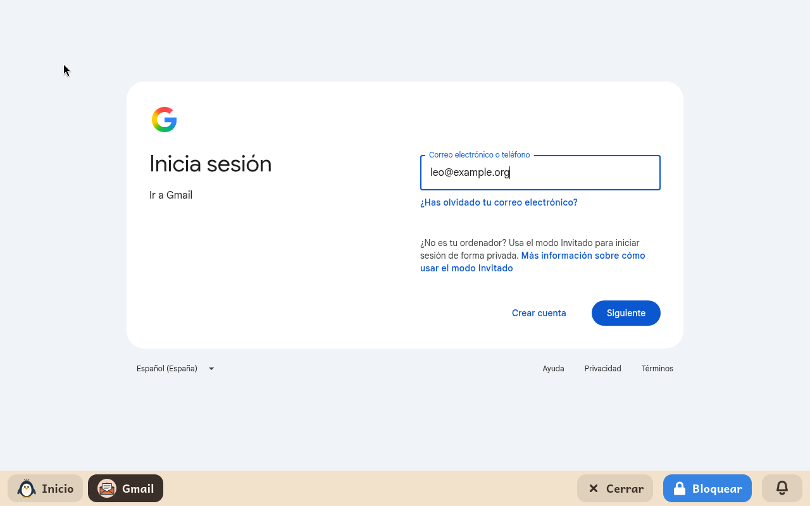

# Gmail

*[English version](../../en/modules/gmail.md)* · [Volver al manual](../user-guide.md#9-módulos-de-aprendizaje)

**Gmail** ofrece acceso directo, seguro y aislado a la interfaz web de correo electrónico de Google en el idioma configurado para el menor.

| | |
|---|---|
| **Edad recomendada** | A partir de 8 años |
| **Conexión a internet** | Requerida en todo momento para enviar y recibir correo electrónico |
| **Servicio web** | [mail.google.com](https://mail.google.com/), propiedad de Google LLC. Kidux no guarda relación comercial ni afiliación con Google. |

## Qué es y cómo funciona

Este módulo proporciona una ventana segura y restringida exclusivamente al servicio web oficial de Gmail. Por razones de seguridad y protección de menores, el sistema bloquea cualquier intento de navegar fuera del servicio de correo (como el buscador de Google, YouTube o sitios web externos enlazados en los mensajes).

Es el módulo recomendado para cuentas de menores de trece años supervisadas mediante **Google Family Link**, ya que las políticas de seguridad de Google impiden la sincronización de estas cuentas infantiles en clientes de escritorio convencionales (como el módulo [Correo](mail.md)). También es ideal para familias que prefieran la interfaz habitual de Gmail en lugar de un gestor de correo de escritorio.

## Configuración para el adulto

Desde la pestaña **Módulos** del panel de control de adultos, es posible facilitar el inicio de sesión:

| Parámetro | Descripción |
|---|---|
| **Dirección de correo** | Cuenta de Google del menor. Al abrir el módulo, la pantalla de inicio de sesión de Google aparecerá con la dirección ya rellenada. |

Un adulto debe acompañar al menor durante la primera apertura para introducir la contraseña y completar la verificación en dos pasos si Google lo requiere. Tras este inicio inicial, la sesión permanece activa indefinidamente entre reinicios del equipo. Kidux nunca almacena ni tiene acceso a la contraseña del menor, ya que esta se introduce directamente en el formulario seguro oficial de Google.

## Aspectos a tener en cuenta

- **Mensajes y archivos adjuntos**: Los correos y documentos adjuntos se almacenan de forma segura en los servidores en la nube de Google, sin ocupar espacio de almacenamiento local en el equipo.
- **Ventanas y previsualizaciones**: La previsualización de archivos adjuntos (imágenes o PDF) funciona de forma fluida dentro del visor de Gmail, bloqueando la descarga o ejecución de archivos sospechosos.
