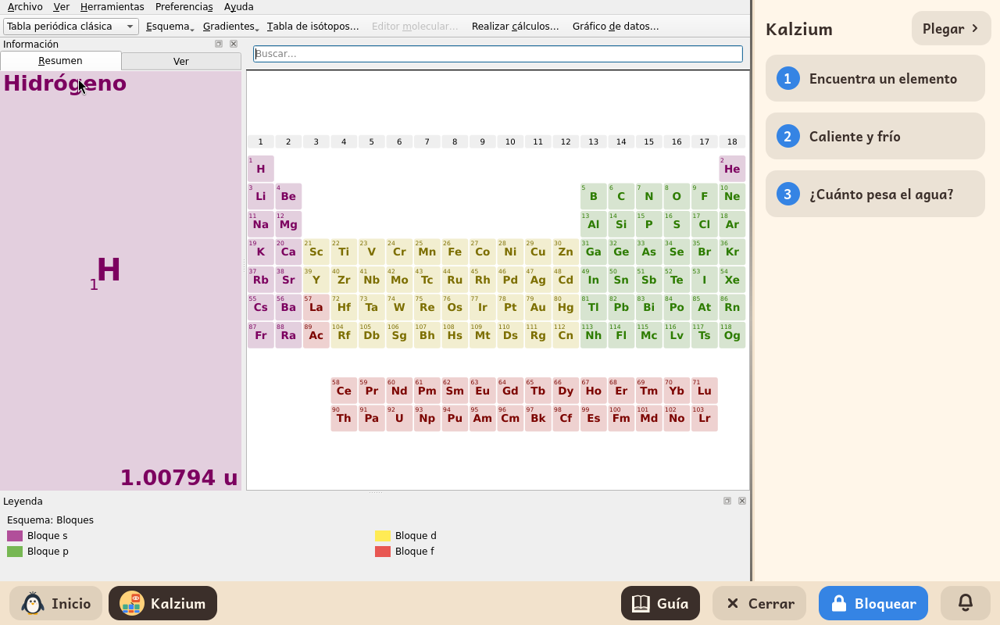

# Kalzium

*[English version](../../en/modules/kalzium.md)* · [Volver al manual](../user-guide.md#9-módulos-de-aprendizaje)

**Kalzium** es la tabla periódica. Cada elemento se abre con cómo es, dónde se encontró, una foto y un dibujo de su átomo.

| | |
|---|---|
| **Para** | Niños de 10 a 16 años |
| **Necesita** | Nada de internet |
| **Programa** | [Kalzium](https://apps.kde.org/kalzium/), de KDE, bajo la licencia GPL-2, de Debian |

## Qué es

La tabla ocupa la ventana. Un clic en un elemento abre todo lo suyo: su nombre, su número, qué aspecto tiene, dónde se descubrió, su átomo con sus electrones, y las temperaturas a las que se funde y hierve. Un deslizador enseña qué elementos son sólidos, líquidos o gases a cada temperatura, y hay un glosario de las palabras.

## La guía que lleva al lado

Kalzium se abre con una guía a la derecha, tres lecciones cortas:

1. **Encuentra un elemento**: las filas y las columnas de la tabla, y qué cuenta la página de un elemento.
2. **Caliente y frío**: el deslizador de temperaturas, y qué elementos se funden primero.
3. **¿Cuánto pesa el agua?**: la calculadora de moléculas, y el peso de una molécula a partir de sus átomos.

**Plegar**, arriba de la guía, la pliega en una tira; **Guía** en la barra la abre otra vez.

## Conviene saber

- El menú **Ayuda** de Kalzium está apagado, y también la descarga de contenido nuevo de la tienda de KDE: los dos abren un navegador web que el niño no tiene.
- No se guarda nada en las carpetas del niño. Los ajustes propios de Kalzium se guardan para el niño, y se quedan cuando se quita el módulo.
