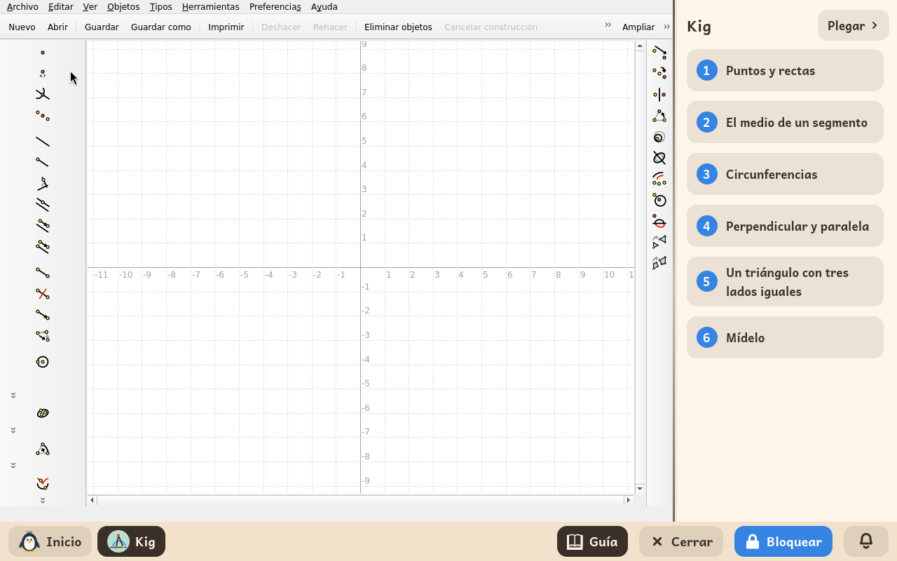
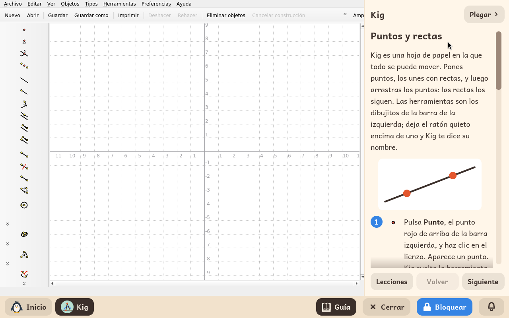
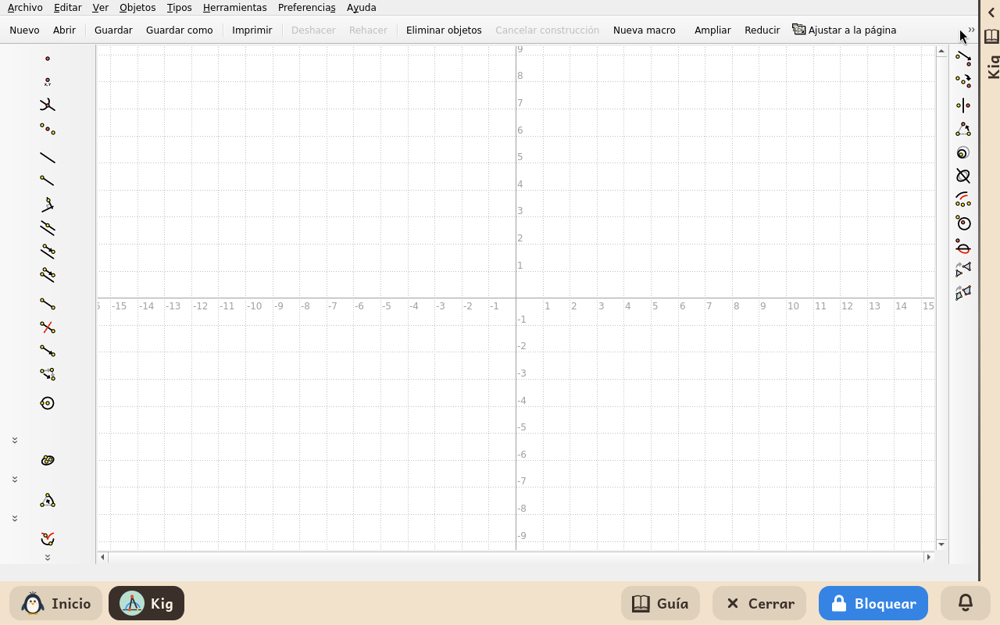

# Kig

*[English version](../../en/modules/kig.md)* · [Volver al manual](../user-guide.md#9-módulos-de-aprendizaje)

**Kig** es una aplicación de geometría dinámica interactiva desarrollada por el proyecto KDE. Permite construir figuras geométricas en pantalla (puntos, rectas, polígonos, circunferencias y cónicas) que conservan estrictamente sus propiedades matemáticas al interactuar con ellas: un punto medio se mantiene en el centro del segmento y una paralela sigue siendo paralela al arrastrar cualquiera de sus elementos de origen.

| | |
|---|---|
| **Edad recomendada** | Niños de 10 a 14 años |
| **Módulos recomendados antes** | GCompris |
| **Conexión a internet** | No requerida (funciona de forma 100 % autónoma sin conexión) |
| **Software utilizado** | [Kig](https://apps.kde.org/kig/), desarrollado por la comunidad KDE bajo licencia GPL-2, empaquetado en Debian |

## Qué es y cómo funciona

Kig actúa como un cuaderno de dibujo geométrico donde los elementos responden a leyes matemáticas. La barra de herramientas lateral organiza los elementos de construcción: puntos, rectas que pasan por dos puntos, segmentos, circunferencias, perpendiculares, paralelas, puntos medios, intersecciones entre curvas y cálculo interactivo de ángulos.

El estudiante diseña una construcción y comprueba visualmente los teoremas: al arrastrar un vértice con el ratón, el resto de la figura se deforma en tiempo real respetando las restricciones geométricas fijadas.

## Guía didáctica interactiva

Kidux incluye una guía didáctica en el panel lateral derecho con seis lecciones prácticas diseñadas específicamente para el estudiante. Cada paso indica con precisión la herramienta correspondiente y su icono gráfico. Cuatro de estas lecciones incluyen una **misión práctica**: un archivo geométrico preconfigurado con retos para resolver, que se copia automáticamente en la carpeta personal del menor (`Documentos/Misiones de Kig`) la primera vez que se accede a la lección.

1. **Puntos y rectas**: construcción de puntos libres, rectas por dos puntos, etiquetado de nombres y trazado de triángulos con segmentos.
2. **El punto medio de un segmento**: construcción de un punto central invariante. Misión: `medio.kig`.
3. **Circunferencias**: intersección entre dos circunferencias y puntos restringidos al perímetro. Misión: `dos-circunferencias.kig`.
4. **Perpendiculares y paralelas**: rectas que preservan su relación angular y construcción de un cuadrado indeformable. Misión: `paralelas.kig`.
5. **Triángulo equilátero**: la construcción con regla y compás clásica de Euclides. Misión: `triangulo.kig`.
6. **Medición dinámica**: visualización en tiempo real de longitudes y ángulos, demostrando por qué la suma de los ángulos de un triángulo siempre es 180°.

El botón **Plegar** en la cabecera del panel lateral colapsa la guía para conceder todo el espacio de pantalla al lienzo de dibujo; al pulsar sobre la banda colapsada o en el botón **Guía** de la barra inferior, el panel vuelve a expandirse de inmediato.

## Gestión de archivos y proyectos

Los proyectos creados pueden guardarse en formato `.kig` mediante el menú **Archivo > Guardar**, quedando almacenados de forma segura en la carpeta personal del estudiante. Las misiones didácticas se abren cómodamente desde **Archivo > Abrir > Documentos > Misiones de Kig**.

## Aspectos a tener en cuenta

- **Entorno aislado**: Las opciones de ayuda externa por internet y los diálogos de descarga de complementos de KDE se encuentran deshabilitados para evitar la salida no supervisada a la web.
- **Enlaces externos bloqueados**: Cualquier intento de apertura de hipervínculos externos es interceptado con un aviso informativo indicando que la navegación externa está desactivada.
