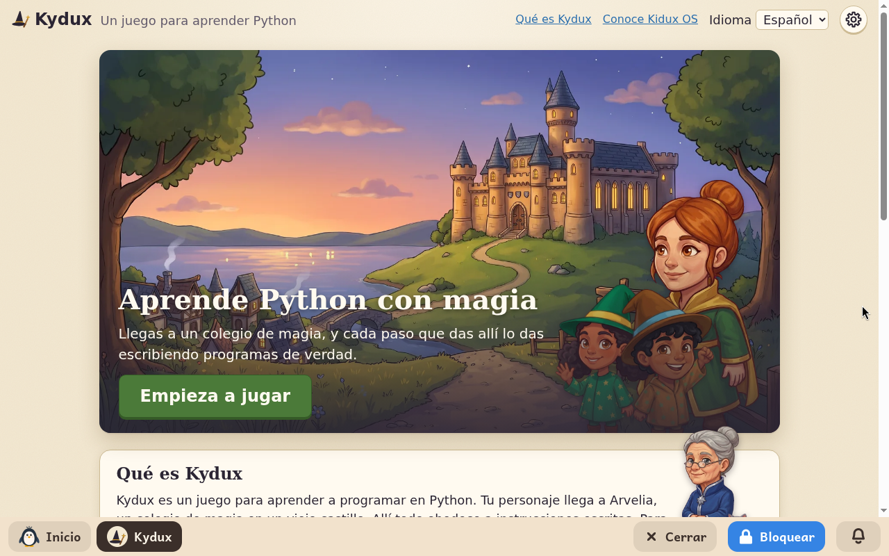

# Kydux

*[English version](../../en/modules/kydux.md)* · [Volver al manual](../user-guide.md#9-módulos-de-aprendizaje) · De la familia Kidux: [Kydux, aprende Python con magia](https://kydux.kidux.org)

**Kydux** es el juego de la familia Kidux para aprender a programar en Python, hecho como [alternativa a CodeCombat](https://kydux.kidux.org): un mago o maga llega a un colegio de magia, y allí cada paso se da escribiendo un poco de Python.

| | |
|---|---|
| **Edad recomendada** | Niños a partir de 8 años que lean con soltura |
| **Conexión a internet** | Requerida siempre que se usa |
| **Idiomas** | Español e inglés: el del niño |
| **Cuenta** | Ninguna |
| **Precio** | Gratis |
| **Servicio web** | [kydux.kidux.org](https://kydux.kidux.org), de la familia Kidux. Software libre bajo la Licencia Pública General de GNU, versión 3 o posterior; su código está en [github.com/othermore/kydux](https://github.com/othermore/kydux). |
| **Sin Kidux** | El mismo juego se juega en cualquier navegador, en cualquier ordenador, en [kydux.kidux.org](https://kydux.kidux.org) |

## Qué es y cómo funciona

El juego es una historia contada por capítulos, divertida para que el niño mantenga el interés. Lecciones cortas explican los conceptos fundamentales de programación, y cada nivel se resuelve con un pequeño programa que el niño escribe con lo aprendido, y que mueve a su personaje por la escena. La dificultad sube poco a poco, y hay ayudas para que no se atranque.

La primera vez, el juego pregunta si puede usar cookies, y después muestra su página de bienvenida y **Empieza a jugar**. El niño crea su personaje, elige su aspecto y pone nombre a su partida.

## Notas importantes

- **El juego está en su web**: el módulo abre Kydux en una ventana propia por encima de la barra, y ninguna otra web. Las novedades del juego llegan solas la siguiente vez que se abre el módulo, sin instalar nada.
- **Las cookies y lo que cuenta el juego**: el aviso del juego dice que cuenta qué historias, lecciones y niveles se abren, cuánto se tarda en un nivel, cuántas veces se ejecuta un programa, las pistas leídas y las estrellas ganadas; que nunca envía los programas que escribe el niño, el nombre de su personaje ni quién es; y que nunca pide un nombre, una dirección ni una cuenta. El recuento lo lleva Google Analytics, con cookies, solo si la respuesta es sí. El juego se juega igual se responda lo que se responda, y la respuesta se puede cambiar en la página de ajustes del juego.
- **Las partidas guardadas**: el juego guarda las partidas de cada niño en el ordenador, en el almacenamiento de Chromium propio del módulo para ese niño, y al día siguiente siguen ahí. Se quedan al quitar el módulo, y se encuentran otra vez al volver a instalarlo. La pantalla de inicio del juego también guarda una partida como archivo (**Exportar**), en la carpeta que elija el niño, primero sus Descargas, y la vuelve a abrir (**Importar una partida**): así se lleva una partida a otro ordenador, o se guarda una copia.
- **El enlace a la web de Kidux**: el juego tiene un enlace a la web de Kidux, que dentro de Kidux no lleva a ninguna parte: Chromium enseña una página que dice que está bloqueada. **Alt+Izquierda** vuelve al juego, sin perder nada; si la página se abrió en una ventana aparte, **Ctrl+W** la cierra.
- **La pantalla**: el juego necesita una pantalla de 1280 × 720 o más.
