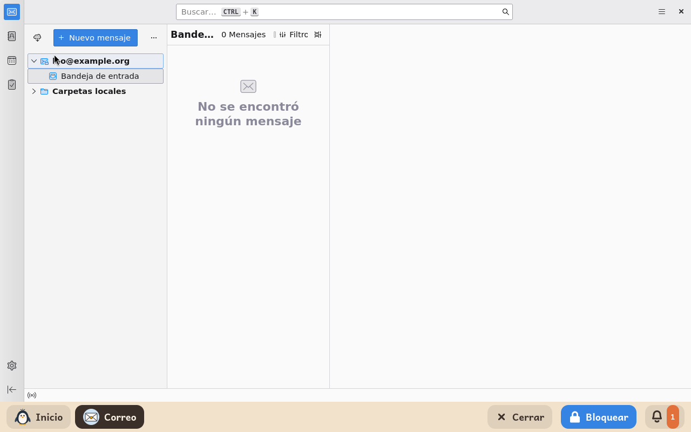
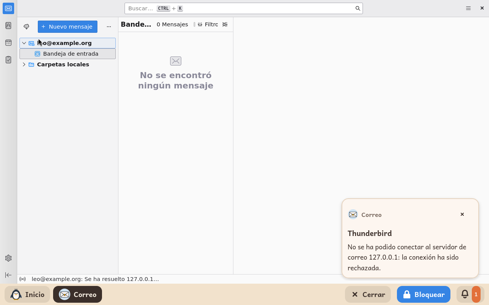

# Correo

*[English version](../../en/modules/mail.md)* · [Volver al manual](../user-guide.md#9-módulos-de-aprendizaje)

**Correo** es un buzón de correo propio del niño, en Thunderbird, el programa de correo. El niño lee y escribe allí sus mensajes, y no tiene nada que configurar: la cuenta es la que da un adulto.

| | |
|---|---|
| **Para** | Niños a partir de 8 años |
| **Necesita** | Internet para enviar y recibir, y una cuenta de correo: Gmail, Outlook, iCloud o cualquier proveedor que hable IMAP |
| **Programa** | [Thunderbird](https://www.thunderbird.net/), de MZLA y la comunidad de Mozilla, bajo la licencia MPL-2.0, de Debian |

## Qué es

Thunderbird, preparado por Kidux para un niño y una cuenta. El niño ve su bandeja de entrada, escribe mensajes, y nada más: el chat de Thunderbird, sus complementos y sus ajustes avanzados están cerrados.

## Qué ajusta un adulto

| Ajuste | Qué hace |
|---|---|
| **Dirección de correo** | La dirección de correo del niño. Correo encuentra por sí solo los servidores del proveedor a partir de ella, para Gmail, Outlook, Hotmail, iCloud, Yahoo y casi todos los demás. |
| **Nombre** | El nombre con el que salen los mensajes del niño. |
| **Servidor de entrada** | Solo para un proveedor que Correo no encuentra por sí solo: su servidor IMAP, como `imap.example.org`. Un servidor en un puerto propio se escribe con el puerto, como `imap.example.org:143`. |
| **Servidor de salida** | Solo para ese proveedor: su servidor SMTP, como `smtp.example.org`. |

Después, el adulto abre Correo con el niño la primera vez. Con una cuenta de Gmail o de Outlook, se abre dentro de Correo la ventana de entrada de Google o de Microsoft. El adulto entra allí, con el segundo paso si la cuenta lo tiene, y Correo se queda dentro. Con cualquier otro proveedor, Correo pide la contraseña una vez. El adulto la escribe, con la casilla de recordarla marcada, y Correo la guarda. La contraseña se queda en la parte del ordenador que es solo del niño, que nadie más en él puede leer. El panel no la tiene nunca.

## Conviene saber

- La cuenta de Google de un niño menor de trece años se gestiona con Family Link, y Google no deja que una cuenta así entre en Correo. Para ella está el módulo [Gmail](gmail.md).
- Lo que el niño cambie en la cuenta vuelve a estar como era la próxima vez que se abre Correo, y una cuenta añadida a mano desaparece: la cuenta es siempre la que se dio en el panel. Sin una dirección en el panel, o con un proveedor que Correo no encuentra y sin servidores puestos, Correo se abre solo con sus carpetas locales.
- Un enlace en un mensaje no lleva a ninguna parte. Un adjunto se guarda en las **Descargas** del niño, y nunca se abre con otro programa.
- Cuando un servidor no contesta, Correo lo dice en una burbuja encima de la barra, y en la línea de su parte de abajo.

