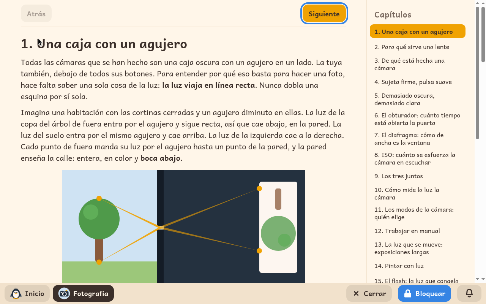

# Fotografía

*[English version](../../en/modules/photography.md)* · [Volver al manual](../user-guide.md#9-módulos-de-aprendizaje)

**Fotografía** es un curso práctico e ilustrado diseñado para aprender a fotografiar con una cámara real: cómo funciona la óptica, cómo sujetar el equipo con estabilidad y cómo dominar la exposición, el enfoque y la composición visual.

| | |
|---|---|
| **Edad recomendada** | Niños de 8 a 12 años con buen hábito lector |
| **Requisitos técnicos** | Una cámara digital (compacta, bridge, réflex o sin espejo) y ninguna conexión a internet |
| **Material didáctico** | Producido por Kidux. Incluye fotografías educativas bajo licencias libres y recreaciones explicativas debidamente acreditadas. |

## Qué es y cómo funciona

El curso está pensado para aprovechar cualquier cámara que disponga de controles o diales de modo (manual, prioridad a la apertura o velocidad), e incluso para sentar las bases con la cámara de un teléfono móvil. A modo de referencia práctica constante, la guía utiliza la cámara compacta avanzada Olympus XZ-2: el apartado **En la Olympus XZ-2** de cada lección indica exactamente qué botón, dial o menú activar, explicando su equivalencia en otras marcas populares.

Cada uno de los capítulos combina explicaciones teóricas claras, ejemplos fotográficos reales, esquemas visuales de la pantalla de la cámara y un reto práctico (**Pruébalo**) para salir a practicar con la cámara. Además, una sección orientativa titulada **Para el adulto** sugiere actividades conjuntas (como usar una linterna en una habitación a oscuras, explorar el flash o fotografiar el atardecer).

## Los treinta capítulos

1. Una caja con un agujero
2. Para qué sirve una lente
3. De qué está hecha una cámara
4. Sujeta firme, pulsa suave
5. Demasiado oscura, demasiado clara
6. El obturador: cuánto tiempo está abierta la puerta
7. El diafragma: cómo de ancha es la ventana
8. ISO: cuánto se esfuerza la cámara en escuchar
9. Los tres juntos
10. Cómo mide la luz la cámara
11. Los modos de la cámara: quién elige
12. Trabajar en manual
13. La luz que se mueve: exposiciones largas
14. Pintar con luz
15. El flash: la luz que congela
16. El enfoque: adónde mira la cámara
17. Los modos de enfoque: una vez, siguiendo, a mano
18. La profundidad de campo: cuánto sale nítido
19. Muy cerca: macro
20. El zoom: cerca y lejos, y lo que les hace a las caras
21. Dónde poner las cosas: la regla de los tercios
22. Líneas, marcos y patrones
23. Los fondos, y ordenar la foto
24. El punto de vista
25. La luz tiene una hora y un lado
26. El color, y el blanco y negro
27. Las personas y los momentos
28. Mirar tus fotos
29. Elegir, y contar una historia
30. Las palabras de la fotografía

## Aspectos a tener en cuenta

El curso y las actividades interactivas se consultan en el ordenador, mientras que las prácticas fotográficas se realizan en el entorno real con la cámara. El módulo no genera archivos adicionales en las carpetas personales del menor.
