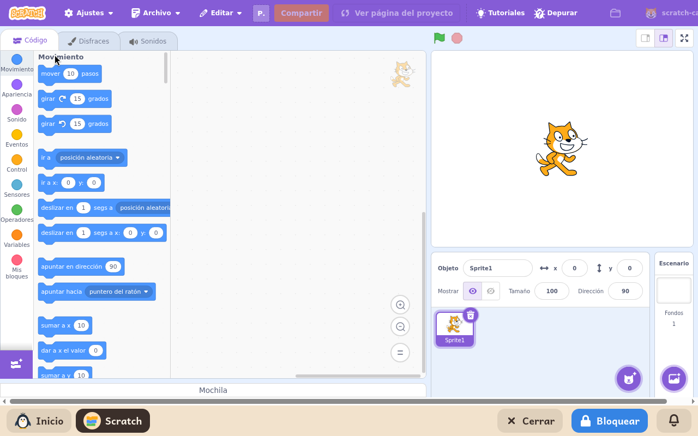

# Scratch

*[English version](../../en/modules/scratch.md)* · [Volver al manual](../user-guide.md#9-módulos-de-aprendizaje)

**Scratch** es el popular entorno de programación visual desarrollado por el MIT Media Lab y la Scratch Foundation. Permite a los estudiantes crear videojuegos interactivos, narraciones animadas y simulaciones encajando bloques de código visuales y coloridos.

| | |
|---|---|
| **Edad recomendada** | Niños y jóvenes de 8 a 16 años |
| **Módulos recomendados antes** | ScratchJr |
| **Conexión a internet** | Opcional (solo se utiliza para descargar la biblioteca oficial de personajes, disfraces, fondos y efectos sonoros; la creación, edición y ejecución funcionan 100 % sin conexión) |
| **Software utilizado** | [Scratch Desktop](https://scratch.mit.edu/), desarrollado por la Scratch Foundation bajo licencia AGPL-3, compilado por Kidux para su ejecución local |

## Qué es y cómo funciona

Kidux integra el editor oficial completo de Scratch en el idioma seleccionado para el menor, ejecutándose directamente en el ordenador. Para preservar la privacidad infantil y evitar distracciones, el entorno prescinde de la red social abierta de la web de Scratch: los proyectos no se publican automáticamente en internet y ningún usuario externo puede interactuar con el menor.

El entorno de trabajo cuenta con todas las herramientas de creación habituales: el escenario de previsualización, la lista de objetos (personajes) con sus propiedades, la paleta completa de bloques por categorías (movimiento, apariencia, sonido, eventos, control, sensores, operadores y variables) y los editores gráficos y de audio integrados.

## Componentes y funciones disponibles

- **Editor completo**: bloques estándar de programación, gestión de disfraces, capas y efectos sonoros.
- **Biblioteca multimedia**: catálogo oficial de personajes, fondos y sonidos, que se descargan de forma segura de los servidores oficiales de Scratch al explorarlos.
- **Editores multimedia**: herramientas de dibujo vectorial y mapa de bits para crear personajes propios, además de grabador y editor de efectos de sonido.
- **Tutoriales guiados**: guías paso a paso con fichas descriptivas para aprender a crear animaciones y mecánicas de juego básicas. Sus vídeos no se reproducen, porque están en una página web, y un módulo solo muestra sus propias páginas.

## Guardar y abrir proyectos

Para guardar un proyecto, basta con hacer clic en **Archivo > Guardar en tu ordenador**. Se abrirá el selector de archivos del sistema para asignarle un nombre y guardarlo en la carpeta de documentos del menor. Para retomar un trabajo anterior, se selecciona **Archivo > Cargar desde tu ordenador**.

Los proyectos se guardan con la extensión estándar `.sb3` y son completamente compatibles con el módulo [TurboWarp](turbowarp.md) y con cualquier instalación convencional de Scratch.
