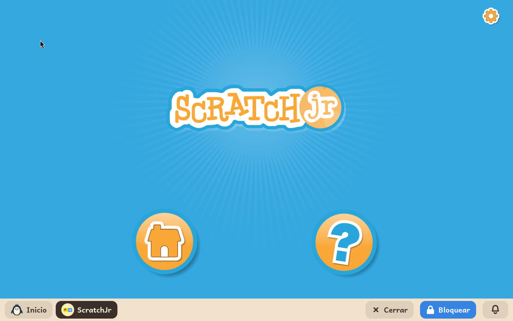

# ScratchJr

*[English version](../../en/modules/scratchjr.md)* · [Volver al manual](../user-guide.md#9-módulos-de-aprendizaje)

**ScratchJr** es un entorno de iniciación a la programación pensado específicamente para los niños más pequeños (de 5 a 7 años). Permite dar vida a personajes y crear divertidos juegos e historias interactivas encajando bloques puramente gráficos, sin necesidad de que el niño sepa leer todavía.

| | |
|---|---|
| **Edad recomendada** | Niños de 5 a 7 años (educación infantil y primeros cursos de primaria) |
| **Conexión a internet** | No requerida (funciona de forma completamente autónoma sin conexión) |
| **Software utilizado** | [ScratchJr](https://www.scratchjr.org/), desarrollado en colaboración por el MIT Media Lab, Tufts University y Playful Invention Company bajo licencia BSD-3 |

## Qué es y cómo funciona

En ScratchJr, la lógica de programación se presenta de forma horizontal mediante bloques con ilustraciones intuitivas. El menor escoge un personaje, arrastra los bloques a la tira de programación y pulsa la bandera verde para iniciar la animación.

El personaje camina, salta, gira, reproduce sonidos grabados o interactúa con otros objetos al tocarse. La ausencia total de texto en la interfaz fomenta la creatividad y la exploración autónoma, desarrollando el razonamiento secuencial y la resolución de problemas desde edades tempranas.

## Funciones y herramientas incluidas

- **Personajes y escenarios**: amplia galería temática de personajes y fondos listos para usar, junto con un sencillo editor de dibujo para pintar elementos personalizados.
- **Bloques de movimiento y control**: secuencias de avance, giros, cambios de escala, diálogos visuales, pausas y bucles de repetición.
- **Narrativa multiescena**: posibilidad de encadenar varias páginas o escenas consecutivas para crear cuentos animados completos.
- **Grabación de audio**: permite al niño grabar su propia voz con el micrófono del equipo para poner voz a los personajes.

## Guardado de proyectos y almacenamiento

Los proyectos se guardan de forma automática e instantánea mientras el niño crea, dentro de la carpeta `Documentos/ScratchJR` en su directorio personal. Si en algún momento se desinstala el módulo para liberar espacio, los proyectos creados no se borran y se recuperan intactos al reinstalarlo.

*Nota técnica*: Para garantizar una ejecución fluida e idéntica a la versión táctil, ScratchJr se ejecuta sobre un entorno de tiempo de ejecución autónomo (de aproximadamente 380 MB), por lo que la instalación puede requerir unos minutos según la conexión.
