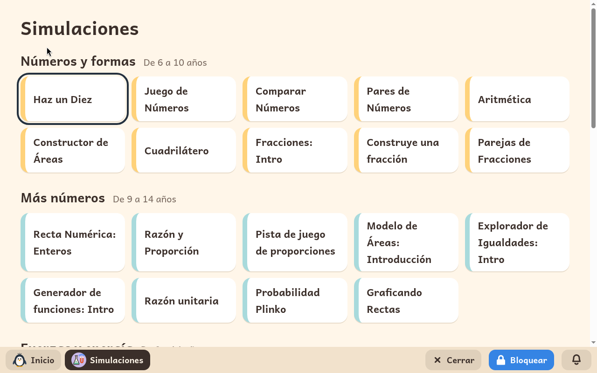
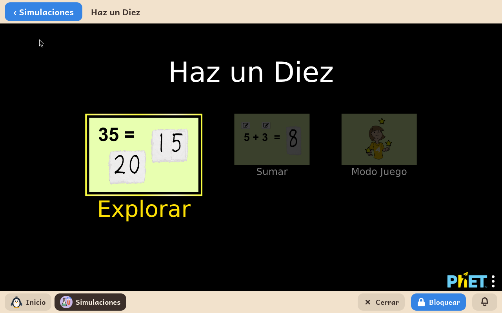

# Simulaciones

*[English version](../../en/modules/simulations.md)* · [Volver al manual](../user-guide.md#9-módulos-de-aprendizaje)

**Simulaciones** es una colección de laboratorios y experimentos científicos y matemáticos interactivos. Permite a los menores manipular conceptos abstractos de forma visual y lúdica: equilibrar balancines, desviar rayos de luz mediante prismas, experimentar con electricidad estática, construir átomos o simular órbitas gravitatorias de planetas.

| | |
|---|---|
| **Edad recomendada** | Niños y jóvenes de 6 a 14 años |
| **Conexión a internet** | No requerida (todas las simulaciones están preinstaladas localmente en el equipo) |
| **Software y contenidos** | [PhET Interactive Simulations](https://phet.colorado.edu/), desarrolladas por la Universidad de Colorado Boulder bajo licencia Creative Commons Atribución 4.0 (CC BY 4.0). Kidux no tiene afiliación oficial con el proyecto PhET. |

## Qué es y cómo funciona

Las simulaciones PhET son un referente pedagógico internacional utilizado en centros escolares de todo el mundo. Kidux ha integrado una cuidada selección de 51 laboratorios interactivos para edades comprendidas entre los 6 y los 14 años, organizados por materias científicas y niveles de edad, con una interfaz completamente traducida al idioma del menor.

Cada simulación se abre en su propio marco. Una barra superior permite regresar en cualquier momento a la biblioteca principal de experimentos.

## Qué incluye

**Números y formas**, de 6 a 10 años: Haz un Diez, Juego de Números, Comparar Números, Pares de Números, Aritmética, Constructor de Áreas, Cuadrilátero, Fracciones: Intro, Construye una fracción, Parejas de Fracciones.

**Más números**, de 9 a 14 años: Recta Numérica: Enteros, Razón y Proporción, Pista de juego de proporciones, Modelo de Áreas: Introducción, Explorador de Igualdades: Intro, Generador de funciones: Intro, Razón unitaria, Probabilidad Plinko, Graficando Rectas.

**Fuerzas y energía**, de 8 a 14 años: Fuerzas y Movimiento: Intro, Ley de equilibrio, Fricción, Energía en la pista de patinaje: Intro, Formas y Cambios de Energía, Masas y Resortes: Intro, Lab de Péndulo, Movimiento de un Proyectil, Lab de Fuerza de Gravedad: Intro.

**Luz, sonido y ondas**, de 8 a 14 años: Visión del color, Reflexión y Refracción de la Luz, Óptica Geométrica: Intro, Ondas: Intro, Onda en una cuerda.

**Electricidad e imanes**, de 8 a 14 años: Globos y electricidad estática, Travoltaje, Imán y brújula, Imanes y Electroimanes, Kit de Construcción de Circuitos: CD.

**La materia y los átomos**, de 9 a 14 años: Estados de la Materia: Intro, Gases: Intro, Densidad, Flotabilidad: Intro, Construye un Átomo, Construye una Molécula, Concentración, Escala pH: Intro.

**La Tierra, el espacio y la vida**, de 8 a 14 años: Gravedad y Órbitas, Mi Sistema Solar, Efecto Invernadero, Bajo presión, Selección Natural.

## Aspectos a tener en cuenta

- **Licencia y créditos**: Cada simulación incluye en su pie de página la atribución a PhET Interactive Simulations de la Universidad de Colorado Boulder conforme a los términos de la licencia CC BY 4.0.
- **Almacenamiento**: Las simulaciones no guardan nada en las carpetas personales del menor.
