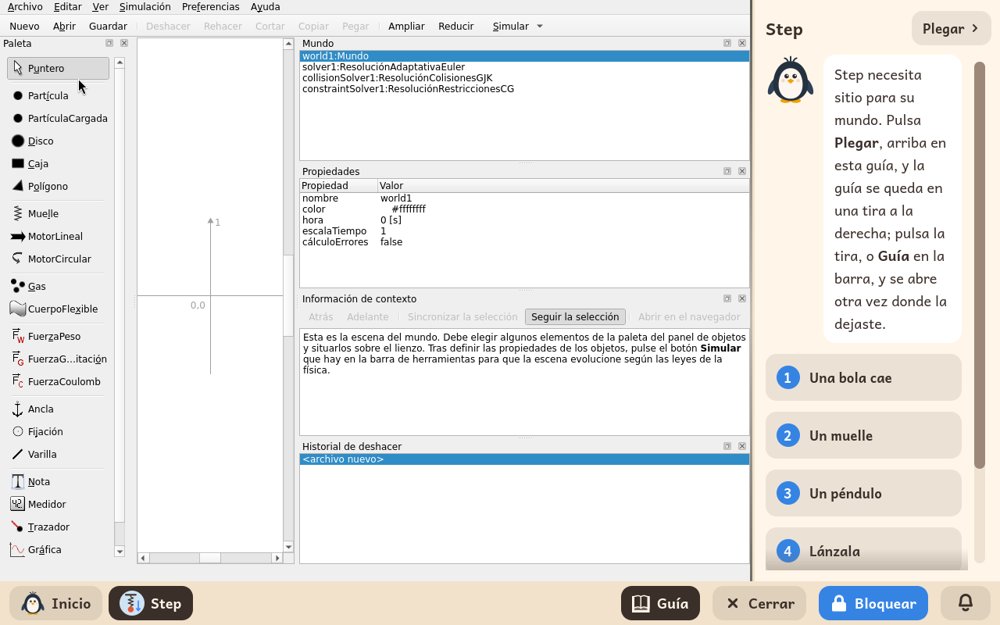

# Step

*[English version](../../en/modules/step.md)* · [Volver al manual](../user-guide.md#9-módulos-de-aprendizaje)

**Step** es un laboratorio de física. El niño pone cuerpos, muelles, cuerdas y fuerzas sobre el plano, le da a reproducir y mira qué pasa, con medidores y gráficas para leerlo.

| | |
|---|---|
| **Para** | Niños de 10 a 16 años |
| **Antes** | Simulaciones |
| **Necesita** | Nada de internet |
| **Programa** | [Step](https://apps.kde.org/step/), de KDE, bajo la licencia GPL-2, de Debian |

## Qué es

A la izquierda, la paleta: partículas, discos, cajas, muelles, motores, fuerzas, anclas y medidores. El niño arrastra una cosa al mundo, le pone su peso o su velocidad en las propiedades, y pulsa **Simular**. La gravedad ya está puesta. Los ejemplos del menú **Archivo** de Step son experimentos listos para correr.

## La guía que lleva al lado

Step se abre con una guía a la derecha, seis lecciones. Cinco de ellas tienen una *misión*: un archivo de Step con un experimento a medio hacer y una nota dentro que dice qué probar, que se copia en los **Documentos** del niño, en **Misiones de Step**, la primera vez que se abre la guía.

1. **Una bola cae**: la gravedad, y una gráfica de la caída. Misión: `caida.step`.
2. **Un muelle**: dos cuerpos unidos por un muelle, y qué hace la rigidez. Misión: `muelle.step`.
3. **Un péndulo**: un peso en una varilla, y por qué su vaivén tarda siempre lo mismo. Misión: `pendulo.step`.
4. **Lánzala**: una bola lanzada de lado, y el arco que recorre. Misión: `lanzamiento.step`.
5. **Mídelo**: medidores y trazadores, y leer una gráfica.
6. **Rebota y choca**: una bola contra una caja, y qué pasa con su energía. Misión: `rebote.step`.

Step necesita sitio para su mundo, así que la guía dice primero cómo plegarla: **Plegar**, arriba, la pliega en una tira pegada al borde, y **Guía** en la barra la abre otra vez donde el niño la dejó.

## Los archivos del niño

Un experimento se guarda desde el propio **Archivo**, **Guardar** de Step, como un archivo `.step` en las carpetas del niño. Una misión se abre de la misma forma: **Archivo**, **Abrir**, **Documentos**, **Misiones de Step**.

## Conviene saber

- **Descargar experimentos nuevos** y el menú **Ayuda** de Step están apagados: los dos abren un navegador web que el niño no tiene.
- **Abrir en el navegador**, en el panel de información de contexto de Step, no abre nada: una burbuja dice que aquí internet está cerrado.
