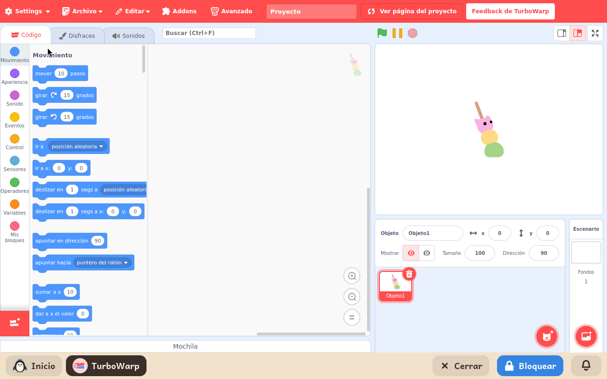

# TurboWarp

*[English version](../../en/modules/turbowarp.md)* · [Volver al manual](../user-guide.md#9-módulos-de-aprendizaje)

**TurboWarp** es una versión de alto rendimiento de Scratch basada en un compilador optimizado a JavaScript. Mantiene la misma interfaz, bloques y compatibilidad de archivos que Scratch, pero ejecuta los proyectos y animaciones con una tasa de fotogramas muy superior.

| | |
|---|---|
| **Edad recomendada** | Niños y jóvenes de 8 a 16 años |
| **Módulos recomendados antes** | ScratchJr |
| **Conexión a internet** | Opcional (solo requerida para cargar recursos de la biblioteca multimedia oficial; todo el entorno y la ejecución funcionan sin conexión) |
| **Software utilizado** | [TurboWarp](https://turbowarp.org/), desarrollado por la comunidad de software libre TurboWarp bajo licencia GPL-3, empaquetado para su uso local en Kidux |

## Qué es y cómo funciona

TurboWarp resulta especialmente recomendable en ordenadores con recursos de hardware limitados o para proyectos complejos donde Scratch estándar pueda presentar ralentizaciones. Cualquier niño familiarizado con Scratch encontrará una disposición idéntica de paneles, herramientas y bloques de programación.

Además de su mayor velocidad de ejecución, TurboWarp ofrece opciones avanzadas de personalización, como la posibilidad de modificar la resolución del escenario o ajustar la tasa de refresco a 60 fotogramas por segundo para lograr una suavidad óptima.

## Funciones disponibles

- **Mismo entorno de creación**: interfaz idéntica a Scratch, con acceso a todos los bloques estándar, disfraces y sonidos.
- **Biblioteca oficial de recursos**: descarga opcional bajo demanda de personajes, fondos y sonidos oficiales.
- **Rendimiento compilado**: ejecución ultra fluida gracias al compilador Just-in-Time integrado.
- **Opciones avanzadas**: control de velocidad de simulación, depuración y ajustes de visualización.

## Guardado de proyectos y compatibilidad

El flujo de guardado es idéntico al de Scratch: mediante **Archivo > Guardar en tu ordenador** se almacena el proyecto en formato estándar `.sb3` en la carpeta personal del menor. Para reanudar el trabajo, se utiliza **Archivo > Cargar desde tu ordenador**.

Los proyectos son bidireccionalmente compatibles: cualquier proyecto creado en Scratch puede abrirse en TurboWarp y viceversa. Por razones de seguridad, la descarga directa de proyectos públicos por número de ID desde la web comunitaria de Scratch está desactivada; los proyectos se gestionan siempre como archivos locales.
