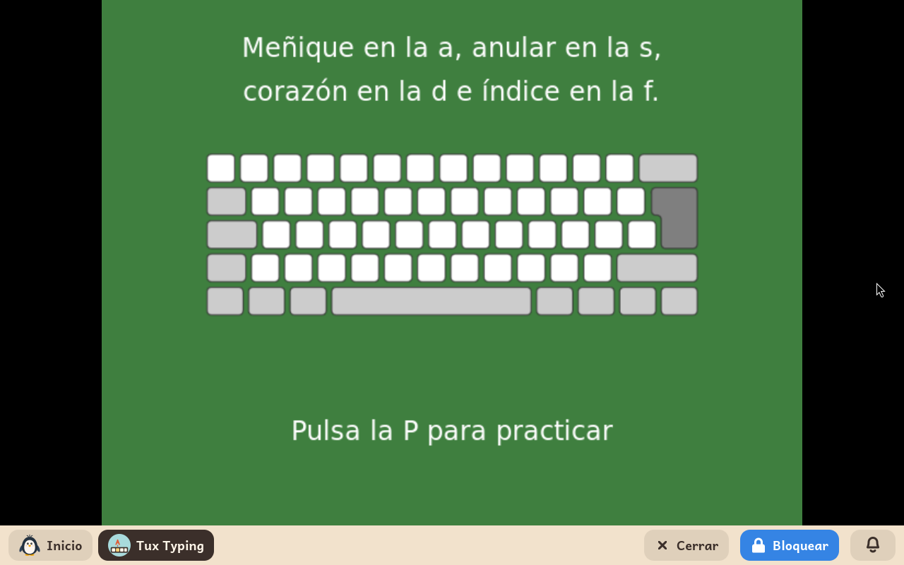
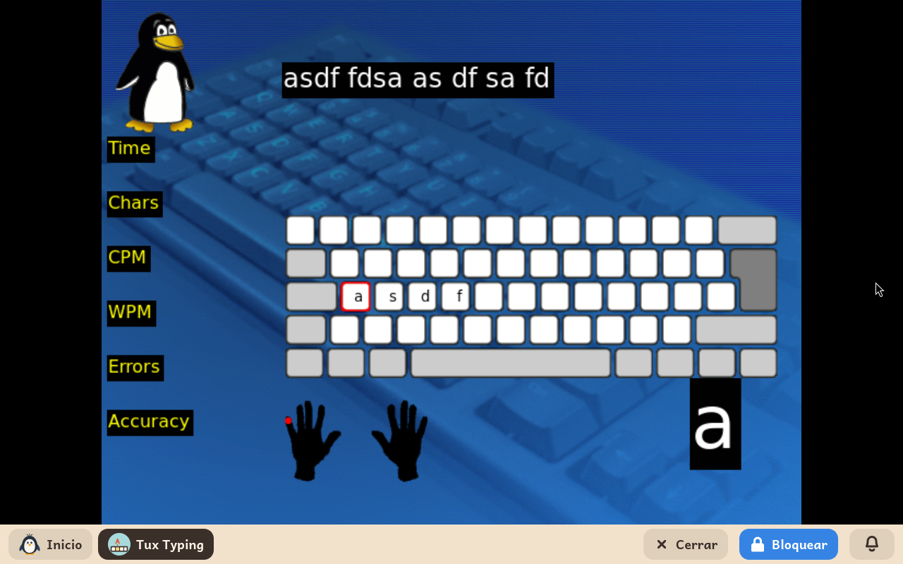

# Tux Typing

*[English version](../../en/modules/tuxtype.md)* · [Volver al manual](../user-guide.md#9-módulos-de-aprendizaje)

**Tux Typing** es un clásico juego arcade de mecanografía protagonizado por el simpático pingüino Tux. Su objetivo es ayudar a los niños a familiarizarse con la distribución del teclado, ganar agilidad en la pulsación de teclas y aprender a escribir con precisión mediante divertidos minijuegos.

| | |
|---|---|
| **Edad recomendada** | Niños de 6 a 12 años |
| **Módulos recomendados antes** | GCompris (para una primera toma de contacto con las letras y el teclado) |
| **Conexión a internet** | No requerida (funciona de forma 100 % autónoma sin conexión) |
| **Software utilizado** | [Tux Typing](https://github.com/tux4kids/tuxtype), desarrollado por la comunidad Tux4Kids bajo licencia GPL-2, empaquetado en Debian |

## Qué es y cómo funciona

En los juegos de Tux Typing, el menor debe teclear letras sueltas o palabras completas a medida que caen del cielo antes de que toquen el suelo, permitiendo a Tux alimentarse o defender su territorio. Conforme se avanza de fase, la velocidad de caída aumenta de forma gradual y las palabras se vuelven más complejas.

El juego está adaptado al idioma preferido del niño: los menús de navegación, las instrucciones y los diccionarios de palabras que caen en las partidas se corresponden con su lengua materna.

## Modos de juego

- **Cascada de peces**: minijuego arcade donde caen peces con letras individuales; ideal para aprender la ubicación física de las teclas.
- **Cometas**: reto donde caen meteoritos con palabras completas que deben teclearse antes del impacto.
- **Lecciones**: el curso de mecanografía de Kidux, que se describe a continuación.

## Lecciones de mecanografía

Kidux incorpora un curso propio de doce lecciones, en español y en inglés según el idioma del niño, que enseña a escribir con los diez dedos siguiendo el orden clásico de la mecanografía: primero la fila central (a s d f y j k l ñ), después la fila superior y por último la inferior, con la coma y el punto.

- **Elegir una lección**: en el menú principal, **Lecciones** muestra la lista, de «Lección 01 - a s d f» a «Lección 12 - x z y punto». Se elige con el ratón o con las flechas e Intro.
- **Recorrido de cada lección**: una primera página presenta las teclas nuevas (**Intro** para seguir); la segunda indica con qué dedo se pulsa cada una sobre un teclado dibujado; con la tecla **P** comienza la práctica de esas teclas y, al terminarla, una segunda práctica con palabras formadas solo por letras ya aprendidas.
- **Durante la práctica**: arriba aparece la frase que hay que escribir; abajo, la tecla siguiente en grande y, sobre el dibujo de las manos, un punto rojo en el dedo que debe pulsarla. Al terminar, Tux celebra el resultado con el tiempo, los errores y la precisión.
- **Salir**: **Esc** abandona la práctica o la lección en cualquier momento.

## Aspectos a tener en cuenta

- **Puntuaciones y récords**: Las mejores puntuaciones y los progresos se conservan de forma interna en la configuración del juego, sin saturar las carpetas de documentos personales del menor.
- **Rótulos en inglés**: Los datos de la práctica (Time, Chars, CPM, WPM, Errors, Accuracy) aparecen en inglés porque el propio Tux Typing no los tiene traducidos: son el tiempo, los caracteres, las pulsaciones y palabras por minuto, los errores y la precisión.
- **Lo que el curso no incluye todavía**: Las mayúsculas y las vocales con tilde.
- **Compatibilidad gráfica**: Al tratarse de una aplicación gráfica clásica, si se selecciona en el panel de adultos una resolución de pantalla escalada (marcada con `*`), los gráficos pueden mostrar un ligero suavizado. Seleccionar una resolución nativa sin asterisco garantiza la máxima nitidez.
