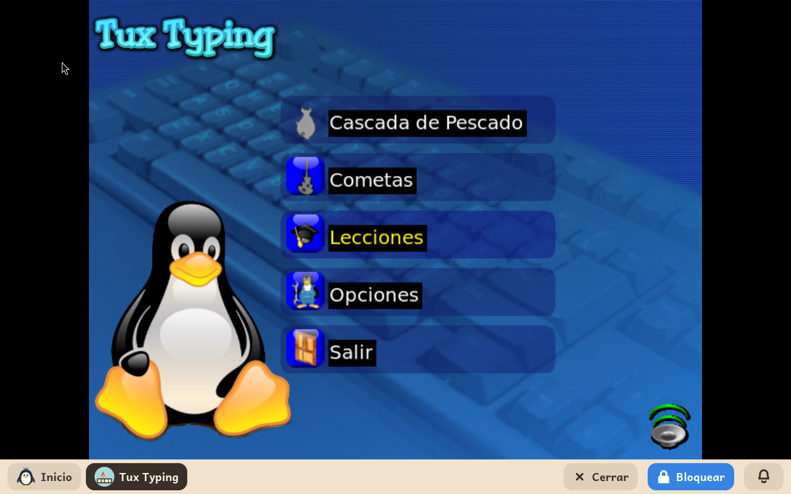

# Tux Typing

*[English version](../../en/modules/tuxtype.md)* · [Volver al manual](../user-guide.md#9-módulos-de-aprendizaje)

**Tux Typing** enseña a un niño a escribir a máquina. Del cielo caen letras y palabras, y el niño atrapa cada una escribiéndola, cada nivel un poco más difícil.

| | |
|---|---|
| **Para** | Niños de 6 a 12 años |
| **Antes** | GCompris, que enseña primero las letras del teclado |
| **Necesita** | Nada de internet |
| **Programa** | [Tux Typing](https://github.com/tux4kids/tuxtype), de Tux4Kids, bajo la licencia GPL-2, de Debian |

## Qué es

El pingüino Tux está abajo en la pantalla, y las letras caen hacia él. El niño escribe cada letra antes de que llegue al suelo, y Tux se la come. Más adelante caen palabras enteras. Los niveles van más deprisa, y las palabras se hacen más largas.

Sus menús están en el idioma del niño, y también las palabras que caen: un niño que habla español atrapa palabras en español.

## Qué incluye

- **Cascada de peces**, donde caen letras sueltas;
- **Cometas**, donde caen palabras y el niño las escribe enteras;
- lecciones que recorren el teclado unas pocas teclas cada vez, con los dedos que hay que usar;
- un modo de práctica en el que el niño escribe un texto a su ritmo.

## Conviene saber

- Tux Typing guarda sus puntuaciones y sus ajustes para sí, no en las carpetas del niño. Al quitar el módulo se conservan para cuando vuelva.
- Es un programa antiguo, hecho para el sistema de pantalla X11. Con un tamaño de pantalla marcado con \* en la página Sistema del panel de adulto puede verse un poco borroso; un tamaño sin \* lo arregla.
