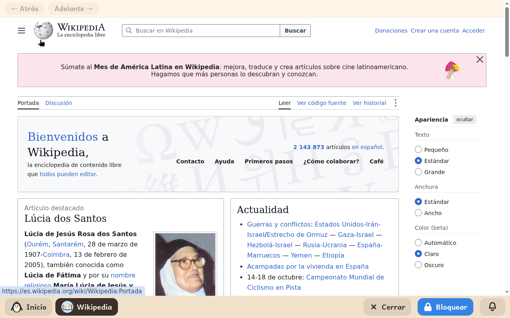

# Wikipedia

*[English version](../../en/modules/wikipedia.md)* · [Volver al manual](../user-guide.md#9-módulos-de-aprendizaje)

**Wikipedia** proporciona acceso restringido a la enciclopedia libre y sus proyectos educativos hermanos (Wikcionario y Wikilibros) en el idioma configurado para el menor, en un entorno de lectura protegido.

| | |
|---|---|
| **Edad recomendada** | A partir de 8 años (a criterio del adulto tutor, al tratarse de una enciclopedia general para todos los públicos) |
| **Conexión a internet** | Requerida en todo momento para consultar artículos e imágenes en línea |
| **Servicio web** | [wikipedia.org](https://www.wikipedia.org/), gestionado por la Fundación Wikimedia y su comunidad de autores voluntarios |

## Qué es y cómo funciona

El módulo abre una ventana de navegación confinada exclusivamente al dominio de Wikipedia y a sus proyectos educativos colaboradores (como Wikcionario, Wikidata, Wikimedia Commons y Wikilibros). Para salvaguardar la navegación infantil, cualquier enlace que apunte a páginas web externas o redes sociales queda automáticamente bloqueado.

Los contenidos son los oficiales de Wikipedia. Los menores pueden realizar búsquedas, consultar artículos enciclopédicos con imágenes y diagramas, y seguir enlaces internos entre conceptos con total naturalidad.

## Navegación y controles

La cabecera de la ventana incluye una barra de navegación con controles esenciales:
- **Atrás** y **Adelante**: permiten retroceder o avanzar entre las páginas consultadas (los botones se atenúan cuando no hay más páginas en el historial).
- **Atajos de teclado y ratón**: la combinación **Alt + Flecha izquierda** y los botones laterales de retroceso del ratón funcionan de manera estándar.

## Aspectos a tener en cuenta

- **Almacenamiento**: La lectura no genera archivos en las carpetas personales del menor.
- **Supervisión familiar**: Wikipedia es una enciclopedia universal editada colaborativamente por la comunidad; los adultos pueden decidir qué menores tienen activo el módulo según su madurez y necesidades escolares.
