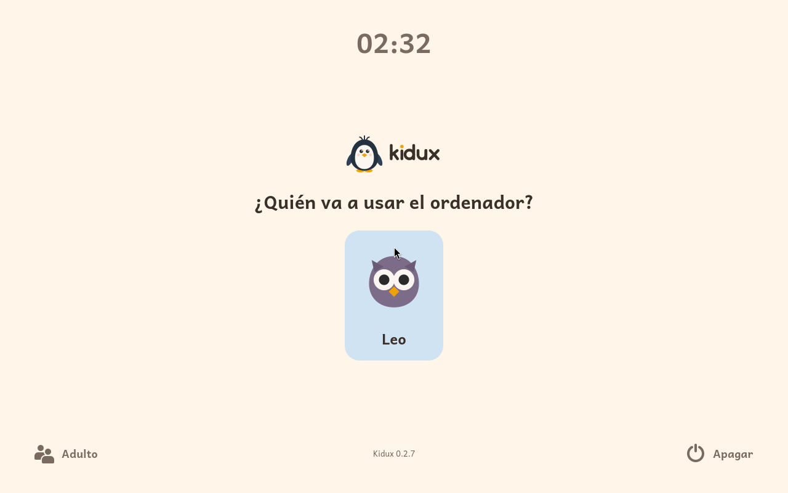
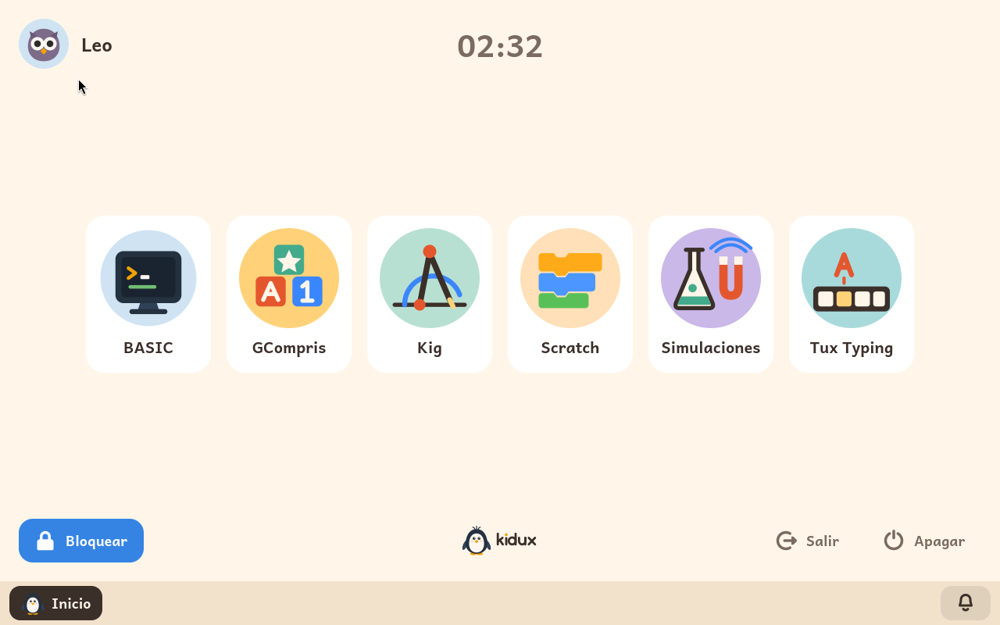

# Probar Kidux en un emulador

*[English version](../en/try.md)*

**Kidux se puede probar en el ordenador de todos los días, antes de dedicarle un ordenador propio.** Para ello se utiliza un emulador: un programa que hace funcionar un ordenador completo dentro de una ventana. El emulador arranca Kidux desde una imagen preparada especialmente para esta prueba, en la que ya hay una familia creada, con un niño y varios módulos de aprendizaje activados para él. En tu ordenador no se instala nada aparte del propio emulador, y cuando cierras la ventana todo queda exactamente como estaba.

Lo que se ve en la ventana es Kidux completo, no una demostración recortada. Es el mismo sistema que el instalador pone en un ordenador, con su pantalla de entrada, la pantalla del niño, los límites de tiempo, la pantalla de bloqueo y el panel de adulto. Incluso se actualiza por sí solo desde el archivo de paquetes de Kidux, como lo haría cualquier ordenador con Kidux instalado.

Conviene saber de antemano que un emulador nunca va tan rápido como un ordenador real. Kidux funciona dentro de otro sistema, que tiene que repartir con él su procesador y su memoria, así que todo responde algo más despacio que en un ordenador con Kidux instalado. En un Mac con procesador de Apple la diferencia es mayor: Kidux está hecho para procesadores de PC, y el Mac tiene que imitar uno entero, instrucción a instrucción. Por eso, en esos Mac, hace falta darle al emulador más recursos, sobre todo más núcleos de procesador; los pasos de UTM, más abajo, indican cuántos. Nada de esto afecta a cómo va Kidux instalado en un ordenador propio.

## La familia de la imagen de prueba

La imagen viene preparada con estos datos, para que puedas empezar a probar nada más arrancarla:

| | |
|---|---|
| **El niño** | Se llama **Leo**, y su contraseña es `leo`. |
| **La contraseña de adulto** | Es `kidux`. Es la que abre el panel de adulto desde la pantalla de entrada o desde la pantalla de bloqueo. |
| **El administrador** | Es la cuenta `ana`, con la contraseña `kidux`. Sirve para la consola de texto, que una prueba normal no necesita en ningún momento. |
| **Módulos de aprendizaje** | Leo tiene instalados y activados seis módulos: BASIC, Tux Typing, Scratch, GCompris, Simulaciones y Kig. Desde el panel de adulto se pueden instalar los demás. |
| **Tiempo** | Leo no tiene ningún límite de tiempo, para que puedas probar con calma. Si quieres ver cómo funcionan los límites, el panel de adulto permite ponerle uno. |
| **Idiomas** | Hay dos imágenes: una en español y otra en inglés. |
| **Lo que necesita** | Unos 4 GB de memoria libres para el emulador, y alrededor de 10 GB de espacio en disco. En un Mac con procesador de Apple, además, varios núcleos de procesador para el emulador: cuatro o más. |

Una vez arrancado, Kidux muestra su pantalla de entrada con el dibujo de Leo. Tras escribir la contraseña de Leo, aparece su pantalla con los seis módulos:





## Qué imagen descargar, según tu ordenador

Hay dos formatos de imagen, porque cada emulador prefiere el suyo. El archivo `.ova` es para VirtualBox, y el archivo `.qcow2` es para UTM y para QEMU. Esta tabla indica qué emulador y qué imagen conviene en cada caso:

| Tu ordenador | El emulador | La imagen |
|---|---|---|
| **Windows** | [VirtualBox](https://www.virtualbox.org/), gratuito | [kidux-trial-es.ova](https://iso.kidux.org/kidux-trial-es.ova) |
| **Mac con procesador Intel** | VirtualBox, o bien [UTM](https://mac.getutm.app/) | El `.ova` para VirtualBox, o el `.qcow2` para UTM |
| **Mac con procesador de Apple** (M1 y posteriores) | [UTM](https://mac.getutm.app/), gratuito | [kidux-trial-es.qcow2](https://iso.kidux.org/kidux-trial-es.qcow2) |
| **Linux** | QEMU, o bien VirtualBox | El `.qcow2` para QEMU, o el `.ova` para VirtualBox |

Las imágenes en inglés se llaman `kidux-trial-en.ova` y `kidux-trial-en.qcow2`, y están en la misma dirección. Cada archivo ocupa alrededor de 1,5 GB.

Si quieres comprobar que la descarga ha llegado entera, las sumas SHA-256 de todas las imágenes están en [SHA256SUMS](https://iso.kidux.org/SHA256SUMS). Ten en cuenta un detalle: el nombre completo de cada archivo incluye la versión de Kidux, y es con ese nombre completo con el que aparece en la lista de sumas y con el que lo guarda el navegador. Si tu programa de descarga lo ha guardado con el nombre corto del enlace, busca en la lista la línea que corresponde a su idioma y a su formato, y compara la suma a mano.

## Windows, o un Mac o Linux, con VirtualBox

1. **Instala VirtualBox y descarga la imagen `.ova`.** VirtualBox se descarga gratis desde su página web, y se instala como cualquier otro programa.

2. **Importa la imagen.** En VirtualBox, elige el menú **Archivo > Importar servicio virtualizado**, selecciona el archivo `.ova` que has descargado y pulsa **Terminar**. VirtualBox crea una máquina ya configurada: dos procesadores, 4 GB de memoria y arranque UEFI, como el de cualquier ordenador comprado en los últimos diez años. No hace falta cambiar ningún ajuste.

3. **Arranca la máquina.** Selecciónala en la lista y pulsa **Iniciar**. Aparece el logo de Kidux y, poco después, su pantalla de entrada con Leo.

Para ver las pantallas de Kidux completas, conviene que la ventana tenga al menos 1280 por 800 puntos. También se puede usar el menú **Ver > Modo pantalla completa**.

## Un Mac con UTM

1. **Instala UTM y descarga la imagen `.qcow2`.** UTM se descarga gratis desde su página web.

2. **Crea una máquina nueva.** En UTM, pulsa **Crear una nueva Máquina Virtual (VM)**. Después elige **Emular** y, a continuación, **Otro**.

3. **Elige el hardware.** En la pantalla **Hardware**, deja elegida la máquina **Intel ICH9 based PC (2009, x86_64)** y la memoria en **4096 MiB**. En **Núcleos de CPU**, escribe **4**; si tu Mac tiene más de 8 núcleos, escribe la mitad de los que tenga. Pulsa **Continuar**.

4. **Deja la máquina sin disco de arranque.** En la pantalla siguiente, en **Boot Device**, marca **Ninguno**. Deja marcada la casilla **Arranque UEFI**, que ya viene activada, y pulsa **Continuar**.

5. **Termina el asistente.** En **Almacenamiento**, pulsa **Continuar** sin cambiar nada: el disco que propone se sustituye en el paso siguiente. En **Directorio compartido**, pulsa **Continuar** sin elegir nada. En **Resumen**, ponle de nombre *Kidux*, marca la casilla **Abrir configuración de la VM** y pulsa **Guardar**.

6. **Cambia el disco por la imagen de Kidux.** En la ventana de configuración que se abre, baja por la columna de la izquierda hasta la sección **Unidades de disco**. Selecciona **Unidad IDE**, pulsa **Eliminar** y confirma que quieres borrarla. Después pulsa **Nuevo...**, cambia **Interfaz** a **VirtIO**, pulsa **Importar...** y elige el archivo `.qcow2` que has descargado. Para terminar, pulsa **Guardar**.

7. **Arranca la máquina.** Pulsa el triángulo que hay junto a su nombre. Primero aparece el logo de UTM, después el de Kidux y, en menos de un minuto, su pantalla de entrada con Leo. Es normal que entre medias la pantalla se quede en negro unos segundos: solo hay que esperar.

Al importar la imagen, UTM hace su propia copia, que ocupa unos 3,5 GB. Por eso, una vez importada, el archivo descargado se puede borrar sin problema.

Hay que tener en cuenta que Kidux está hecho para ordenadores PC. En un Mac con procesador de Apple, UTM tiene que emular un procesador de PC completo, de modo que todo funciona, pero más despacio que en un ordenador real. Cuantos más núcleos le des a la máquina, mejor irá: con 2 núcleos va muy lento, con 4 ya se puede usar y con 8 funciona bastante bien. En un Mac con procesador Intel no hace falta emular nada, y tanto UTM como VirtualBox hacen funcionar Kidux a velocidad normal.

## Linux con QEMU

Instala QEMU y su firmware UEFI. En Debian o Ubuntu son los paquetes `qemu-system-x86` y `ovmf`. Después descarga la imagen `.qcow2` y, desde la carpeta en la que esté, arráncala con esta orden:

```
qemu-system-x86_64 -enable-kvm -cpu host -m 4096 -smp 2 -machine q35 \
    -bios /usr/share/ovmf/OVMF.fd \
    -drive file=kidux-trial-es.qcow2,if=virtio \
    -vga none -device VGA,xres=1280,yres=800 \
    -device qemu-xhci -device usb-tablet -nic user,model=virtio-net-pci
```

Aparece el logo de Kidux y, después, su pantalla de entrada con Leo. Todo lo que cambies durante la prueba se guarda en el propio archivo de la imagen. Si quieres empezar otra vez desde el principio, basta con descargar la imagen de nuevo.

## Lo que una prueba no puede enseñar

Un emulador muestra casi todo lo que hace Kidux, pero hay algunas cosas que solo se ven en un ordenador de verdad:

- **Las piezas propias del ordenador real.** Su wifi, su tapa, su batería o sus teclas de brillo y volumen. Dentro de un emulador, Kidux ve la red del emulador como si fuera un cable, y no encuentra ni batería ni tapa.
- **La velocidad de un ordenador real.** Un emulador siempre es más lento que el mismo ordenador con Kidux instalado, y mucho más lento cuando además tiene que emular un procesador distinto.
- **Las teclas que el ordenador se guarda para sí.** Algunas combinaciones, como Ctrl+Alt+Supr, las recibe el ordenador que rodea al emulador, y no llegan a Kidux.

Cuando hayas visto suficiente, [el manual de uso](user-guide.md#2-instalar-kidux) explica cómo instalar Kidux en un ordenador propio.
