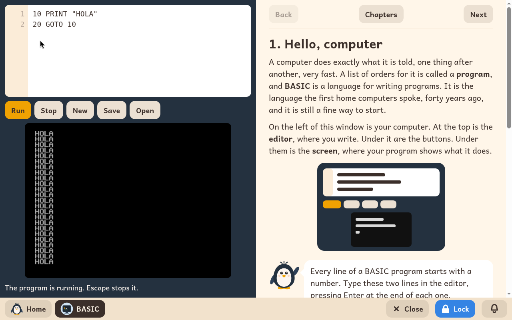

# BASIC

*[English version](../../en/modules/basic.md) · [Versión en español](../../es/modules/basic.md)* · [Retour au guide d'utilisation](../user-guide.md#9-modules-dapprentissage)

**BASIC** est le langage de programmation qui a fait découvrir l'informatique à des millions d'enfants pendant la révolution des ordinateurs familiaux des années 1980, et il reste l'une des façons les plus accessibles et les plus gratifiantes d'apprendre la vraie programmation. Ce module recrée cette expérience fondatrice sous une forme moderne, en écran partagé : à gauche, un environnement interactif avec un éditeur de code et un écran d'affichage ; à droite, un tutoriel interactif complet, pas à pas.

| | |
|---|---|
| **Âge recommandé** | Enfants de 8 à 14 ans qui lisent bien |
| **Modules recommandés avant** | Scratch |
| **Connexion à Internet** | Non nécessaire (fonctionne entièrement hors ligne) |
| **Logiciel utilisé** | [wwwBASIC](https://github.com/google/wwwbasic), développé par Google sous licence Apache-2.0, intégré dans un environnement éducatif propre à Kidux |

## Vue d'ensemble et fonctionnement

La moitié gauche de l'écran est organisée en trois parties :
- **L'éditeur de code (en haut)** : là où l'enfant écrit et modifie les lignes de code BASIC.
- **La barre de commandes (au milieu)** : elle contient les boutons qui contrôlent l'exécution. Le bouton **Lancer** (ou le raccourci clavier Ctrl+Entrée) démarre aussitôt le programme. Si un programme tourne sans fin ou doit être interrompu, le bouton **Arrêter** (ou la touche Échap) l'arrête proprement.
- **L'écran d'affichage (en bas)** : il montre ce que produit le programme, y compris le texte, les graphismes, les couleurs et les sons rétro. Quand une erreur de syntaxe ou d'exécution se produit, l'écran indique le numéro exact de la ligne, et l'éditeur la met en évidence pour faciliter la correction.

La moitié droite de l'écran accueille le guide interactif, organisé chapitre par chapitre. Avec les boutons **Précédent**, **Suivant** et **Chapitres**, l'enfant lit les explications, tape les exemples de code dans l'éditeur et essaie des variantes. Chaque chapitre se termine par des exercices créatifs pour aller plus loin et un encadré **Pour l'adulte** qui résume les notions abordées.

## Les trente chapitres du cours

1. Bonjour, ordinateur
2. PRINT : l'ordinateur écrit
3. LET : des boîtes avec un nom (les variables)
4. INPUT : parler avec l'ordinateur
5. GOTO : sauter dans le code
6. IF : prendre des décisions
7. FOR et NEXT : compter et répéter
8. GOSUB et RETURN : des sous-programmes réutilisables
9. READ et DATA : ranger des tableaux de données
10. REM : des notes et des commentaires pour soi
11. INT : les nombres entiers et les arrondis
12. RND : tirer des nombres au hasard
13. Les organigrammes : réfléchir avant de programmer
14. Construire des jeux interactifs
15. Enregistrer et ranger ses programmes
16. Dans l'ordinateur : comment il fonctionne
17. Des opérations mathématiques plus avancées
18. L'ordre des opérations et les priorités
19. CLS : effacer et remettre l'écran à zéro
20. Aller plus loin avec INPUT
21. Des boucles imbriquées avec FOR et NEXT
22. La logique booléenne : AND et OR
23. Construire des menus interactifs avec IF
24. Gérer des données avec READ, DATA et RESTORE
25. DIM : des tableaux et des listes
26. Les algorithmes de tri
27. Travailler avec des chaînes de caractères et du texte
28. Les codes ASCII : CHR$ et ASC
29. Dessiner avec des coordonnées, les couleurs et le son
30. Des projets complets à garder et à enrichir

## Les réglages pour l'adulte

| Réglage | Rôle |
|---|---|
| **Tape-le pour moi** | Affiche sous chaque programme du guide un bouton qui le copie automatiquement dans l'éditeur. Quand il est désactivé, l'enfant doit taper chaque programme lui-même, caractère par caractère, pour s'entraîner à la frappe et à la syntaxe. Activé par défaut. |

Ce réglage se fait séparément pour chaque enfant, avec le bouton **Réglages** de BASIC dans la page Modules de l'espace adulte.

## Enregistrer et gérer les fichiers

Le code écrit dans l'éditeur est conservé automatiquement quand on quitte BASIC, et il attend à la réouverture du module, jusqu'à ce que l'enfant clique sur **Nouveau**.

Pour garder des programmes durablement, le bouton **Enregistrer** ouvre une fenêtre de choix de fichier dans les dossiers de l'enfant (dans **Téléchargements**) pour enregistrer des fichiers avec l'extension `.bas`. Le bouton **Ouvrir** permet de rouvrir n'importe quel programme déjà enregistré.
