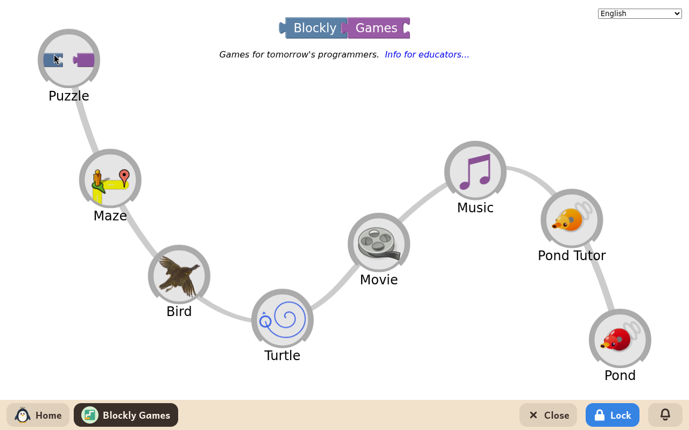
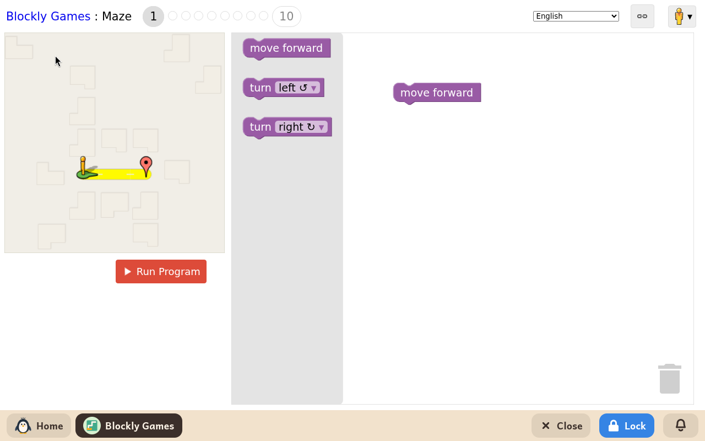

# Blockly Games

*[English version](../../en/modules/blockly-games.md) · [Versión en español](../../es/modules/blockly-games.md)* · [Retour au guide d'utilisation](../user-guide.md#9-modules-dapprentissage)

**Blockly Games** est une série d'énigmes éducatives interactives développées par Google pour faire découvrir les bases de l'informatique et la pensée algorithmique avec des blocs de programmation visuels, en progressant en douceur.

| | |
|---|---|
| **Âge recommandé** | Enfants de 6 à 12 ans qui savent un peu lire |
| **Recommandé avant** | ScratchJr |
| **Connexion à Internet** | Non nécessaire (fonctionne entièrement hors ligne, sur l'ordinateur) |
| **Logiciel utilisé** | [Blockly Games](https://blockly.games/), développé par Google sous licence Apache-2.0, empaqueté pour fonctionner hors ligne dans Kidux |

## Ce que c'est et comment ça marche

Chaque jeu est organisé en dix niveaux progressifs. Dans les premiers niveaux, les enfants relient deux ou trois blocs de mouvement simples ; dans les niveaux avancés, ils apprennent à créer des boucles imbriquées, des comparaisons mathématiques et des conditions.

L'enfant fait glisser et emboîte des blocs dans l'espace de travail, puis clique sur le bouton pour lancer le programme et vérifier si son personnage suit la bonne suite d'instructions jusqu'à l'objectif. Si la solution est incomplète ou rencontre un obstacle, des indices visuels aident l'enfant à trouver l'erreur et à essayer d'autres idées, sans pénalité. Toutes les consignes, étiquettes et dialogues s'affichent dans la langue choisie pour l'enfant.

## Les activités

- **Labyrinthe** : apprend l'enchaînement des instructions, les virages conditionnels et les boucles de répétition pour amener un personnage à destination.
- **Oiseau** : introduit les opérateurs logiques et la prise de décision selon la position et l'état de l'oiseau.
- **Tortue** : explore la géométrie en guidant une tortue qui dessine des formes géométriques et des motifs artistiques élaborés.
- **Film** : montre le lien entre les fonctions mathématiques et le temps pour produire une courte scène animée.
- **Musique** : apprend la composition musicale algorithmique, avec les notes, les rythmes et plusieurs pistes jouées ensemble.

## Autres remarques

La progression dans chaque niveau est enregistrée automatiquement dans le profil de l'enfant. Si un adulte supprime le module puis le réinstalle plus tard, tous les niveaux réussis restent acquis. Les activités ne créent pas de fichiers de projet éparpillés dans le dossier personnel de l'enfant.
