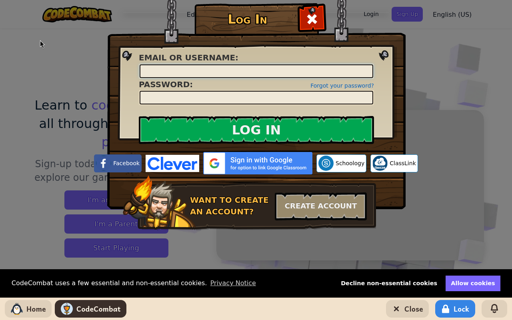
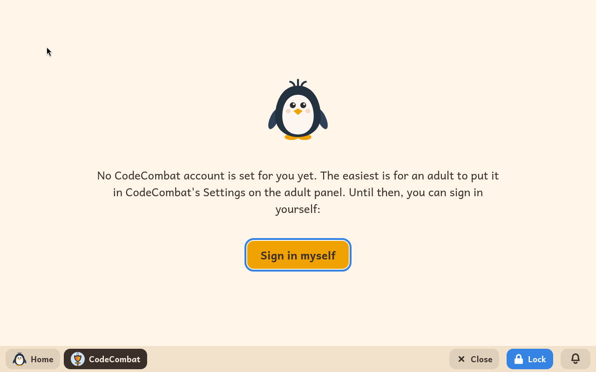

# CodeCombat

*[English version](../../en/modules/codecombat.md) · [Versión en español](../../es/modules/codecombat.md)* · [Retour au guide d'utilisation](../user-guide.md#9-modules-dapprentissage)

**CodeCombat** est un jeu de rôle et d'aventure éducatif dans lequel on écrit du vrai Python ou du vrai JavaScript pour diriger son héros, en temps réel, à travers des campagnes de donjons pleines de défis.

| | |
|---|---|
| **Âge recommandé** | Enfants de 9 à 16 ans qui lisent avec aisance |
| **Recommandé avant** | Scratch |
| **Connexion à Internet** | Nécessaire (le jeu tourne sur les serveurs web de CodeCombat) |
| **Service web** | [codecombat.com](https://codecombat.com/), géré par CodeCombat Inc. Kidux n'est ni affilié à CodeCombat ni soutenu par lui. |

## Ce que c'est et comment ça marche

Ce module donne un accès dédié, sûr et isolé au site officiel de CodeCombat, dans la langue préférée de l'enfant. Le système bloque les liens externes, les publicités de tiers et les domaines web non autorisés, pour garantir un environnement d'apprentissage sûr et concentré.

Les enfants apprennent la pensée informatique et une vraie syntaxe (boucles, variables, appels de fonctions et conditions) en tapant du code dans un éditeur interactif. Quand ils lancent leur programme, leur personnage exécute leurs instructions à l'écran.

## Les réglages pour l'adulte

Les adultes peuvent indiquer les identifiants du compte dans la page **Modules** de l'espace adulte, pour une connexion automatique :

| Réglage | Description |
|---|---|
| **E-mail** | L'adresse e-mail du compte CodeCombat de l'enfant. |
| **Mot de passe** | Le mot de passe du compte. Kidux l'utilise pour se connecter de façon transparente, sans jamais le montrer à l'enfant. |

Quand les identifiants sont indiqués, le module se connecte automatiquement à chaque démarrage, en affichant un bref message (*Connexion à CodeCombat…*). Si les identifiants sont refusés ou que le réseau n'est pas disponible, un message d'erreur apparaît avec la possibilité de réessayer.

Si aucun compte n'a été indiqué, l'écran explique qu'un adulte peut fournir les identifiants dans l'espace adulte, et propose un bouton pour se connecter à la main par l'interface du site.

## À savoir

- **Abonnements et niveaux payants** : les premiers niveaux sont gratuits ; les mondes avancés de la campagne demandent un abonnement actif, acheté directement auprès de CodeCombat. Pour la sécurité de l'enfant et celle de vos finances, l'achat doit se faire depuis un autre appareil, puisque le module n'ouvre aucun autre site que CodeCombat.
- **Connexion par des services tiers** : les boutons de connexion par réseau social (Google, Facebook, Clever) ne fonctionnent pas dans cet environnement isolé ; utilisez directement l'adresse e-mail et le mot de passe.
- **Cookies et données** : le site peut demander vos préférences en matière de cookies au premier lancement. La progression et les statistiques du jeu sont enregistrées à distance sur les serveurs de CodeCombat, sans rien laisser sur le disque de l'ordinateur.
