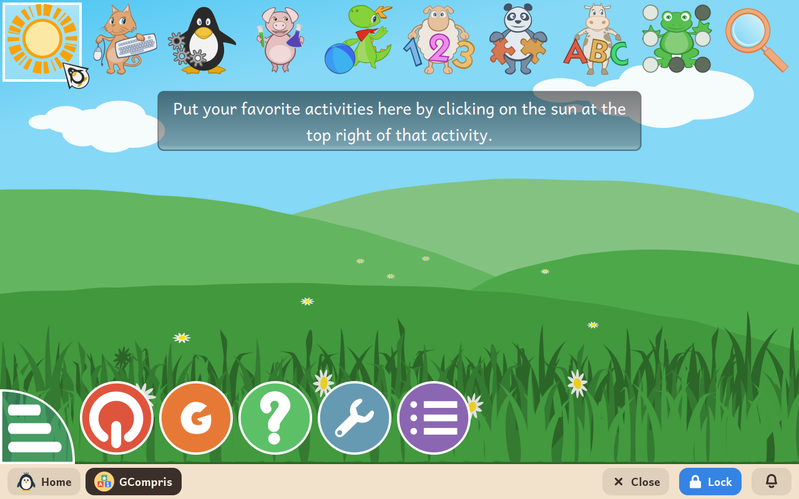

# GCompris

*[English version](../../en/modules/gcompris.md) · [Versión en español](../../es/modules/gcompris.md)* · [Retour au guide d'utilisation](../user-guide.md#9-modules-dapprentissage)

**GCompris** est une suite éducative complète de plus d'une centaine d'activités interactives pour les enfants de 2 à 10 ans : lecture, mathématiques, sciences, géographie, et premiers pas avec la souris et le clavier.

| | |
|---|---|
| **Âge recommandé** | Enfants de 2 à 10 ans |
| **Connexion à Internet** | Nécessaire seulement lors des premières utilisations, pour télécharger les voix et certains médias. Une fois ceux-ci en place, la suite fonctionne entièrement hors ligne. |
| **Logiciel utilisé** | [GCompris](https://gcompris.net/), développé par la communauté internationale du logiciel libre GCompris sous licence GPL-3, empaqueté depuis Debian |

## Ce que c'est et comment ça marche

GCompris réunit une large collection de mini-jeux éducatifs adaptés aux étapes du développement de l'enfant. Les jeunes enfants peuvent entendre le son des lettres, associer des quantités à des objets illustrés, trier des formes et des couleurs, et développer leur motricité fine avec la souris et le clavier, à leur propre rythme.

L'application est entièrement traduite et accompagnée de voix enregistrées dans la langue de l'enfant, ce qui lui permet de jouer et d'explorer seul, avant même de savoir lire.

## Les catégories d'activités

Les activités sont regroupées en domaines d'apprentissage, faciles à reconnaître grâce à des icônes ludiques :

- **Lecture et écriture** : découverte de l'alphabet, sons des lettres, formation de mots et jeux de vocabulaire.
- **Mathématiques et logique** : compter, additionner, soustraire, lire l'heure sur une horloge à aiguilles ou numérique, et reconnaître la monnaie.
- **Sciences et géographie** : cartes du monde, expériences sur le cycle de l'eau et premiers phénomènes physiques.
- **Découverte de l'ordinateur** : exercices guidés pour déplacer le pointeur, cliquer, double-cliquer, taper au clavier et dessiner librement.

Chaque activité affiche de petites étoiles de difficulté et des indications d'âge. GCompris s'affiche en plein écran au-dessus de la barre du bas ; le bouton **Accueil** de la barre ramène en douceur à l'écran principal de l'enfant.

## À savoir

- **Téléchargement des voix** : pour économiser de la place sur le disque au départ, les voix du narrateur et certains médias se téléchargent automatiquement en arrière-plan la première fois qu'une activité qui en a besoin est ouverte. L'espace adulte le rappelle avant l'installation.
- **Vie privée et enregistrement** : les dessins, les réglages personnalisés et les étoiles des activités réussies sont gardés à l'intérieur de GCompris, sans laisser de fichiers en trop dans les dossiers personnels de l'enfant.
