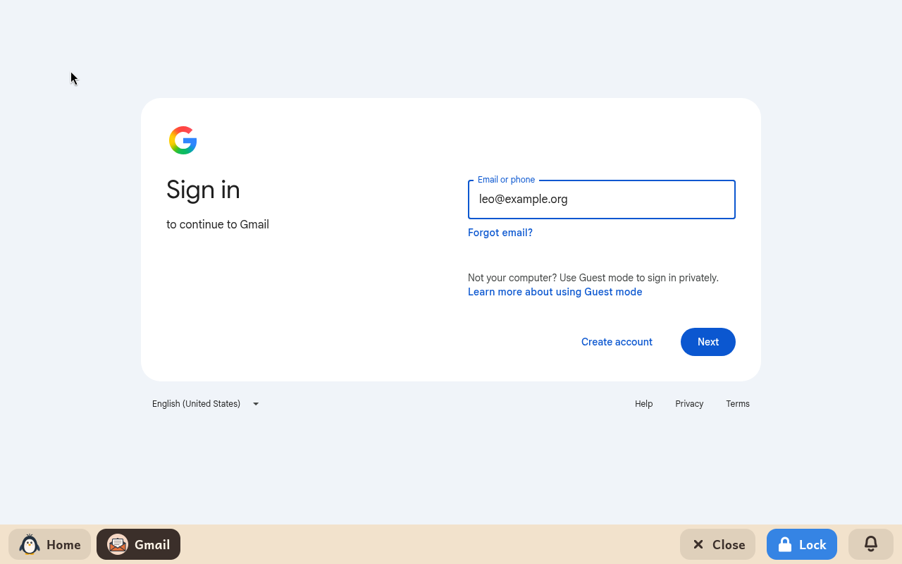

# Gmail

*[English version](../../en/modules/gmail.md) · [Versión en español](../../es/modules/gmail.md)* · [Retour au guide d'utilisation](../user-guide.md#9-modules-dapprentissage)

**Gmail** donne un accès direct, sûr et isolé à la messagerie web des comptes Google, dans la langue choisie pour l'enfant.

| | |
|---|---|
| **Âge recommandé** | À partir de 8 ans |
| **Connexion à Internet** | Nécessaire en permanence pour envoyer et recevoir des messages |
| **Service web** | [mail.google.com](https://mail.google.com/), géré par Google LLC. Kidux n'est ni affilié à Google ni soutenu par lui. |

## Ce que c'est et comment ça marche

Ce module ouvre un navigateur isolé, limité strictement à l'interface web officielle de Gmail. Pour la sécurité de l'enfant, la navigation en dehors de la messagerie (comme la recherche Google, YouTube ou les liens externes contenus dans les messages) est entièrement bloquée.

Ce module est vivement recommandé pour les enfants de moins de treize ans dont le compte Google est supervisé avec **Google Family Link**, car les règles d'authentification de Google empêchent ces comptes de se connecter aux clients de messagerie habituels (comme le module [Messagerie](mail.md)). Il convient aussi aux familles qui préfèrent l'interface web qu'elles connaissent à un client de messagerie.

## Les réglages pour l'adulte

Les adultes peuvent indiquer les informations du compte dans la page **Modules** de l'espace adulte, pour simplifier la connexion :

| Réglage | Description |
|---|---|
| **Adresse e-mail** | L'adresse du compte Google de l'enfant. Au lancement du module, la page de connexion de Google s'ouvre avec cette adresse déjà remplie. |

Un adulte devrait accompagner l'enfant lors de la première configuration, pour saisir le mot de passe du compte et valider la double authentification si Google la demande. Une fois connectée, la session reste ouverte même après la fermeture de l'application ou le redémarrage de l'ordinateur. Kidux ne garde jamais le mot de passe Google de l'enfant et n'y a jamais accès, puisque la connexion se fait entièrement dans le formulaire sécurisé de Google.

## À savoir

- **Messages stockés en ligne** : les messages et les pièces jointes restent en sécurité dans le stockage en ligne de Google, sans occuper de place sur le disque de l'ordinateur.
- **Aperçu des pièces jointes** : les images et les documents joints peuvent être consultés en toute sécurité dans la visionneuse web intégrée de Gmail.
