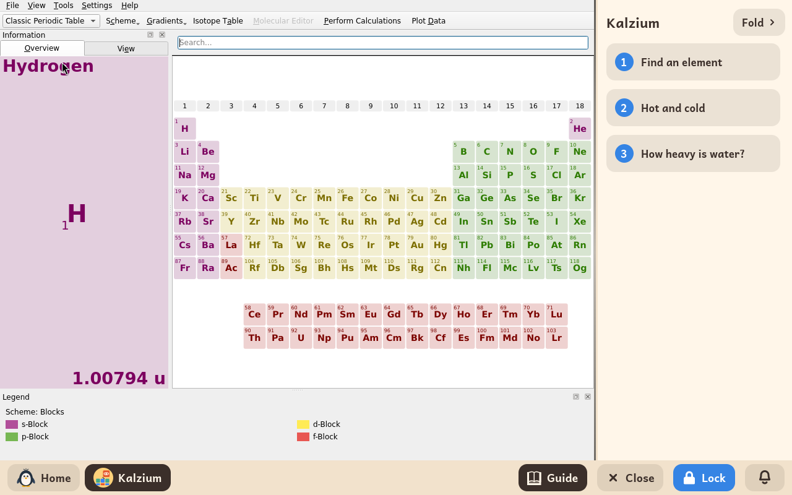

# Kalzium

*[English version](../../en/modules/kalzium.md) · [Versión en español](../../es/modules/kalzium.md)* · [Retour au guide d'utilisation](../user-guide.md#9-modules-dapprentissage)

**Kalzium** est un tableau périodique interactif des éléments chimiques développé par le projet KDE Éducation, conçu pour les élèves en chimie et en sciences.

| | |
|---|---|
| **Âge recommandé** | Élèves de 10 à 16 ans |
| **Connexion à Internet** | Non nécessaire (toutes les données scientifiques, les tableaux et les médias sont installés sur l'ordinateur) |
| **Logiciel utilisé** | [Kalzium](https://apps.kde.org/kalzium/), développé par la communauté KDE sous licence GPL-2, empaqueté depuis Debian |

## Ce que c'est et comment ça marche

Kalzium offre une vue claire et dynamique du tableau périodique des éléments. Choisir un élément ouvre une fiche complète avec son symbole chimique, son numéro atomique, sa masse atomique, l'histoire de sa découverte, des photos d'échantillons, le schéma de Bohr de ses couches électroniques, et ses températures de fusion et d'ébullition.

Le logiciel comprend de nombreux outils d'apprentissage interactifs, comme une frise chronologique qui montre quand les éléments ont été découverts au fil de l'histoire, un curseur de température qui montre les changements d'état (solide, liquide, gaz), un calculateur de masse moléculaire et un glossaire illustré du vocabulaire de la chimie.

## Le guide interactif intégré

Kidux accompagne Kalzium d'un guide interactif placé à côté, avec trois leçons d'introduction structurées :

1. **Trouver un élément** : se repérer dans les périodes, les familles et les blocs du tableau, et comprendre les fiches des éléments.
2. **Chaud et froid** : utiliser le curseur de température pour observer les changements d'état et repérer les éléments aux températures de fusion inhabituelles.
3. **Combien pèse l'eau ?** : calculer une masse moléculaire en additionnant les masses atomiques de ses atomes (comme H₂O).

Cliquer sur **Replier**, en haut, replie le guide en une fine bande sur le bord pour laisser toute la largeur au tableau périodique ; cliquer sur **Guide** dans la barre du bas le rouvre à tout moment.

## À savoir

- **Sécurité et actions limitées** : les liens vers l'aide en ligne et le téléchargement de modules complémentaires depuis le KDE Store ont été volontairement désactivés, pour que l'enfant reste en sécurité dans l'environnement hors ligne.
- **Préférences** : les réglages d'apparence et le choix des unités sont enregistrés automatiquement dans le profil de l'enfant, sans encombrer son dossier de documents.
