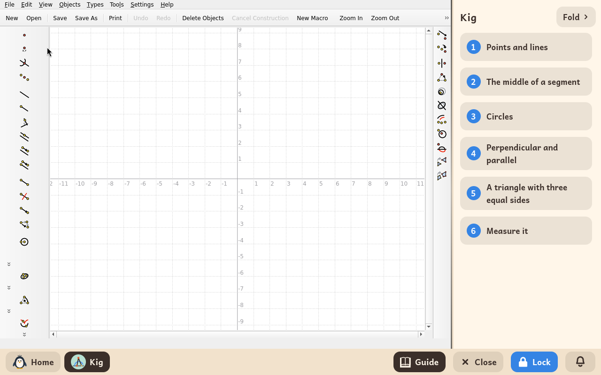
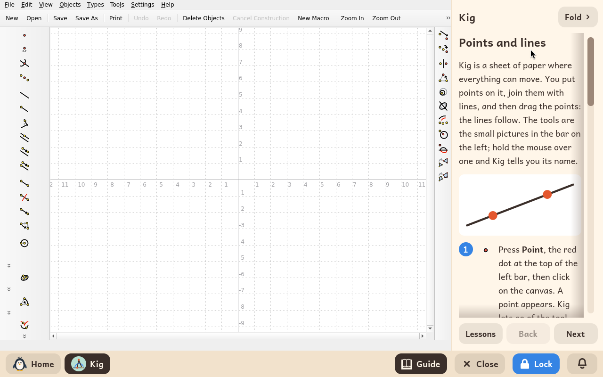
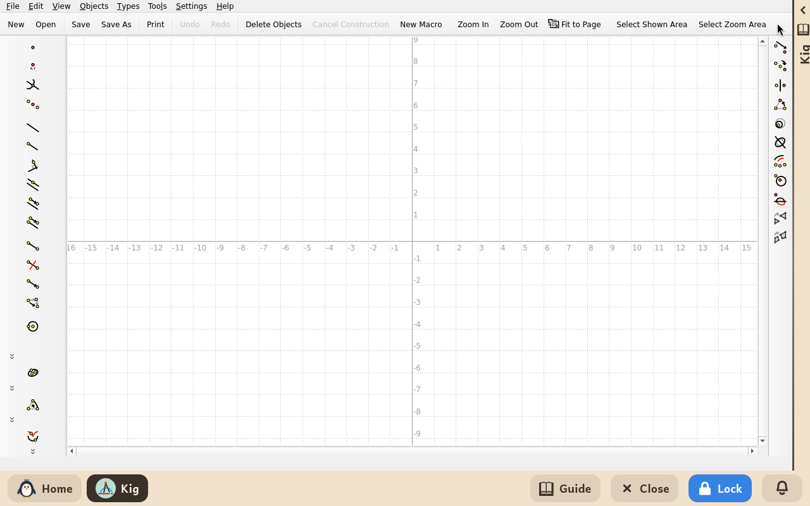

# Kig

*[English version](../../en/modules/kig.md) · [Versión en español](../../es/modules/kig.md)* · [Retour au guide d'utilisation](../user-guide.md#9-modules-dapprentissage)

**Kig** est un environnement interactif de géométrie dynamique développé par le projet KDE Éducation. Il permet de construire des figures mathématiques (points, droites, polygones, cercles et coniques) qui gardent strictement leurs propriétés géométriques quand on les manipule : un milieu reste au milieu et des droites parallèles restent parallèles quand on déplace l'un des points dont elles dépendent.

| | |
|---|---|
| **Âge recommandé** | Enfants de 10 à 14 ans |
| **Recommandé avant** | GCompris |
| **Connexion à Internet** | Non nécessaire (fonctionne entièrement hors ligne, sur l'ordinateur) |
| **Logiciel utilisé** | [Kig](https://apps.kde.org/kig/), développé par la communauté KDE sous licence GPL-2, empaqueté depuis Debian |

## Ce que c'est et comment ça marche

Kig fonctionne comme un carnet de géométrie interactif. La barre d'outils latérale propose des outils de construction complets : points, droites définies par deux points, segments, cercles, perpendiculaires, parallèles, milieux, intersections de courbes et mesure des angles en temps réel.

Les élèves peuvent construire des figures géométriques complexes et vérifier des théorèmes par l'expérience : en faisant glisser un sommet sur le plan avec la souris, le reste de la figure se transforme en respectant toutes les règles mathématiques.

## Le guide interactif intégré

Kidux accompagne Kig d'un guide interactif placé à côté, avec six leçons structurées conçues pour les élèves. Chaque étape montre l'outil à utiliser avec son nom officiel et son icône. Quatre leçons comportent une **mission** interactive : un fichier de géométrie préparé, avec des défis pratiques, copié automatiquement dans le dossier personnel de l'enfant (`Documents/Missions de Kig`) la première fois que le guide est ouvert.

1. **Points et droites** : placer des points libres, tracer des droites passant par deux points, leur donner un nom, et construire des triangles avec des segments.
2. **Le milieu d'un segment** : construire un milieu qui reste toujours au milieu. Mission : `milieu.kig`.
3. **Les cercles** : trouver les intersections de cercles et des points contraints à rester sur un cercle. Mission : `deux-cercles.kig`.
4. **Perpendiculaire et parallèle** : des droites qui gardent leurs relations d'angle, et la construction d'un carré indéformable. Mission : `paralleles.kig`.
5. **Le triangle équilatéral** : la construction classique d'Euclide, à la règle et au compas. Mission : `triangle.kig`.
6. **La mesure dynamique** : mesurer des angles et des longueurs en temps réel, et voir pourquoi la somme des angles d'un triangle fait toujours 180°.

Cliquer sur **Replier**, en haut du panneau latéral, replie le guide en une fine bande sur le bord pour laisser toute la largeur de l'écran au dessin ; cliquer sur la bande repliée ou sur le bouton **Guide** de la barre du bas le rouvre aussitôt.

## Enregistrer et gérer les fichiers

Les figures construites peuvent être enregistrées au format `.kig` avec **Fichier > Enregistrer**, en sécurité dans le dossier personnel de l'enfant. Les missions s'ouvrent à tout moment avec **Fichier > Ouvrir > Documents > Missions de Kig**.

## À savoir

- **Sécurité hors ligne** : les menus de documentation en ligne et le téléchargement de modules complémentaires depuis le KDE Store sont désactivés, pour que l'application reste entièrement sur l'ordinateur.
- **Liens externes bloqués** : tout lien externe cliqué dans l'outil affiche une bulle d'information indiquant que l'accès à Internet est désactivé.
